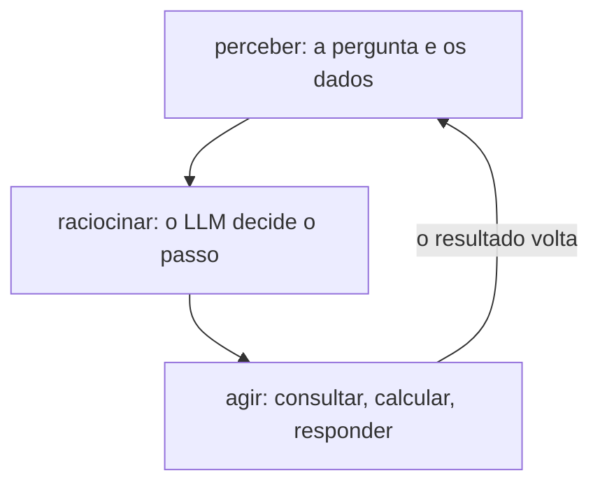
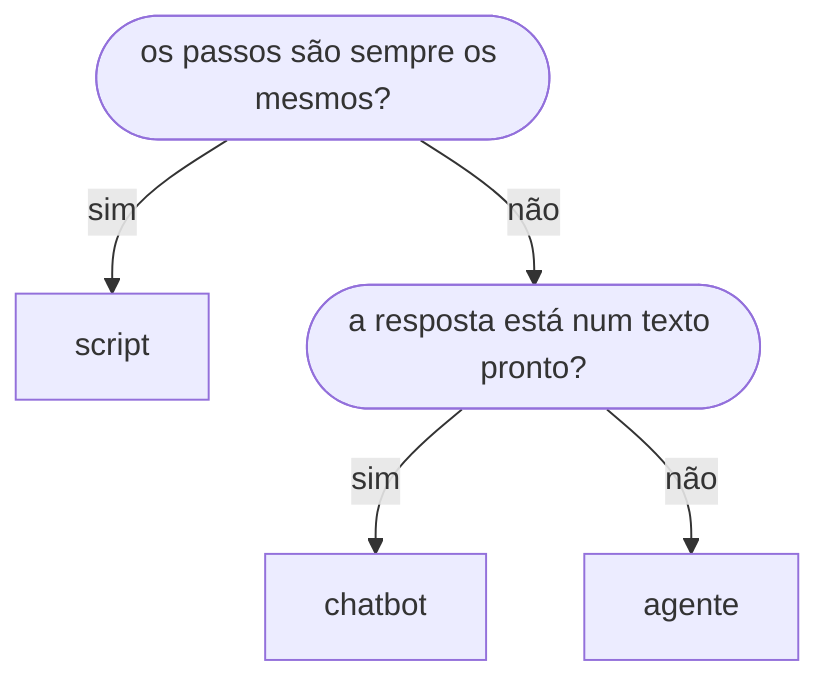
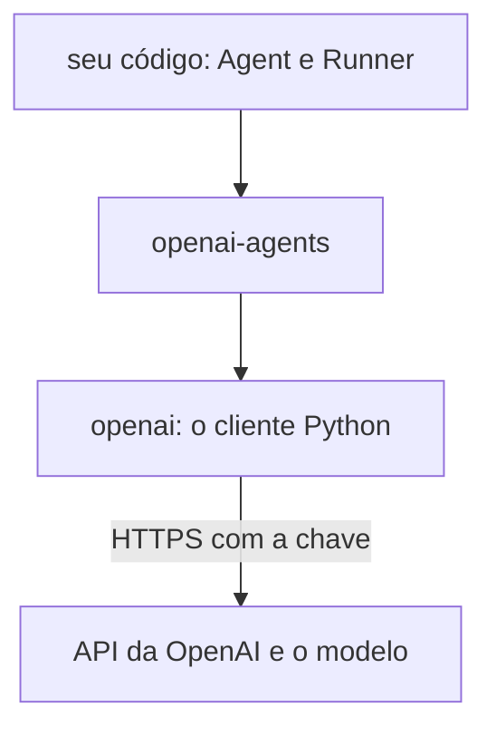

## **Etapa 5:** Arquitetura e Configuração de Agentes

---
layout: section
---

## O que é um **agente**
**Do modelo que prevê ao componente que decide**

---
layout: two-cols-header
layoutClass: gap-8
sourceLabel: "Building Agents, cap. 1"
source: https://github.com/PacktPublishing/Building-Agents-with-OpenAI-Agents-SDK
---

# Perceber, raciocinar, agir

#### **O ciclo que separa um agente de um programa comum**

::left::



::right::

<div class="text-left w-full [&_li]:mb-4">

- **Perceber** — a pergunta do vendedor e o que chega do ambiente: o perfil, a probabilidade, o resultado de cada ação.
- **Raciocinar** — o LLM decide o próximo passo: falta um dado ou já dá para responder?
- **Agir** — consultar o modelo de assinatura, registrar um fato, responder ao vendedor.

</div>

<!--
- a definição clássica é a de Russell e Norvig: um agente percebe o ambiente por sensores e age sobre ele por atuadores. Num agente de IA, os sensores são as entradas (a pergunta, documentos, o resultado das ferramentas) e os atuadores são as ferramentas (chamar uma API, executar código).
- o LLM é o "cérebro": é ele que raciocina. Sozinho, ele só gera texto; o ciclo é que o transforma em agente.
- o capítulo 1 do Building Agents with OpenAI Agents SDK apresenta agentes por esse ciclo.
- o ciclo volta ao começo: o resultado de uma ação vira percepção, e o agente decide de novo. É o laço que as ferramentas da etapa 7 vão percorrer.
-->

---
layout: default
---

# O assistente comercial, etapa a etapa

#### **O mesmo agente cresce até o fim da disciplina**

<br/>

| etapa | o assistente ganha | no SDK |
|---|---|---|
| 5 | a arquitetura e o ambiente configurado | `openai-agents`, `.env` |
| 6 | instruções, saída estruturada e execução assíncrona | `Agent`, `Runner`, `output_type` |
| 7 | ferramentas: buscar o usuário e prever a assinatura | `@function_tool` |
| 8 | a API do modelo e uma API pública | `requests` nas ferramentas |
| 9 | memória da conversa e dos fatos de cada usuário | `Session`, `SQLiteSession` |

<!--
- o assistente ajuda o time comercial da empresa de bicicletas a decidir para quais usuários avulsos ligar, oferecendo a assinatura: o problema das etapas 1 a 4.
- ele aproveita tudo o que veio antes: o usuarios_avulsos.csv, o pipeline_assinatura.joblib da etapa 2, o threshold 0,3 da etapa 3 e a api.py da etapa 4.
- handoffs (passar a conversa a outro agente) e guardrails (validar entrada e saída) existem no SDK, mas ficam fora da disciplina.
-->

---
layout: section
---

## Agente, chatbot ou **script**?
**A arquitetura decide o que cada um faz sozinho**

---
layout: default
---

# Três arquiteturas

#### **Quem decide os passos muda tudo**

<br/>

| | script | chatbot | agente |
|---|---|---|---|
| fluxo | entrada fixa → função → saída | pergunta → resposta em texto | perceber → raciocinar → agir, em ciclo |
| quem decide os passos | o programador, de antemão | ninguém: é um passo só | o modelo, a cada volta |
| age sobre o ambiente | só o que foi programado | não | sim, com ferramentas |
| na empresa | a `api.py` da etapa 4 | o FAQ dos planos | o assistente comercial |

<!--
- o script é previsível e barato: faz sempre a mesma coisa. A api.py da etapa 4 recebe um perfil e devolve a probabilidade; não decide nada além disso.
- o chatbot conversa, mas não age: responde com o que sabe (ou com o texto que recebeu). Um chatbot "com acesso ao modelo de assinatura" que apenas repassa o número continua sendo um chatbot.
- o agente escolhe o que fazer a cada volta: buscar o perfil, consultar o modelo, pedir um dado que falta ou responder.
- o software baseado em regras é o script com muitos if: decide, mas só entre os caminhos que o programador previu.
-->

---
layout: two-cols-header
layoutClass: gap-8
---

# Quando um chatbot basta

#### **O agente custa mais: só vale quando os passos dependem da pergunta**

::left::



::right::

<div class="text-left w-full [&_li]:mb-4">

- **Script** — prever a probabilidade de todos os avulsos, toda segunda-feira.
- **Chatbot** — "quanto custa o plano anual?": a resposta está na tabela de preços.
- **Agente** — "para quem eu ligo hoje, e por quê?": os passos dependem dos dados.
- **O custo do agente** — mais chamadas ao modelo, mais demora e respostas menos previsíveis.

</div>

<!--
- a pergunta que decide: o caminho até a resposta é sempre o mesmo? Se é, um script resolve, mais barato e testável.
- o FAQ dos planos é o caso típico de chatbot: as perguntas variam, mas a resposta está num texto pronto (a tabela de preços, as regras de uso).
- o agente se paga quando a resposta exige reunir dados diferentes a cada pergunta e decidir o que fazer com eles.
-->

---
layout: two-cols-header
layoutClass: gap-8
---

# Demo: o ciclo em miniatura

#### **Um laço que decide o próximo passo pelo que já percebeu**

::left::

```python {monaco-run} {autorun: false, height: 'auto'}
def raciocinar(vistos):  # no agente, é o LLM
    if "perfil" not in vistos:
        return "buscar_perfil"
    if "prob" not in vistos:
        return "prever"
    return "responder"

agir = {"buscar_perfil": ("perfil", "30 anos"),
        "prever": ("prob", 0.464)}
vistos = {"pergunta": "Vale ligar para o U00042?"}
while (acao := raciocinar(vistos)) != "responder":
    chave, valor = agir[acao]  # agir no ambiente
    vistos[chave] = valor  # perceber o resultado
    print(acao, "->", valor)
print("ligar?", vistos["prob"] >= 0.3)
```

::right::

<div class="text-left w-full [&_li]:mb-4">

- **`raciocinar`** — escolhe a próxima ação pelo que já foi percebido.
- **O laço** — agir, perceber o resultado e raciocinar de novo, até responder.
- **Antes de executar** — se a pergunta já trouxesse o perfil, quantas ações haveria?

</div>

<!--
- saída esperada:
  buscar_perfil -> 30 anos
  prever -> 0.464
  ligar? True
- com o perfil na pergunta, só uma ação (prever): o laço se adapta ao que já foi percebido. Um script faria sempre as duas.
- aqui, raciocinar é um if escrito à mão; no agente, quem escolhe a ação é o LLM, a partir das instruções e do que já está na conversa. As ações viram ferramentas na etapa 7.
-->

---
layout: section
---

## O **OpenAI Agents SDK**
**Poucos primitivos para construir agentes**

---
layout: two-cols-header
layoutClass: gap-8
sourceLabel: OpenAI Agents SDK
source: https://openai.github.io/openai-agents-python/
---

# Os primitivos do SDK

#### **O pacote `openai-agents`, importado como `agents`**

::left::

| primitivo | para quê | etapa |
|---|---|---|
| `Agent` | o agente | 6 |
| `Runner` | executa o ciclo | 6 |
| `output_type` | saída estruturada | 6 |
| `@function_tool` | ferramentas | 7 e 8 |
| `Session` | memória | 9 |

::right::

<div class="text-left w-full [&_li]:mb-4">

- **O provedor** — a OpenAI, por padrão; o `OPENAI_BASE_URL` aponta para outro serviço compatível.
- **O modelo** — o padrão do SDK é o `gpt-5.6-luna`; o `OPENAI_DEFAULT_MODEL` troca o padrão.
- **Fora da disciplina** — handoffs, guardrails e agentes de voz.

</div>

<!--
- o SDK é a camada de agentes da OpenAI sobre o cliente Python dela (o pacote openai). Há outros frameworks, como LangGraph, CrewAI e Pydantic AI: a disciplina fica com o da OpenAI.
- o capítulo 2 do Building Agents with OpenAI Agents SDK apresenta os primitivos; os capítulos 3 a 5 são os das etapas 6 a 9.
- o modelo padrão pode ser trocado em cada agente, com Agent(model="..."), ou para o projeto todo, com a variável OPENAI_DEFAULT_MODEL.
- versão usada nos slides: openai-agents 0.25.0 (20/11/2026).
-->

---
layout: two-cols-header
layoutClass: gap-8
sourceLabel: Tracing
source: https://openai.github.io/openai-agents-python/tracing/
---

# Por baixo do SDK

#### **Cada volta do agente é um pedido HTTPS à API da OpenAI**

::left::



::right::

<div class="text-left w-full [&_li]:mb-4">

- **A chave** — vai em cada pedido: sem ela, o primeiro `Runner` falha com `OpenAIError`.
- **O custo** — cada chamada ao modelo consome tokens da sua conta.
- **O rastreamento** — o SDK envia o registro de cada execução ao painel da OpenAI; `set_tracing_disabled(True)` desliga.

</div>

<!--
- sem a chave, a mensagem é "Missing credentials. Please pass an `api_key` ... or set the `OPENAI_API_KEY` environment variable": quase sempre é o .env que não foi carregado.
- o SDK usa a Responses API da OpenAI por padrão (OpenAIResponsesModel).
- o rastreamento (tracing) mostra no painel da OpenAI cada chamada ao modelo e cada ferramenta: bom para depurar. Também se desliga com a variável OPENAI_AGENTS_DISABLE_TRACING=true.
- o mesmo protocolo HTTP da api.py da etapa 4: o agente é um cliente de uma API, como o testar_api.py.
-->

---
layout: section
---

## Configurando o **ambiente**
**A chave fora do código, as versões registradas**

---
layout: two-cols-header
layoutClass: gap-8
sourceLabel: "OpenAI Agents SDK: installation"
source: https://openai.github.io/openai-agents-python/#installation
---

# As dependências com uv

#### **Duas bibliotecas novas no projeto da disciplina**

::left::

```bash
uv add openai-agents python-dotenv
```

```toml [pyproject.toml]
dependencies = [
    "openai-agents>=0.25.0",
    "python-dotenv>=1.2.4",
    # ... pandas, scikit-learn e as outras
]
```

::right::

<div class="text-left w-full [&_li]:mb-4">

- **`openai-agents`** — o SDK; no código, `from agents import ...`.
- **`python-dotenv`** — lê o `.env` para as variáveis de ambiente.
- **`pyproject.toml` e `uv.lock`** — as versões exatas: outro computador recria o ambiente com `uv sync`.
- **Python** — o SDK pede o 3.10 ou mais novo; o projeto usa o 3.14.

</div>

<!--
- é o mesmo projeto uv da DR1 e das etapas anteriores: o uv add acrescenta as duas dependências ao pyproject.toml e fixa as versões no uv.lock.
- o nome do pacote (openai-agents) é diferente do nome do import (agents). E o pacote openai, o cliente da API, vem junto como dependência.
- o pip install fica fora: sem o uv, as versões não ficam registradas, e o colega não reproduz o ambiente.
-->

---
layout: two-cols-header
layoutClass: gap-8
sourceLabel: python-dotenv
source: https://pypi.org/project/python-dotenv/
---

# A chave fora do código

#### **O `.env` fica na sua máquina; o `.env.example` vai para o Git**

::left::

```ini [.env]
OPENAI_API_KEY=sk-proj-...
```

```ini [.env.example]
OPENAI_API_KEY=
```

```bash
echo ".env" >> .gitignore
git check-ignore -v .env
# .gitignore:12:.env    .env
```

::right::

<div class="text-left w-full [&_li]:mb-4">

- **`.env`** — a chave de verdade, criada no painel da OpenAI.
- **`.gitignore`** — o `.env` nunca entra no Git: confira antes do primeiro commit.
- **`.env.example`** — diz o nome da variável, sem o valor.
- **A chave é uma senha** — quem a tem gasta os seus créditos; se vazar, revogue no painel.

</div>

<!--
- a chave se cria em platform.openai.com, em API keys: ela aparece uma única vez. No mesmo painel ficam os créditos, os limites de gasto e o rastreamento.
- git check-ignore -v mostra a regra que ignora o arquivo; se não mostrar nada, o .env seria versionado. O número da linha depende do seu .gitignore.
- uma chave que entrou num commit continua no histórico do Git mesmo depois de apagada: o único remédio é revogá-la e criar outra.
- os agentes de código (Antigravity, Claude Code) leem os arquivos da pasta: não deixe o .env ao alcance deles nem cole a chave no chat.
-->

---
layout: two-cols-header
layoutClass: gap-8
sourceLabel: python-dotenv
source: https://pypi.org/project/python-dotenv/
---

# Conferindo o ambiente

#### **A versão do SDK e a chave carregada, sem expor a chave e sem gastar tokens**

::left::

```python [verificar_ambiente.py]
import os
from importlib.metadata import version

from dotenv import load_dotenv

encontrou = load_dotenv()  # o .env vira variável
chave = os.getenv("OPENAI_API_KEY")

print("openai-agents", version("openai-agents"))
print(".env carregado:", encontrou)
if chave:
    print("OPENAI_API_KEY: ..." + chave[-4:])
else:
    print("OPENAI_API_KEY ausente: confira o .env")
```

::right::

```bash
$ uv run python verificar_ambiente.py
openai-agents 0.25.0
.env carregado: True
OPENAI_API_KEY: ...b71Q
```

<div class="text-left w-full [&_li]:mb-3 mt-4">

- **`load_dotenv()`** — copia o `.env` para as variáveis de ambiente, onde o SDK procura a chave.
- **Só o final** — os 4 últimos caracteres bastam para saber qual chave foi carregada.

</div>

<!--
- o script não chama a API: confere o ambiente sem custo. A primeira chamada ao modelo é a da etapa 6.
- sem o .env, a saída é ".env carregado: False" e "OPENAI_API_KEY ausente: confira o .env".
- uma variável que já existe na máquina vence o .env: o load_dotenv não sobrescreve (override=False). É assim nos servidores, onde a chave vem do ambiente e não há .env.
- a alternativa no código, set_default_openai_key(chave), só faz sentido quando a chave vem de outro lugar, como um cofre de segredos.
-->

---
layout: two-cols-header
layoutClass: gap-8
sourceLabel: python-dotenv
source: https://pypi.org/project/python-dotenv/
---

# Demo: o que o `load_dotenv` faz

#### **Cada linha `NOME=valor` vira uma variável de ambiente**

::left::

```python {monaco-run} {autorun: false, height: 'auto'}
import os
ENV = """# .env: fica fora do Git
OPENAI_API_KEY=sk-proj-exemplo-falso-b71Q
OPENAI_DEFAULT_MODEL=gpt-5.6-luna"""

def carregar(texto):  # o que o load_dotenv faz
    for linha in texto.splitlines():
        if linha and not linha.startswith("#"):
            nome, valor = linha.split("=", 1)
            os.environ.setdefault(nome, valor)

os.environ["OPENAI_DEFAULT_MODEL"] = "gpt-5.6-sol"
carregar(ENV)
chave = os.environ["OPENAI_API_KEY"]
modelo = os.environ["OPENAI_DEFAULT_MODEL"]
print("chave: ..." + chave[-4:])
print("modelo:", modelo)
```

::right::

<div class="text-left w-full [&_li]:mb-4">

- **`carregar`** — lê as linhas `NOME=valor` e pula os comentários.
- **`setdefault`** — só grava a variável que ainda não existe.
- **Antes de executar** — qual modelo vale: o do `.env` ou o que já estava na máquina?

</div>

<!--
- saída esperada:
  chave: ...b71Q
  modelo: gpt-5.6-sol
- a variável que já existia vence: é o comportamento padrão do load_dotenv (override=False). Num servidor, a chave vem do ambiente, e o .env nem existe.
- o load_dotenv de verdade trata ainda aspas, a palavra export, espaços e variáveis dentro de valores.
- a chave do exemplo é falsa: nunca use uma chave real em código, slide ou notebook.
-->

---
layout: section
---

## Live Coding

🚲 &nbsp;**Projeto:** o mesmo projeto uv das etapas anteriores, agora com o OpenAI Agents SDK

🧭 &nbsp;**Análise:** a arquitetura do assistente comercial (perceber, raciocinar e agir; agente, chatbot ou script) e o ambiente do SDK configurado e conferido, sem expor a chave

<!--
Projeto: o mesmo das etapas anteriores (WSL + uv, Python 3.14). Antes da aula, crie a chave em platform.openai.com (API keys) com um limite de gasto baixo.

=================================================================
ARQUIVO 1 — terminal (dependências e .gitignore)

```bash
uv add openai-agents python-dotenv
echo ".env" >> .gitignore
git check-ignore -v .env
```

=================================================================
ARQUIVO 2 — .env (na raiz do projeto; não vai para o Git)

```ini
OPENAI_API_KEY=sk-proj-...a chave criada no painel...
```

=================================================================
ARQUIVO 3 — .env.example (vai para o Git)

```ini
OPENAI_API_KEY=
```

=================================================================
ARQUIVO 4 — verificar_ambiente.py (uv run python verificar_ambiente.py)

```python
"""Confere o ambiente do SDK sem expor a chave e sem chamar a API."""
import os
from importlib.metadata import version

from dotenv import load_dotenv

encontrou = load_dotenv()  # copia o .env para as variáveis de ambiente
chave = os.getenv("OPENAI_API_KEY")

print("openai-agents", version("openai-agents"))
print(".env carregado:", encontrou)
if chave:
    print("OPENAI_API_KEY: ..." + chave[-4:])
else:
    print("OPENAI_API_KEY ausente: confira o .env")
```

=================================================================
ARQUIVO 5 — arquitetura.md (escrito com a IA e revisado em aula)

- Perceber: a pergunta do vendedor ("vale ligar para o U00042?") e, nas próximas etapas, o perfil, a probabilidade e os fatos registrados.
- Raciocinar: o LLM decide se falta um dado (o perfil, a probabilidade) ou se já pode recomendar.
- Agir: consultar o modelo de assinatura (etapas 7 e 8), registrar um fato (etapa 9) e responder com a recomendação.
- Script, chatbot e agente: a tabela do slide "Três arquiteturas", com a api.py da etapa 4 como script e o FAQ dos planos como chatbot.
- Quando o chatbot basta: perguntas sobre preços e regras de uso, cuja resposta está num texto pronto.

>>> Resultados esperados: pyproject.toml com openai-agents>=0.25.0 e python-dotenv>=1.2.4 (versões de 20/11/2026); git check-ignore -v .env mostra a regra do .gitignore; o git status lista o .env.example, mas não o .env.
>>> verificar_ambiente.py: "openai-agents 0.25.0", ".env carregado: True" e os 4 últimos caracteres da chave. Sem o .env: ".env carregado: False" e "OPENAI_API_KEY ausente: confira o .env".
-->

---
layout: default
layoutClass: gap-8
---

# Live coding: codificação assistida por IA

#### **Prompt para preparar o projeto do agente sem expor a chave**

<div class="h-7" />

<WindowMockup color="dark" padding="0.5rem 0.5rem 0.5rem 0.5rem" title="prompt.md" codeblock>

```md {*}{maxHeight:'290px'}
# Papel
Você é um engenheiro de IA especialista no OpenAI Agents SDK e em
segurança de credenciais.

# Tarefa
Prepare o projeto da disciplina para construir agentes com o OpenAI
Agents SDK, sem expor a chave da OpenAI.

# Contexto
1. Instale openai-agents e python-dotenv com uv add, no projeto uv atual.
2. Crie o .env.example com a variável OPENAI_API_KEY sem valor e garanta
   que o .env esteja no .gitignore. Não crie, não abra e não leia o .env:
   eu mesmo coloco a chave nele.
3. Crie "verificar_ambiente.py": carregue o .env com python-dotenv e mostre
   a versão do openai-agents e, da chave, só os 4 últimos caracteres, sem
   chamar a API.
4. Em "arquitetura.md", descreva o ciclo perceber-raciocinar-agir do
   assistente comercial e compare-o com um chatbot e com um script,
   incluindo um caso em que o chatbot basta.

# Saída e Verificação
- Rode verificar_ambiente.py com e sem o .env.
- Mostre que o git status não lista o .env.
```
</WindowMockup>

<!--
# 1 - human-in-the-loop: o agente de código lê os arquivos da pasta. Se ele abrir o .env para "conferir", a chave vai parar no histórico da conversa: proíba no prompt e deixe o .env fora do alcance dele.

# 2 - se aparecer openai.api_key = "sk-..." ou os.environ["OPENAI_API_KEY"] = "sk-..." no código, recuse: a chave fica só no .env.

# 3 - confira se ele usou uv add, e não pip install: as versões precisam ir para o pyproject.toml e o uv.lock.

# 4 - no arquitetura.md, confira se o "agente" descrito decide os passos: um texto que só repassa a probabilidade descreve um chatbot.
-->

---
layout: default
---

# Hands-on

<br/>

🛠️ &nbsp;**Exercício \#1:** Descreva o ciclo perceber-raciocinar-agir de um guia do museu do Titanic.

🛠️ &nbsp;**Exercício \#2:** Compare o guia com um chatbot de FAQ e com um script; diga quando o chatbot basta.

🛠️ &nbsp;**Exercício \#3:** Configure `.env`, `.env.example` e `.gitignore` e confira com `git status`.

🛠️ &nbsp;**Exercício \#4:** Mostre a versão do SDK e só os 4 últimos caracteres da chave carregada.

- [ ] pôr o `.env` no `.gitignore` antes do primeiro commit
- [ ] deixar o `.env.example` sem o valor da chave
- [ ] registrar as versões no `pyproject.toml` e no `uv.lock`
- [ ] nunca imprimir a chave inteira
- [ ] apontar um caso em que o chatbot basta

<br/>

<!--
Cenário: o guia do museu do Titanic, que nas próximas etapas usa o pipeline do Titanic da etapa 2.

# Exercício #1 — Ciclo perceber-raciocinar-agir
Perceber: a pergunta do visitante ("eu sobreviveria?"), o perfil que ele conta (idade, sexo, classe, porto) e os dados dos passageiros. Raciocinar: o LLM decide se precisa da probabilidade do modelo, de um fato histórico ou se já pode responder. Agir: consultar o pipeline do Titanic (uma ferramenta, na etapa 7) e responder com a probabilidade e o contexto.

# Exercício #2 — Agente, chatbot ou script
Script: calcular a probabilidade de todos os passageiros do teste (passos fixos). Chatbot: o FAQ do museu (horários, ingressos, acessibilidade): a resposta está num texto pronto, e um chatbot basta. Agente: "eu sobreviveria?" com um perfil livre, que exige reunir dados e consultar o modelo.

# Exercício #3 — Ambiente
uv add openai-agents python-dotenv; .env com OPENAI_API_KEY; .env.example sem valor; ".env" no .gitignore. O git status mostra o .env.example e não mostra o .env; git check-ignore -v .env mostra a regra.

# Exercício #4 — Conferência
importlib.metadata.version("openai-agents") (0.25.0 em 20/11/2026) e chave[-4:]. Sem o .env, a mensagem de chave ausente, sem exceção. O script não chama a API.

## os exercícios preparam os Exercícios 1 a 3 do TP3
-->
