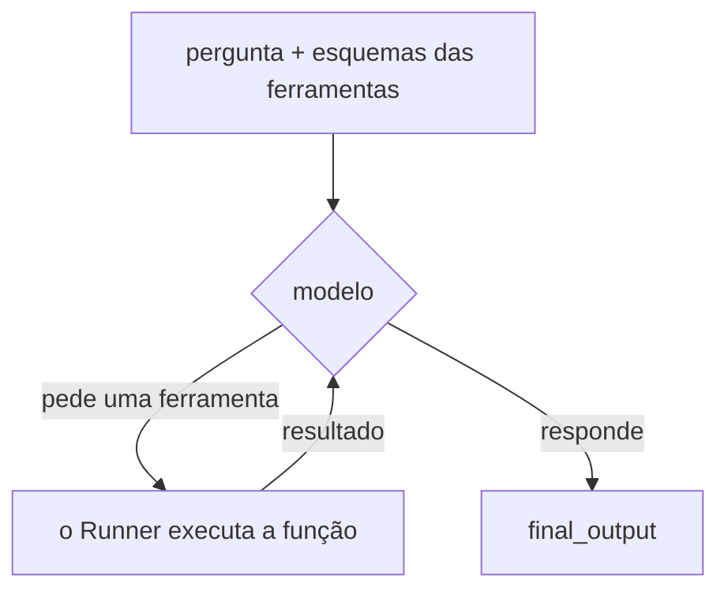

## **Etapa 7:** Integração Avançada de Ferramentas

---
layout: section
---

## **Ferramentas**: o agente passa a agir
**O modelo pede, o seu código executa**

---
layout: two-cols-header
layoutClass: gap-8
sourceLabel: Tools
source: https://openai.github.io/openai-agents-python/tools/
---

# Por que ferramentas?

#### **O agente das etapas 5 e 6 só sabe o que está no prompt**

::left::

```python [agente.py]
agente = Agent(
    name="Assistente comercial",
    instructions=INSTRUCOES,
    output_type=Recomendacao,
)
resultado = await Runner.run(
    agente, "Vale ligar para o usuário U00042?")
# o modelo não conhece o U00042:
# inventa a probabilidade ou se recusa
```

::right::

<div class="text-left w-full [&_li]:mb-4">

- **O que falta** — o perfil do U00042 está no `usuarios_avulsos.csv`; a probabilidade, no pipeline da etapa 2.
- **Ferramenta** — uma função Python que o agente pode pedir para executar: buscar um dado, calcular, chamar uma API.
- **Quem executa** — o seu código: o modelo só escolhe a ferramenta e os argumentos.

</div>

<!--
- é o "agir" do ciclo perceber-raciocinar-agir da etapa 5: sem ferramentas, o agente só raciocina sobre as instruções e a pergunta.
- Recomendacao é a saída estruturada (output_type) da etapa 6: usuario_id, probabilidade, ligar, prioridade e motivo. Ela não muda nesta etapa.
- com o output_type, o modelo precisa preencher a probabilidade mesmo sem dados: ou chuta um número, ou devolve 0 com um motivo como "sem dados". As duas respostas passam na validação do Pydantic, e por isso o erro não aparece.
-->

---
layout: two-cols-header
layoutClass: gap-8
sourceLabel: Running agents
source: https://openai.github.io/openai-agents-python/running_agents/
---

# O ciclo de uma ferramenta

#### **Cada volta do ciclo é uma chamada ao modelo**

::left::



::right::

<div class="text-left w-full [&_li]:mb-4">

- **O modelo recebe** — a pergunta e o esquema de cada ferramenta: nome, descrição e argumentos.
- **O modelo pede** — o nome da ferramenta e os argumentos em JSON; ele não executa nada.
- **O Runner executa** — chama a função e devolve o resultado ao modelo, junto com o histórico.
- **O modelo decide** — outra ferramenta ou a resposta final.

</div>

<!--
- o U00042 leva três voltas: buscar_usuario, prever_assinatura e a resposta final. Cada volta é uma chamada paga ao modelo, com o histórico inteiro na entrada.
- len(resultado.raw_responses) conta as chamadas ao modelo: uma resposta por volta.
- o Runner.run tem max_turns=10: se o ciclo passar de 10 voltas, ele para com a exceção MaxTurnsExceeded.
- o modelo pode pedir mais de uma ferramenta na mesma volta: o Runner executa todas antes de voltar ao modelo.
-->

---
layout: two-cols-header
layoutClass: gap-8
sourceLabel: Function tools
source: https://openai.github.io/openai-agents-python/tools/#function-tools
---

# A primeira ferramenta

#### **Uma função Python com `@function_tool`, docstring e type hints**

::left::

```python [ferramentas.py]
import pandas as pd
from agents import function_tool

USUARIOS = (pd.read_csv("usuarios_avulsos.csv")
            .drop(columns="virou_assinante")
            .set_index("usuario_id"))

@function_tool
def buscar_usuario(usuario_id: str) -> str:
    """Busca o perfil de um usuário avulso.

    Args:
        usuario_id: o ID, de U00001 a U03000.
    """
    if usuario_id not in USUARIOS.index:
        return f"{usuario_id} não encontrado."
    return USUARIOS.loc[usuario_id].to_json()
```

::right::

<div class="text-left w-full [&_li]:mb-4">

- **`@function_tool`** — transforma a função numa ferramenta; o nome da função vira o nome da ferramenta.
- **Docstring** — a primeira linha descreve a ferramenta; a seção `Args`, cada argumento.
- **Type hints** — viram o tipo de cada argumento no esquema: `usuario_id` é texto.
- **O retorno** — volta ao modelo como texto: aqui, o perfil em JSON.

</div>

<!--
- a base é lida uma vez, na importação do módulo, e não a cada chamada.
- virou_assinante é o alvo histórico: a ferramenta não o mostra ao modelo. Numa base real, seriam os avulsos do mês corrente, ainda sem resposta.
- usuário inexistente: a ferramenta devolve uma mensagem em vez de levantar exceção, e o modelo pode avisar o vendedor.
- saída para o U00042: {"regiao":"zona_oeste","canal":"convenio_empresa","pagamento":"cartao","idade":30,"viagens_30d":7,"distancia_media_km":3.0,"avaliacao_media":3.4}
- o capítulo 4 do Building Agents with OpenAI Agents SDK constrói ferramentas do mesmo jeito.
-->

---
layout: two-cols-header
layoutClass: gap-8
sourceLabel: Function tools
source: https://openai.github.io/openai-agents-python/tools/#function-tools
---

# O que o modelo enxerga

#### **Da ferramenta, o modelo só vê o nome, a descrição e o esquema**

::left::

```python
buscar_usuario.name
# 'buscar_usuario'
buscar_usuario.description
# 'Busca o perfil de um usuário avulso.'
buscar_usuario.params_json_schema
```

```json
{"properties": {"usuario_id": {
   "description": "o ID, de U00001 a U03000.",
   "title": "Usuario Id", "type": "string"}},
 "required": ["usuario_id"],
 "title": "buscar_usuario_args", "type": "object",
 "additionalProperties": false}
```

::right::

<div class="text-left w-full [&_li]:mb-4">

- **A descrição decide a escolha** — o modelo escolhe a ferramenta pelo nome e pela descrição: docstring vaga, chamada errada.
- **Modo estrito** — `required` e `additionalProperties`: o modelo envia exatamente esses argumentos.
- **O código fica de fora** — o modelo não lê a função, só o esquema.

</div>

<!--
- o esquema segue o JSON Schema, o mesmo formato que o FastAPI publica no /docs.
- o modo estrito (strict_json_schema=True) é o padrão do @function_tool: o modelo não pode inventar argumentos nem omitir um obrigatório.
- name_override e description_override, no @function_tool, trocam o nome e a descrição sem mexer na função.
-->

---
layout: section
---

## Inputs tipados com **Pydantic**
**O contrato da ferramenta, conferido antes da execução**

---
layout: two-cols-header
layoutClass: gap-8
sourceLabel: "Pydantic: Fields"
source: https://docs.pydantic.dev/latest/concepts/fields/
---

# Um modelo Pydantic como entrada

#### **O contrato da API da etapa 4, agora com faixas e valores permitidos**

::left::

```python [ferramentas.py]
from typing import Literal
from pydantic import BaseModel, Field

class PerfilUsuario(BaseModel):
    idade: int = Field(ge=16, le=90)
    viagens_30d: int = Field(ge=0)
    distancia_media_km: float = Field(gt=0)
    avaliacao_media: float | None = Field(
        default=None, ge=1, le=5)
    regiao: Literal["centro", "zona_sul",
                    "zona_norte", "zona_oeste"]
    canal: Literal["loja_de_apps", "indicacao",
                   "convenio_empresa"]
    pagamento: Literal["cartao", "pix"]
```

::right::

```python [ferramentas.py]
PIPE = joblib.load("pipeline_assinatura.joblib")

@function_tool
def prever_assinatura(
        perfil: PerfilUsuario) -> float:
    """Probabilidade de o usuário virar assinante.

    Args:
        perfil: as sete features do usuário.
    """
    X = pd.DataFrame([perfil.model_dump()])
    p = PIPE.predict_proba(X)[0, 1]
    return round(float(p), 3)
```

<!--
- Literal: só as categorias do treino, e o modelo recebe a lista. Field: as faixas válidas, como a idade de 16 a 90 e a nota de 1 a 5. A demo seguinte mostra como os dois aparecem no esquema.
- PerfilUsuario repete o Usuario da api.py da etapa 4 com regras a mais: lá, qualquer texto passava em regiao; aqui, uma região nova é recusada antes do pipeline.
- um argumento, sete campos: o modelo monta o perfil inteiro, como o corpo do /prever. O model_dump() gera um dicionário com os nomes das features do treino, e o DataFrame de uma linha entra direto no pipeline.
- avaliacao_media pode faltar (None): o SimpleImputer do pipeline preenche com a mediana do treino.
- round(float(p), 3) troca o tipo do numpy por um float do Python; o SDK entrega ao modelo o texto "0.464".
- o joblib.load executa código: só arquivos gerados pelo próprio time (etapa 4).
-->

---
layout: two-cols-header
layoutClass: gap-8
sourceLabel: "Pydantic: JSON Schema"
source: https://docs.pydantic.dev/latest/concepts/json_schema/
---

# Demo: o esquema que o modelo vê

#### **O `@function_tool` monta o esquema dos argumentos com o Pydantic**

::left::

```python {monaco-run} {autorun: false, height: 'auto'}
from typing import Literal
from pydantic import BaseModel, Field

class PerfilUsuario(BaseModel):
    idade: int = Field(ge=16, le=90)
    canal: Literal["loja_de_apps", "indicacao",
                   "convenio_empresa"]
    avaliacao_media: float | None = None

esquema = PerfilUsuario.model_json_schema()
props = esquema["properties"]
print(props["idade"])
print(props["canal"]["enum"])
print("obrigatórios:", esquema["required"])
```

::right::

<div class="text-left w-full [&_li]:mb-4">

- **Três campos** — um inteiro com faixa, uma categoria e uma nota que pode faltar.
- **`model_json_schema()`** — o esquema JSON que o Pydantic gera a partir da classe.
- **Antes de executar** — quais campos o modelo é obrigado a enviar?

</div>

<!--
- saída esperada:
  {'maximum': 90, 'minimum': 16, 'title': 'Idade', 'type': 'integer'}
  ['loja_de_apps', 'indicacao', 'convenio_empresa']
  obrigatórios: ['idade', 'canal']
- o Field vira minimum e maximum; o Literal vira enum. A avaliacao_media, com padrão None, fica fora dos obrigatórios: o esquema dela é anyOf [number, null], com default null.
- no modo estrito, o SDK torna todos os campos obrigatórios, inclusive avaliacao_media: quando não sabe a nota, o modelo envia null.
-->

---
layout: two-cols-header
layoutClass: gap-8
sourceLabel: "Pydantic: Validators"
source: https://docs.pydantic.dev/latest/concepts/models/#validating-data
---

# Demo: o Pydantic barra o argumento errado

#### **O SDK valida os argumentos antes de chamar a função**

::left::

```python {monaco-run} {autorun: false, height: 'auto'}
from typing import Literal
from pydantic import BaseModel, Field
from pydantic import ValidationError

class PerfilUsuario(BaseModel):
    idade: int = Field(ge=16, le=90)
    canal: Literal["loja_de_apps", "indicacao",
                   "convenio_empresa"]
for a in [{"idade": 31, "canal": "indicacao"},
          {"idade": "31", "canal": "indicacao"},
          {"idade": 12, "canal": "parceiro"}]:
    try:
        print("aceito:", PerfilUsuario(**a))
    except ValidationError as e:
        campos = [x["loc"][0] for x in e.errors()]
        print("recusado:", campos)
```

::right::

<div class="text-left w-full [&_li]:mb-4">

- **Três pedidos** — três jeitos de o modelo preencher os argumentos da ferramenta.
- **O segundo** — a idade veio como texto: passa ou não passa?
- **No SDK** — o pedido recusado não chega à função: o modelo recebe um aviso de erro e pode tentar de novo.

</div>

<!--
- saída esperada: aceito: idade=31 canal='indicacao' (duas vezes) e recusado: ['idade', 'canal'].
- o Pydantic converte o texto "31" em 31 (modo lax, o padrão); 12 anos e o canal "parceiro" estão fora do contrato.
- no SDK, o modelo recebe "An error occurred while running the tool. Please try again." e o ciclo continua. O mesmo aviso aparece quando a própria função levanta uma exceção.
- com @function_tool(failure_error_function=None), o erro interrompe o Runner com UserError.
-->

---
layout: two-cols-header
layoutClass: gap-8
sourceLabel: Agents
source: https://openai.github.io/openai-agents-python/agents/
---

# O agente com as ferramentas

#### **A lista `tools` entra no agente; a saída estruturada não muda**

::left::

```python [agente.py]
class Recomendacao(BaseModel):
    usuario_id: str
    probabilidade: float
    ligar: bool
    prioridade: Literal["baixa", "media", "alta"]
    motivo: str

agente = Agent(
    name="Assistente comercial",
    instructions=INSTRUCOES,
    tools=[buscar_usuario, prever_assinatura],
    output_type=Recomendacao,
)
```

::right::

```python [agente.py]
resultado = await Runner.run(
    agente, "Vale ligar para o usuário U00042?")
print(resultado.final_output)
# usuario_id='U00042' probabilidade=0.464
# ligar=True prioridade='media' motivo='...'
print(len(resultado.raw_responses))    # 3
```

<div class="text-left w-full [&_li]:mb-3 mt-4">

- **As instruções** — dizem quando usar cada ferramenta e o threshold 0,3 da etapa 3.
- **A probabilidade** — 0,464, a do pipeline: o modelo copia, não estima.
- **Três chamadas** — buscar, prever e responder.

</div>

<!--
- INSTRUCOES: "Você ajuda o time comercial de uma empresa de bicicletas compartilhadas a decidir para quais usuários avulsos ligar, oferecendo a assinatura. Para cada usuário citado, busque o perfil com buscar_usuario e estime a probabilidade com prever_assinatura. Recomende ligar a partir de 0,3. Prioridade: alta a partir de 0,6, média de 0,3 a 0,6 e baixa abaixo de 0,3. Use só os dados que as ferramentas devolverem."
- o motivo muda a cada execução: é texto do modelo. Os números vêm das ferramentas.
- outros usuários: U00010 (0,817, prioridade alta) e U00043 (0,206, não ligar).
- o Runner.run roda dentro de uma função async, com asyncio.run(main()), como na etapa 6.
-->

---
layout: section
---

## Controlando o ciclo: **tool_choice** e **tool_use_behavior**
**Quem escolhe a ferramenta e quando o ciclo termina**

---
layout: two-cols-header
layoutClass: gap-8
sourceLabel: Forcing tool use
source: https://openai.github.io/openai-agents-python/agents/#forcing-tool-use
---

# `tool_choice`: quem escolhe a ferramenta

#### **Uma configuração do modelo, em `ModelSettings`**

::left::

| `tool_choice` | o modelo… |
|---|---|
| `"auto"` (padrão) | decide se chama e qual |
| `"required"` | precisa chamar alguma |
| `"none"` | não pode chamar nenhuma |
| `"prever_assinatura"` | precisa chamar essa |

::right::

```python [comportamentos.py]
from agents import ModelSettings

forcado = agente.clone(
    model_settings=ModelSettings(
        tool_choice="prever_assinatura"))
```

<div class="text-left w-full [&_li]:mb-3 mt-4">

- **`reset_tool_choice=True`** (padrão) — depois de uma chamada, o SDK devolve a escolha ao modelo; sem isso, `"required"` não deixa o ciclo terminar.
- **Nome errado** — o SDK não confere: a API recusa o pedido (erro 400).

</div>

<!--
- clone copia o agente trocando só o que foi passado: é o jeito de comparar configurações sem repetir o Agent inteiro.
- com o reset (padrão), o tool_choice enviado ao modelo é "required" na primeira volta e vazio (o padrão, "auto") nas seguintes.
- com reset_tool_choice=False, toda volta exige uma ferramenta: o modelo não consegue responder e o Runner para no max_turns com MaxTurnsExceeded.
- "none" com output_type: o modelo responde sem dados e preenche a probabilidade mesmo assim. Serve para perguntas que não precisam de ferramenta.
- forçar uma ferramenta faz sentido quando todo pedido começa por ela, como buscar o usuário antes de qualquer decisão.
-->

---
layout: two-cols-header
layoutClass: gap-8
sourceLabel: Tool use behavior
source: https://openai.github.io/openai-agents-python/agents/#tool-use-behavior
---

# `tool_use_behavior`: quando o ciclo termina

#### **Voltar ao modelo ou encerrar na ferramenta**

::left::

```python [comportamentos.py]
from agents import StopAtTools

agente.clone(tool_use_behavior="run_llm_again")
agente.clone(
    tool_use_behavior="stop_on_first_tool")
agente.clone(tool_use_behavior=StopAtTools(
    stop_at_tool_names=["prever_assinatura"]))
```

<div class="text-left w-full [&_li]:mb-3 mt-4">

- **`"run_llm_again"`** (padrão) — o resultado volta ao modelo, que interpreta e responde.
- **Encerrar na ferramenta** — economiza chamadas ao modelo.

</div>

::right::

| opção | chamadas | saída |
|---|---|---|
| run_llm_again | 3 | Recomendacao |
| stop_on_first_tool | 1 | perfil (JSON) |
| StopAtTools | 2 | 0.464 |

> [!IMPORTANT]
> Encerrando na ferramenta, a resposta é a saída dela, sem passar pelo `output_type`: para manter o esquema, a ferramenta devolve o próprio objeto (`Recomendacao`).

<!--
- "stop_on_first_tool" para na primeira ferramenta chamada, a buscar_usuario: a resposta é o perfil, não a recomendação.
- StopAtTools encerra quando uma das ferramentas da lista é chamada: aqui, a prever_assinatura, com o float 0.464.
- verificado no SDK: com "stop_on_first_tool" e uma ferramenta que devolve um Recomendacao, o final_output é esse objeto, com 1 chamada ao modelo.
- a etapa 8 mostra a quarta opção: uma função que decide se encerra e monta a saída.
-->

---
layout: two-cols-header
layoutClass: gap-8
sourceLabel: "Running agents: exceptions"
source: https://openai.github.io/openai-agents-python/running_agents/#exceptions
---

# Configurações que dão errado

#### **Cada uma deixa uma evidência diferente**

::left::

```python [comportamentos.py]
from agents import MaxTurnsExceeded

em_loop = agente.clone(
    model_settings=ModelSettings(
        tool_choice="required"),
    reset_tool_choice=False)
try:
    await Runner.run(em_loop, PERGUNTA)
except MaxTurnsExceeded as erro:
    print(erro)    # Max turns (10) exceeded
```

::right::

<div class="text-left w-full [&_li]:mb-4">

- **`"required"` sem reset** — o modelo chama ferramentas até o limite de voltas: `MaxTurnsExceeded`.
- **Nome inexistente** — o pedido falha na API, antes de qualquer ferramenta.
- **`"none"`** — sem dados, o modelo inventa a probabilidade ou se recusa.
- **`"stop_on_first_tool"`** — com duas ferramentas em sequência, para na busca: a resposta é o perfil.

</div>

<!--
- o max_turns padrão é 10; Runner.run(..., max_turns=3) estoura antes e gasta menos na demonstração.
- a evidência de cada caso: a exceção, o erro 400, a probabilidade que não bate com o pipeline e o tipo do final_output (str em vez de Recomendacao).
- o comportamentos.py roda as cinco configurações com a mesma pergunta e imprime as chamadas ao modelo e o final_output de cada uma.
-->

---
layout: section
---

## Live Coding

🚲 &nbsp;**Dataset:** `usuarios_avulsos.csv` e o `pipeline_assinatura.joblib` da etapa 2

🧭 &nbsp;**Análise:** o assistente comercial ganha ferramentas: busca o usuário, estima a assinatura com entradas validadas pelo Pydantic e tem o ciclo controlado por `tool_choice` e `tool_use_behavior`

<!--
Projeto: o mesmo das etapas anteriores, com o SDK da etapa 5 (uv add openai-agents python-dotenv) e o .env com a OPENAI_API_KEY. Os três arquivos ficam na pasta do usuarios_avulsos.csv e do pipeline_assinatura.joblib.

=================================================================
ARQUIVO 1 — ferramentas.py (as duas ferramentas)

```python
"""Ferramentas do assistente comercial: a base de usuários e o modelo de assinatura."""
from typing import Literal

import joblib
import pandas as pd
from agents import function_tool
from pydantic import BaseModel, Field

# virou_assinante é o alvo histórico: a ferramenta não o mostra ao modelo
USUARIOS = (pd.read_csv("usuarios_avulsos.csv")
            .drop(columns="virou_assinante")
            .set_index("usuario_id"))
# o joblib.load executa código: só o arquivo gerado pelo próprio time, na etapa 2
PIPE = joblib.load("pipeline_assinatura.joblib")


class PerfilUsuario(BaseModel):
    idade: int = Field(ge=16, le=90)
    viagens_30d: int = Field(ge=0)
    distancia_media_km: float = Field(gt=0)
    avaliacao_media: float | None = Field(default=None, ge=1, le=5)
    regiao: Literal["centro", "zona_sul", "zona_norte", "zona_oeste"]
    canal: Literal["loja_de_apps", "indicacao", "convenio_empresa"]
    pagamento: Literal["cartao", "pix"]


@function_tool
def buscar_usuario(usuario_id: str) -> str:
    """Busca o perfil de um usuário avulso.

    Args:
        usuario_id: o ID, de U00001 a U03000.
    """
    if usuario_id not in USUARIOS.index:
        return f"{usuario_id} não encontrado."
    return USUARIOS.loc[usuario_id].to_json()


@function_tool
def prever_assinatura(perfil: PerfilUsuario) -> float:
    """Probabilidade de o usuário virar assinante.

    Args:
        perfil: as sete features do usuário.
    """
    X = pd.DataFrame([perfil.model_dump()])
    p = PIPE.predict_proba(X)[0, 1]
    return round(float(p), 3)
```

=================================================================
ARQUIVO 2 — agente.py (o assistente das etapas 5 e 6, agora com ferramentas: uv run python agente.py)

```python
"""O assistente comercial: decide se vale ligar para um usuário avulso, com as ferramentas."""
import asyncio
from typing import Literal

from agents import Agent, Runner
from dotenv import load_dotenv
from pydantic import BaseModel

from ferramentas import buscar_usuario, prever_assinatura

load_dotenv()

INSTRUCOES = (
    "Você ajuda o time comercial de uma empresa de bicicletas compartilhadas a decidir para quais "
    "usuários avulsos ligar, oferecendo a assinatura. Para cada usuário citado, busque o perfil com "
    "buscar_usuario e estime a probabilidade com prever_assinatura. Recomende ligar a partir de 0,3. "
    "Prioridade: alta a partir de 0,6, média de 0,3 a 0,6 e baixa abaixo de 0,3. "
    "Use só os dados que as ferramentas devolverem."
)


class Recomendacao(BaseModel):
    usuario_id: str
    probabilidade: float
    ligar: bool
    prioridade: Literal["baixa", "media", "alta"]
    motivo: str


agente = Agent(
    name="Assistente comercial",
    instructions=INSTRUCOES,
    tools=[buscar_usuario, prever_assinatura],
    output_type=Recomendacao,
)


async def main():
    resultado = await Runner.run(agente, "Vale ligar para o usuário U00042?")
    print(resultado.final_output)
    print("chamadas ao modelo:", len(resultado.raw_responses))


if __name__ == "__main__":
    asyncio.run(main())
```

=================================================================
ARQUIVO 3 — comportamentos.py (tool_choice e tool_use_behavior: uv run python comportamentos.py)

```python
"""Compara tool_choice e tool_use_behavior no assistente comercial."""
import asyncio

from agents import MaxTurnsExceeded, ModelSettings, Runner, StopAtTools

from agente import agente

PERGUNTA = "Vale ligar para o usuário U00042?"

VARIANTES = {
    "padrão (auto, run_llm_again)": agente,
    "tool_choice='required'": agente.clone(model_settings=ModelSettings(tool_choice="required")),
    "tool_choice='none'": agente.clone(model_settings=ModelSettings(tool_choice="none")),
    "stop_on_first_tool": agente.clone(tool_use_behavior="stop_on_first_tool"),
    "StopAtTools": agente.clone(
        tool_use_behavior=StopAtTools(stop_at_tool_names=["prever_assinatura"])),
}

# configuração errada de propósito: obrigar uma ferramenta em toda volta do ciclo
EM_LOOP = agente.clone(model_settings=ModelSettings(tool_choice="required"),
                       reset_tool_choice=False)


async def main():
    for nome, variante in VARIANTES.items():
        resultado = await Runner.run(variante, PERGUNTA)
        print(f"{nome}: {len(resultado.raw_responses)} chamadas | "
              f"{type(resultado.final_output).__name__}: {resultado.final_output}")
    try:
        await Runner.run(EM_LOOP, PERGUNTA)
    except MaxTurnsExceeded as erro:
        print("required sem reset:", erro)


if __name__ == "__main__":
    asyncio.run(main())
```

>>> Resultados esperados: buscar_usuario.params_json_schema com usuario_id (string, obrigatório) e additionalProperties false; no esquema da prever_assinatura, os sete campos do PerfilUsuario são obrigatórios (avaliacao_media aceita null).
>>> agente.py: usuario_id='U00042' probabilidade=0.464 ligar=True prioridade='media' (o motivo varia) e 3 chamadas ao modelo. U00010: 0,817 (alta); U00043: 0,206 (não ligar).
>>> comportamentos.py: padrão e required → 3 chamadas, Recomendacao; none → 1 chamada, Recomendacao sem dados (probabilidade inventada ou 0); stop_on_first_tool → 1 chamada, str com o perfil do U00042; StopAtTools → 2 chamadas, float 0.464; required sem reset → Max turns (10) exceeded.
-->

---
layout: default
layoutClass: gap-8
---

# Live coding: codificação assistida por IA

#### **Prompt para dar ferramentas ao assistente comercial**

<div class="h-7" />

<WindowMockup color="dark" padding="0.5rem 0.5rem 0.5rem 0.5rem" title="prompt.md" codeblock>

```md {*}{maxHeight:'290px'}
# Papel
Você é um engenheiro de IA especialista no OpenAI Agents SDK.

# Tarefa
Dê ferramentas ao assistente comercial da empresa de bicicletas, para que
ele decida para quais usuários avulsos ligar com dados, e não com palpites.

# Contexto
1. Em "ferramentas.py", crie com @function_tool a ferramenta buscar_usuario,
   que lê o perfil de um usuário em @usuarios_avulsos.csv sem a coluna
   virou_assinante, e a prever_assinatura, que recebe um modelo Pydantic
   com as sete features (Literal nas categorias, Field nas faixas) e
   devolve a probabilidade do @pipeline_assinatura.joblib.
2. Documente cada ferramenta com docstring e a seção Args.
3. Em "agente.py", entregue as duas ferramentas ao agente das etapas 5 e 6,
   sem mudar o output_type Recomendacao, e execute com Runner.run.
4. Em "comportamentos.py", compare com agente.clone o tool_choice ("auto",
   "required" e "none") e o tool_use_behavior ("run_llm_again",
   "stop_on_first_tool" e StopAtTools).

# Saída e Verificação
- Imprima o esquema de cada ferramenta (params_json_schema).
- Para cada configuração, imprima o final_output e o número de chamadas ao
  modelo (len(resultado.raw_responses)).
```
</WindowMockup>

<!--
# 1 - human-in-the-loop: confira se a ferramenta não devolve a coluna virou_assinante. O alvo vazaria para o modelo, que passaria a "acertar" sem o pipeline.

# 2 - se o agente escrever o esquema JSON da ferramenta à mão, ou usar functions e function_call (a API antiga de chat), peça o @function_tool: o SDK gera o esquema a partir da função.

# 3 - se as categorias vierem como str, o modelo pode inventar uma região: peça Literal com os valores do treino.
-->

---
layout: default
---

# Hands-on

<br/>

🛠️ &nbsp;**Exercício \#1:** Crie a ferramenta `buscar_passageiro` e confira o esquema que o modelo vê.

🛠️ &nbsp;**Exercício \#2:** Crie o `PerfilPassageiro` e uma ferramenta com o pipeline do Titanic.

🛠️ &nbsp;**Exercício \#3:** Pergunte "e se fosse eu?" com `tool_choice` em auto, required e none.

🛠️ &nbsp;**Exercício \#4:** Compare os três `tool_use_behavior` em chamadas e no `final_output`.

- [ ] escrever a docstring com a seção `Args`
- [ ] usar `Literal` nas categorias e `Field` nas faixas
- [ ] passar ao pipeline um `DataFrame` com os nomes das colunas do treino
- [ ] contar as chamadas ao modelo com `len(resultado.raw_responses)`
- [ ] ver o tipo do `final_output` quando o ciclo encerra na ferramenta

<br/>

<!--
Cenário: um guia do museu do Titanic, com o titanic do seaborn e o pipeline salvo no Exercício 4 da etapa 2 (pipeline_titanic.joblib: age, fare, sibsp, parch, sex, pclass e embarked; C = 10; 0,804 no teste).

# Exercício #1 — Uma ferramenta de busca
@function_tool def buscar_passageiro(indice: int) -> str, com docstring e Args ("indice: a linha do passageiro, de 0 a 890"); devolve as sete features e o survived da linha em JSON. Esquema: indice do tipo integer, obrigatório, additionalProperties false.
Passageiro 1: {"age":38.0,"fare":71.2833,"sibsp":1,"parch":0,"sex":"female","pclass":1,"embarked":"C","survived":1}. Índice fora da faixa: a ferramenta devolve uma mensagem, sem exceção.

# Exercício #2 — Entrada tipada
PerfilPassageiro: age float | None (Field ge=0, le=100, padrão None), sex Literal["male", "female"], pclass Literal[1, 2, 3], sibsp e parch int (ge=0), fare float | None (ge=0, padrão None), embarked Literal["S", "C", "Q"] | None (padrão None). Os None ficam com o SimpleImputer do pipeline.
prever_sobrevivencia(perfil) → pd.DataFrame([perfil.model_dump()]) e predict_proba: passageiro 1 → 0,919; passageiro 0 (homem, 22 anos, 3ª classe) → 0,083.

# Exercício #3 — tool_choice
"Sou uma mulher de 30 anos e viajaria sozinha, de 2ª classe, saindo de Southampton. Eu sobreviveria?": perfil {age 30, sex female, pclass 2, sibsp 0, parch 0, fare None, embarked S} → 0,814.
"auto" e "required": 2 chamadas (ferramenta e resposta); "none": 1 chamada e nenhuma probabilidade do pipeline (o modelo responde com o que sabe da história).

# Exercício #4 — tool_use_behavior
"O passageiro 1 sobreviveria pelo modelo?": "run_llm_again" → 3 chamadas e uma resposta em texto; "stop_on_first_tool" → 1 chamada e o JSON do buscar_passageiro; StopAtTools(stop_at_tool_names=["prever_sobrevivencia"]) → 2 chamadas e o float 0.919.

## os exercícios preparam os Exercícios 11 e 12 do AT
-->
