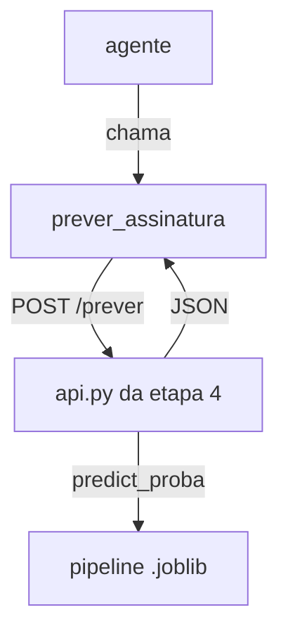

## **Etapa 8:** Integração de Ferramentas e APIs

---
layout: section
---

## Ferramentas que **chamam APIs**
**O pipeline sai do processo do agente e fica atrás da API da etapa 4**

---
layout: two-cols-header
layoutClass: gap-8
---

# Da função à API

#### **A ferramenta deixa de carregar o modelo e passa a pedir a previsão**

::left::



::right::

<div class="text-left w-full [&_li]:mb-4">

- **Na etapa 7** — a ferramenta carregava o `.joblib` no processo do agente.
- **Agora** — a ferramenta faz um pedido HTTP; o pipeline fica só no servidor.
- **Por quê** — um modelo para vários clientes (agente, painel, app), e cada camada muda sem mexer nas outras.
- **O preço** — a rede: o servidor pode demorar, cair ou recusar o pedido.

</div>

<!--
- três camadas, três arquivos: o pipeline (scikit-learn, etapas 2 a 4), a API (api.py, FastAPI) e o agente (SDK). Ninguém importa o .joblib fora da api.py.
- a API sobe num terminal (uv run fastapi dev api.py) e o agente roda em outro.
- a api.py é a mesma da etapa 4, sem nenhuma mudança: POST /prever com as sete features, resposta {"probabilidade", "ligar"}.
-->

---
layout: two-cols-header
layoutClass: gap-8
sourceLabel: "Requests: Quickstart"
source: https://requests.readthedocs.io/en/latest/user/quickstart/
---

# O cliente HTTP: `requests`

#### **Um pedido com o corpo em JSON, sempre com tempo limite**

::left::

```python
import requests

perfil = {"idade": 30, "viagens_30d": 7,
          "distancia_media_km": 3.0,
          "avaliacao_media": 3.4,
          "regiao": "zona_oeste",
          "canal": "convenio_empresa",
          "pagamento": "cartao"}
resposta = requests.post(
    "http://127.0.0.1:8000/prever",
    json=perfil, timeout=5)
resposta.raise_for_status()
resposta.json()
# {'probabilidade': 0.464, 'ligar': True}
```

::right::

<div class="text-left w-full [&_li]:mb-4">

- **`json=`** — converte o dicionário em JSON e avisa o servidor do formato.
- **`timeout=5`** — sem ele, o `requests` espera para sempre por um servidor travado.
- **`raise_for_status()`** — transforma as respostas 4xx e 5xx em exceção.
- **`.json()`** — o corpo da resposta como dicionário.

</div>

<!--
- o perfil é o do U00042: a mesma probabilidade da ferramenta da etapa 7 (0,464), porque o pipeline é o mesmo.
- o requests é o mesmo do testar_api.py da etapa 4; a novidade é o timeout e o raise_for_status.
- os códigos que importam aqui: 200 (deu certo), 422 (a FastAPI recusou os dados) e 500 (o servidor falhou).
-->

---
layout: two-cols-header
layoutClass: gap-8
sourceLabel: Function tools
source: https://openai.github.io/openai-agents-python/tools/#function-tools
---

# A ferramenta que chama a API

#### **O mesmo nome e o mesmo contrato: o agente não percebe a troca**

::left::

```python [ferramentas.py]
import requests

API_MODELO = "http://127.0.0.1:8000"

@function_tool
def prever_assinatura(
        perfil: PerfilUsuario) -> str:
    """Probabilidade de virar assinante, pela API.

    Args:
        perfil: as sete features do usuário.
    """
    resposta = requests.post(
        f"{API_MODELO}/prever",
        json=perfil.model_dump(), timeout=5)
    resposta.raise_for_status()
    return resposta.text
```

::right::

<div class="text-left w-full [&_li]:mb-4">

- **Reescrita, não acréscimo** — o `ferramentas.py` troca a versão da etapa 7; o `agente.py` continua igual.
- **`model_dump()`** — o perfil vira o corpo do pedido, com os nomes que o `Usuario` da API espera.
- **`resposta.text`** — o JSON da API vai direto para o modelo.
- **Duas validações** — o Pydantic da ferramenta e o da API (422).

</div>

<!--
- o import do joblib e a linha PIPE = joblib.load(...) saem do ferramentas.py: o processo do agente não carrega mais o modelo.
- o modelo recebe {"probabilidade":0.464,"ligar":true}: o ligar já vem com o threshold 0,3 da API.
- verificado: o agente.py da etapa 7, sem nenhuma mudança, responde igual, com 3 chamadas ao modelo.
- a URL fica numa constante: em produção, ela viria de uma variável de ambiente, como a chave da OpenAI.
-->

---
layout: two-cols-header
layoutClass: gap-8
sourceLabel: "Requests: Errors and Exceptions"
source: https://requests.readthedocs.io/en/latest/user/quickstart/#errors-and-exceptions
---

# Quando a API falha

#### **Cada falha vira uma mensagem que o modelo entende**

::left::

```python [ferramentas.py]
    try:
        resposta = requests.post(
            f"{API_MODELO}/prever",
            json=perfil.model_dump(), timeout=5)
        resposta.raise_for_status()
    except requests.Timeout:
        return ("A API do modelo não respondeu "
                "em 5 s. Não estime a probabilidade.")
    except requests.ConnectionError:
        return ("A API do modelo está fora do ar. "
                "Não estime a probabilidade.")
    except requests.HTTPError:
        return ("A API do modelo recusou o pedido "
                f"(HTTP {resposta.status_code}).")
    return resposta.text
```

::right::

<div class="text-left w-full [&_li]:mb-4">

- **`Timeout`** — o servidor não respondeu a tempo.
- **`ConnectionError`** — ninguém atendeu: a API está fora do ar.
- **`HTTPError`** — a API respondeu com erro: 422 (dados inválidos) ou 500 (falha no servidor).
- **Sem a mensagem** — o SDK repassa um aviso genérico, e o modelo tenta de novo ou chuta.

</div>

<!--
- com a API desligada, o agente responde que não conseguiu a previsão, em vez de travar ou inventar um número. É a falha transparente que o time comercial precisa.
- sem o try/except, a exceção chega ao SDK, que entrega ao modelo "An error occurred while running the tool. Please try again.": ele não sabe se foi o usuário, a rede ou o servidor.
- a ordem dos except importa: o ConnectTimeout é Timeout e ConnectionError ao mesmo tempo, e cai no primeiro que aparecer.
- com a API desligada na mesma máquina, a conexão é recusada na hora: ConnectionError.
- o "Não estime a probabilidade" orienta o modelo; as instruções do agente dizem o que responder nesse caso.
-->

---
layout: two-cols-header
layoutClass: gap-8
sourceLabel: "Requests: Exceptions"
source: https://requests.readthedocs.io/en/latest/api/#exceptions
---

# Demo: qual `except` pega cada falha?

#### **Na ordem em que aparecem: o primeiro que combina vence**

::left::

```python {monaco-run} {autorun: false, height: 'auto'}
import requests

def ferramenta(erro):
    try:
        raise erro  # o erro do requests.post
    except requests.Timeout:
        return "demorou: não estime"
    except requests.ConnectionError:
        return "fora do ar: não estime"

for erro in [requests.ReadTimeout(),
             requests.ConnectionError(),
             requests.ConnectTimeout()]:
    print(type(erro).__name__, "->",
          ferramenta(erro))
```

::right::

<div class="text-left w-full [&_li]:mb-4">

- **`ReadTimeout`** — a conexão abriu, mas a resposta não veio a tempo.
- **`ConnectTimeout`** — o servidor nem atendeu a conexão a tempo.
- **Antes de executar** — ele é `Timeout` e `ConnectionError` ao mesmo tempo: em qual `except` ele cai?

</div>

<!--
- saída esperada:
  ReadTimeout -> demorou: não estime
  ConnectionError -> fora do ar: não estime
  ConnectTimeout -> demorou: não estime
- o Python testa os except de cima para baixo e para no primeiro que combina: o ConnectTimeout herda de ConnectionError e de Timeout, e cai no Timeout porque ele vem antes.
- com o ConnectionError em primeiro lugar, o ConnectTimeout viraria "fora do ar". As duas mensagens servem; o que importa é escolher a ordem de propósito.
- a demo levanta as exceções do requests de verdade, sem rede: o navegador não abre conexões para a API local.
-->

---
layout: section
---

## Uma API **pública**
**A previsão de chuva para as ações nas estações**

---
layout: two-cols-header
layoutClass: gap-8
sourceLabel: Open-Meteo Forecast API
source: https://open-meteo.com/en/docs
---

# Uma API pública: Open-Meteo

#### **Um pedido GET com parâmetros na URL, sem chave de acesso**

::left::

```python [ferramentas.py]
OPEN_METEO = "https://api.open-meteo.com/v1/forecast"

@function_tool
def previsao_chuva(dias: int) -> str:
    """Previsão de chuva no Rio de Janeiro.

    Args:
        dias: quantos dias à frente, de 1 a 7.
    """
    params = {"latitude": -22.91, "longitude": -43.17,
              "daily": ["precipitation_sum",
                        "precipitation_probability_max"],
              "timezone": "auto", "forecast_days": dias}
    r = requests.get(OPEN_METEO, params=params,
                     timeout=10)
    r.raise_for_status()
    return resumir(r.json()["daily"])
```

::right::

<div class="text-left w-full [&_li]:mb-4">

- **O caso** — o time comercial faz ações de rua nas estações, com teste grátis da assinatura.
- **Por que chuva** — na DR1, dias com mais de 5 mm tiveram 16,9 viagens, contra 29,6.
- **`params=`** — o `requests` monta a URL; a lista vira o parâmetro repetido.

</div>

<!--
- no ferramentas.py das notas, o pedido fica num try/except requests.RequestException (a mãe de todas as exceções do requests), que devolve "Previsão do tempo indisponível.": a falha de uma API pública não pode derrubar o agente.
- a Open-Meteo é gratuita e sem chave para uso não comercial, com limite diário de chamadas. Para uso comercial, há planos pagos.
- latitude e longitude do Rio de Janeiro; timezone "auto" usa o fuso das coordenadas (America/Sao_Paulo), e os dias da previsão são os do Rio.
- a lista em "daily" vira o parâmetro repetido na URL (daily=precipitation_sum&daily=precipitation_probability_max), que a Open-Meteo aceita.
- o agente de planejamento (agente_chuva.py, nas notas do Live Coding) usa só esta ferramenta: "Qual o melhor dia para a ação nos próximos 3 dias?".
-->

---
layout: two-cols-header
layoutClass: gap-8
sourceLabel: Open-Meteo Forecast API
source: https://open-meteo.com/en/docs
---

# Demo: resumir a resposta da API

#### **O modelo recebe só o que ajuda a decidir**

::left::

```python {monaco-run} {autorun: false, height: 'auto'}
import json
texto = (  # parte da resposta da Open-Meteo
    '{"latitude":-22.95,"longitude":-43.21,'
    '"generationtime_ms":0.06,"elevation":5.0,'
    '"timezone":"America/Sao_Paulo","daily":'
    '{"time":["2026-11-19","2026-11-20"],'
    '"precipitation_sum":[9.9,0.0],'
    '"precipitation_probability_max":[100,33]}}')
d = json.loads(texto)["daily"]
colunas = zip(d["time"], d["precipitation_sum"],
              d["precipitation_probability_max"])
resumo = "\n".join(f"{dia}: {mm} mm, chance {p}%"
                   for dia, mm, p in colunas)
print(resumo)
print(len(texto), "caracteres ->", len(resumo))
```

::right::

<div class="text-left w-full [&_li]:mb-4">

- **O texto** — parte da resposta de 19/11/2026 (dois dias), como chega em `r.text`.
- **O resumo** — uma linha por dia: data, milímetros e chance de chuva.
- **Antes de executar** — qual dia você escolheria para a ação?

</div>

<!--
- saída esperada:
  2026-11-19: 9.9 mm, chance 100%
  2026-11-20: 0.0 mm, chance 33%
  226 caracteres -> 62
- o dia 20 tem 0,0 mm e 33% de chance: serve. O 19 passa dos 5 mm.
- o resumo tem pouco mais de um quarto do texto: menos tokens a cada volta do ciclo e menos campos para o modelo confundir.
- a resposta inteira tem ainda utc_offset_seconds, timezone_abbreviation e a unidade de cada campo. A demo guarda um trecho fixo, porque o navegador não chama a API e a previsão muda todo dia.
-->

---
layout: section
---

## Encerrando o ciclo **na ferramenta**
**Quando a resposta da API já é a resposta final**

---
layout: two-cols-header
layoutClass: gap-8
sourceLabel: Tool use behavior
source: https://openai.github.io/openai-agents-python/agents/#tool-use-behavior
---

# Uma função em `tool_use_behavior`

#### **Ela decide se o ciclo termina e monta a saída no formato do esquema**

::left::

```python [consulta_rapida.py]
class Consulta(BaseModel):
    probabilidade: float
    ligar: bool

def parar_na_previsao(contexto, resultados):
    for r in resultados:
        if r.tool.name == "prever_assinatura":
            try:
                saida = Consulta.model_validate_json(
                    r.output)
            except ValidationError:
                saida = r.output  # o aviso de erro
            return ToolsToFinalOutputResult(
                is_final_output=True,
                final_output=saida)
    return ToolsToFinalOutputResult(
        is_final_output=False)
```

::right::

```python [consulta_rapida.py]
consulta_rapida = Agent(
    name="Consulta rápida",
    instructions=("Busque o usuário e consulte "
                  "prever_assinatura."),
    tools=[buscar_usuario, prever_assinatura],
    output_type=Consulta,
    tool_use_behavior=parar_na_previsao)
# Consulta(probabilidade=0.464, ligar=True)
# 2 chamadas ao modelo, em vez de 3
```

<div class="text-left w-full [&_li]:mb-3 mt-4">

- **O painel** — só precisa dos números: a última chamada ao modelo sobra.
- **O esquema mantido** — o JSON da API vira um `Consulta`.

</div>

<!--
- a função recebe os resultados das ferramentas de cada volta (resultados: lista de FunctionToolResult, com r.tool e r.output) e devolve um ToolsToFinalOutputResult.
- por que não as outras opções: "stop_on_first_tool" pararia na buscar_usuario; StopAtTools entregaria o texto cru da API, sem validação.
- com a API desligada, o final_output é o aviso da ferramenta ("A API do modelo está fora do ar..."), também com 2 chamadas: o painel mostra o problema em vez de um número inventado.
- verificado com a API no ar e fora do ar, no SDK 0.24.
-->

---
layout: section
---

## Live Coding

🚲 &nbsp;**Dataset:** `usuarios_avulsos.csv`, a `api.py` da etapa 4 e a Open-Meteo

🧭 &nbsp;**Análise:** a ferramenta passa a consultar o modelo pela API, com tratamento de falhas; a previsão de chuva entra como API pública; e uma consulta rápida encerra o ciclo na ferramenta

<!--
Projeto: o mesmo da etapa 7. A api.py da etapa 4 roda num terminal (uv run fastapi dev api.py, em 127.0.0.1:8000) e os scripts do agente, em outro. O requests já foi instalado na etapa 4.

=================================================================
ARQUIVO 1 — ferramentas.py (reescrito: o prever_assinatura chama a API, e o .joblib sai do processo do agente; entra a previsao_chuva)

```python
"""Ferramentas do assistente comercial: a base de usuários, a API do modelo e a previsão de chuva."""
from typing import Literal

import pandas as pd
import requests
from agents import function_tool
from pydantic import BaseModel, Field

# virou_assinante é o alvo histórico: a ferramenta não o mostra ao modelo
USUARIOS = (pd.read_csv("usuarios_avulsos.csv")
            .drop(columns="virou_assinante")
            .set_index("usuario_id"))
API_MODELO = "http://127.0.0.1:8000"  # a api.py da etapa 4: uv run fastapi dev api.py
OPEN_METEO = "https://api.open-meteo.com/v1/forecast"


class PerfilUsuario(BaseModel):
    idade: int = Field(ge=16, le=90)
    viagens_30d: int = Field(ge=0)
    distancia_media_km: float = Field(gt=0)
    avaliacao_media: float | None = Field(default=None, ge=1, le=5)
    regiao: Literal["centro", "zona_sul", "zona_norte", "zona_oeste"]
    canal: Literal["loja_de_apps", "indicacao", "convenio_empresa"]
    pagamento: Literal["cartao", "pix"]


@function_tool
def buscar_usuario(usuario_id: str) -> str:
    """Busca o perfil de um usuário avulso.

    Args:
        usuario_id: o ID, de U00001 a U03000.
    """
    if usuario_id not in USUARIOS.index:
        return f"{usuario_id} não encontrado."
    return USUARIOS.loc[usuario_id].to_json()


@function_tool
def prever_assinatura(perfil: PerfilUsuario) -> str:
    """Probabilidade de virar assinante, pela API.

    Args:
        perfil: as sete features do usuário.
    """
    try:
        resposta = requests.post(f"{API_MODELO}/prever", json=perfil.model_dump(), timeout=5)
        resposta.raise_for_status()
    except requests.Timeout:
        return "A API do modelo não respondeu em 5 s. Não estime a probabilidade."
    except requests.ConnectionError:
        return "A API do modelo está fora do ar. Não estime a probabilidade."
    except requests.HTTPError:
        return f"A API do modelo recusou o pedido (HTTP {resposta.status_code})."
    return resposta.text


def resumir(d):
    """Só o que o modelo precisa: dia, milímetros e chance de chuva."""
    colunas = zip(d["time"], d["precipitation_sum"], d["precipitation_probability_max"])
    return "\n".join(f"{dia}: {mm} mm, chance {p}%" for dia, mm, p in colunas)


@function_tool
def previsao_chuva(dias: int) -> str:
    """Previsão de chuva no Rio de Janeiro.

    Args:
        dias: quantos dias à frente, de 1 a 7.
    """
    params = {"latitude": -22.91, "longitude": -43.17,
              "daily": ["precipitation_sum", "precipitation_probability_max"],
              "timezone": "auto", "forecast_days": dias}
    try:
        r = requests.get(OPEN_METEO, params=params, timeout=10)
        r.raise_for_status()
    except requests.RequestException:
        return "Previsão do tempo indisponível."
    return resumir(r.json()["daily"])
```

=================================================================
ARQUIVO 2 — agente.py e comportamentos.py: os da etapa 7, sem nenhuma mudança (com a API no ar: uv run python agente.py)

=================================================================
ARQUIVO 3 — agente_chuva.py (o planejador das ações nas estações: uv run python agente_chuva.py)

```python
"""O planejador das ações de rua nas estações, com a previsão de chuva."""
import asyncio

from agents import Agent, Runner
from dotenv import load_dotenv

from ferramentas import previsao_chuva

load_dotenv()

planejador = Agent(
    name="Planejador de ações",
    instructions=(
        "Você ajuda o time comercial a escolher o dia das ações de rua nas estações, que oferecem um "
        "teste grátis da assinatura. Dias com mais de 5 mm de chuva têm bem menos viagens: evite-os. "
        "Use previsao_chuva e responda em poucas linhas."),
    tools=[previsao_chuva],
)


async def main():
    resultado = await Runner.run(planejador, "Qual o melhor dia para a ação nos próximos 3 dias?")
    print(resultado.final_output)


if __name__ == "__main__":
    asyncio.run(main())
```

=================================================================
ARQUIVO 4 — consulta_rapida.py (encerra o ciclo na ferramenta: uv run python consulta_rapida.py)

```python
"""Consulta rápida para o painel: a resposta da API já é a resposta final."""
import asyncio

from agents import Agent, Runner, ToolsToFinalOutputResult
from dotenv import load_dotenv
from pydantic import BaseModel, ValidationError

from ferramentas import buscar_usuario, prever_assinatura

load_dotenv()


class Consulta(BaseModel):
    probabilidade: float
    ligar: bool


def parar_na_previsao(contexto, resultados):
    """Encerra o ciclo assim que a API do modelo responde, sem outra chamada ao modelo."""
    for r in resultados:
        if r.tool.name == "prever_assinatura":
            try:
                saida = Consulta.model_validate_json(r.output)
            except ValidationError:
                saida = r.output  # o aviso de erro da ferramenta
            return ToolsToFinalOutputResult(is_final_output=True, final_output=saida)
    return ToolsToFinalOutputResult(is_final_output=False)


consulta_rapida = Agent(
    name="Consulta rápida",
    instructions="Busque o usuário com buscar_usuario e consulte prever_assinatura.",
    tools=[buscar_usuario, prever_assinatura],
    output_type=Consulta,
    tool_use_behavior=parar_na_previsao,
)


async def main():
    resultado = await Runner.run(consulta_rapida, "U00042")
    print(resultado.final_output)
    print("chamadas ao modelo:", len(resultado.raw_responses))


if __name__ == "__main__":
    asyncio.run(main())
```

TESTE DE FALHA: pare a API (Ctrl+C no terminal do fastapi) e rode de novo o agente.py e o consulta_rapida.py.

>>> Resultados esperados: POST /prever com o perfil do U00042 → 200 {"probabilidade":0.464,"ligar":true}.
>>> agente.py sem mudanças: probabilidade=0.464 ligar=True prioridade='media', 3 chamadas ao modelo; a ferramenta devolve {"probabilidade":0.464,"ligar":true}.
>>> agente_chuva.py: a ferramenta devolve uma linha por dia (em 19/11/2026: 9,9 mm e 100% no dia 19; 0,0 mm e 33% no dia 20; 0,5 mm e 18% no dia 21); a resposta muda com a previsão do dia.
>>> consulta_rapida.py: Consulta(probabilidade=0.464, ligar=True), 2 chamadas ao modelo.
>>> Com a API parada: a ferramenta devolve "A API do modelo está fora do ar. Não estime a probabilidade."; o consulta_rapida.py entrega esse texto como final_output (2 chamadas), e o agente.py responde sem inventar a probabilidade.
-->

---
layout: default
layoutClass: gap-8
---

# Live coding: codificação assistida por IA

#### **Prompt para levar a ferramenta do processo para a API**

<div class="h-7" />

<WindowMockup color="dark" padding="0.5rem 0.5rem 0.5rem 0.5rem" title="prompt.md" codeblock>

```md {*}{maxHeight:'290px'}
# Papel
Você é um engenheiro de IA especialista no OpenAI Agents SDK e em APIs HTTP.

# Tarefa
Faça o assistente comercial consultar o modelo de assinatura pela API, sem
carregar o pipeline no processo do agente, e sem falhar em silêncio.

# Contexto
1. Reescreva a prever_assinatura de @ferramentas.py para chamar o POST
   /prever da @api.py com requests, com timeout, e trate Timeout,
   ConnectionError e HTTPError com mensagens claras para o modelo.
2. Mantenha o nome, a docstring e o PerfilUsuario da ferramenta: o
   @agente.py não pode mudar.
3. Crie a ferramenta previsao_chuva, que consulta a Open-Meteo (GET, sem
   chave) para o Rio de Janeiro e devolve só dia, milímetros e chance.
4. Em "consulta_rapida.py", use uma função em tool_use_behavior que encerra
   o ciclo na prever_assinatura e devolve um modelo Pydantic Consulta.

# Saída e Verificação
- Rode o agente com a API no ar e com a API desligada.
- Mostre o final_output e o número de chamadas ao modelo nos dois casos.
```
</WindowMockup>

<!--
# 1 - human-in-the-loop: confira se toda chamada do requests tem timeout. Sem ele, uma API travada trava o agente junto.

# 2 - se o agente usar except Exception e devolver "erro", peça uma mensagem por falha: o modelo precisa saber o que aconteceu para avisar o vendedor.

# 3 - confira se o ferramentas.py não importa mais o joblib: o pipeline fica só na API.
-->

---
layout: default
---

# Hands-on

<br/>

🛠️ &nbsp;**Exercício \#1:** Sirva o pipeline do Titanic com FastAPI num `/prever` e teste com `requests`.

🛠️ &nbsp;**Exercício \#2:** Reescreva a `prever_sobrevivencia` para chamar a API, com `timeout` e as falhas tratadas.

🛠️ &nbsp;**Exercício \#3:** Com a Open-Meteo Marine, conte como está o mar hoje onde o Titanic afundou.

🛠️ &nbsp;**Exercício \#4:** Encerre o ciclo na previsão com uma função e teste com a API desligada.

- [ ] subir a API num terminal e o agente em outro
- [ ] passar `timeout` em toda chamada do `requests`
- [ ] devolver uma mensagem clara em cada falha, sem exceção
- [ ] mandar ao modelo só os campos úteis da resposta
- [ ] desligar a API e conferir a resposta do agente

<br/>

<!--
# Exercício #1 — API do Titanic
api.py com o pipeline_titanic.joblib e um modelo Pydantic Passageiro (as sete colunas; age, fare e embarked podem faltar); POST /prever devolve {"probabilidade", "sobreviveria": p >= 0.5}.
Mulher de 30 anos, 2ª classe, sozinha, de Southampton, sem tarifa: {"probabilidade": 0.814, "sobreviveria": true}. Com sex "outro", a API responde 422.

# Exercício #2 — Ferramenta com requests
A prever_sobrevivencia da etapa 7 passa a fazer requests.post(..., json=perfil.model_dump(), timeout=5) e trata Timeout, ConnectionError e HTTPError. Mesmo nome e mesmo PerfilPassageiro: o guia não muda. Com a API no ar, o guia responde com 0,814 para o perfil acima.

# Exercício #3 — API pública
GET https://marine-api.open-meteo.com/v1/marine com latitude 41.73, longitude -49.95 e current=["wave_height", "sea_surface_temperature"]. Em 20/11/2026: ondas de 2,26 m e mar a 15,3 °C (muda a cada hora). Na noite do naufrágio, a água estava perto de −2 °C.
A ferramenta devolve uma frase curta com a altura das ondas e a temperatura; com a rede fora, uma mensagem de indisponível.

# Exercício #4 — Encerrar na ferramenta
Uma função em tool_use_behavior que encerra quando prever_sobrevivencia responde e valida o JSON num modelo Pydantic (probabilidade e sobreviveria). "E se fosse eu?" com o perfil do Exercício 1: 1 chamada ao modelo (só a ferramenta é chamada). Com a API desligada, o final_output é o aviso da ferramenta.

## os exercícios preparam os Exercícios 12 e 14 do AT
-->
