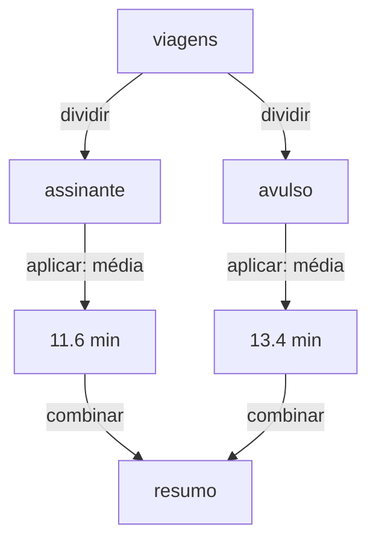

## **Etapa 1:** Manipulação Básica de Dados

---
layout: section
---

## Instalação e configuração de **ambiente**

<!--

verificar como está o WSL na máquina windows - TODOS DEVEM USAR WSL

-->

---
layout: two-cols-header
layoutClass: gap-8
class: flex items-center justify-center
sourceLabel: WSL
source: https://learn.microsoft.com/windows/wsl/
---

# Windows Subsystem for Linux (WSL)

#### **Linux e mac oferecem ambientes de desenvolvimento rápidos e o WSL também**

::left::

<div class="text-left w-full [&_li]:mb-5">

- **Experência semelhante com linux/mac** — WSL usa shell bash para linha de comando.
- **Ambiente rápido e leve** — Sistema de arquivo baseado em linux rápido e leve.
- **Integração com o Windows** — arquivos, terminal e o editor (VS Code/Antigravity) acessam o WSL.

</div>

::right::

<div class="h-full flex items-center justify-center">
    <AssetImg src="wsl.jpg" class="w-full max-w-[440px] rounded-lg" />
</div>

<!--
# comandos WSL
wsl --version
wsl --update
wsl --status
wsl --install -d Ubuntu
wsl
wsl -l --running
wsl --help

# comando WSL para distro por aluno
# export
wsl --export ubuntu C:\LabWSL\ubuntu-base.tar

# import aluno1
wsl --import ubuntu-<nome-aluno> C:\LabWSL C:\LabWSL\ubuntu-base.tar
wsl -d <nome-aluno> -u root -e bash -c "useradd -m -G sudo -s /bin/bash <nome-aluno> && echo '<nome-aluno>:senha123' | chpasswd && echo -e '[user]\ndefault=<nome-aluno>' > /etc/wsl.conf"

# import aluno2
wsl --import ubuntu-<nome-aluno> C:\LabWSL C:\LabWSL\ubuntu-base.tar
wsl -d <nome-aluno> -u root -e bash -c "useradd -m -G sudo -s /bin/bash <nome-aluno> && echo '<nome-aluno>:123456' | chpasswd && echo -e '[user]\ndefault=<nome-aluno>' > /etc/wsl.conf"
-->

---
layout: two-cols-header
layoutClass: gap-8
class: flex items-center justify-center
---

# Antigravity IDE

#### **IDE da Google para desenvolvimento de software com agente de codificação**

::left::

<div class="text-left w-full">

Download e documentação em:
- [antigravity.google/download](https://antigravity.google/download#antigravity-ide)
- [antigravity.google/docs/ide/overview](https://antigravity.google/docs/ide/overview)

<br/>

<v-click at="+1">

> [!TIP]
> A Google decidiu dividir o produto Antigravity em dois: Antigravity 2.0 e Antigravity IDE. 

</v-click>

</div>

::right::

<Transform :scale="0.9" origin="center">
    <AssetImg
    src="ide-google-antigravity.png"
    class="rounded-lg"
    />
</Transform>

<!-- 

# criar pasta pelo antigravity e usar o terminal para instalar uv, init, python, etc

# verifique se o aluno tem acesso ao plano Pro gratuito para estudantes

- checar se todos tem o Antigravity instalado
- mostrar rapidamente o chatbot agentico
 -->

---
sourceLabel: Downloads
source: https://www.python.org/downloads/
---

# Versões do Python

#### **Use sempre versões estáveis (fase de bugfix)**


<Transform :scale="0.7" origin="center">
    <AssetImg
    src="release-cycle.svg"
    class="rounded-lg border-10 border-white"
    />
</Transform>


<!-- 
Python tem um ciclo de cinco fases com versão estável (bugfixes) a cada dois meses 

**Cinco fases**: 
- feature, 
- prerelease, 
- bugfix, 
- security, 
- end-of-life
-->

---
layout: default
sourceLabel: Install UV
source: https://docs.astral.sh/uv/getting-started/installation
---

# Instalação Python e UV

<br/>


#### **Instalação UV: uma opção rápida e simplificada para gerenciar projetos python**
<br/>


::code-group

```sh [macOS/linux]
curl -LsSf https://astral.sh/uv/install.sh | sh
```

::

<br/><br/>

#### **Instalação do Python em múltiplas plataformas**

<br/>

::code-group

```sh [cross plataform]
uv python install 3.14
```

```sh [macOS]
brew install python@3.14
```

::


---
layout: default
sourceLabel: Install UV
source: https://docs.astral.sh/uv/getting-started/installation
footer: true
---

# Gerenciador de projetos UV

#### **uv é um gerenciador de projetos ultrarrápido escrito em Rust pela Astral (OpenAI)**

<br/>

| | |  |
| --- | --- | --- |
| instalação python | `instalador oficial` | ```uv python install``` |
| versão python | `python --version` | ```uv run python --version``` |
| criar ambiente/projeto | `python -m venv .venv` | `uv init <projeto>` |
| ativar ambiente virtual | `.venv/Scripts/activate` | ``-`` *(automático)* |
| instalar pacote | `pip install <pacote>` | ```uv add <pacote>``` |
| executar script | `python script.py` | ```uv run script.py``` |


<!--
instalação:
https://docs.astral.sh/uv/getting-started/installation/

wsl: curl -LsSf https://astral.sh/uv/install.sh | sh

powershell: <br/>
```powershell -ExecutionPolicy ByPass -c "irm https://astral.sh/uv/install.ps1 | iex"```

-->


---
layout: default
sourceLabel: Install UV
source: https://docs.astral.sh/uv/getting-started/installation
footer: true
---

# Mais sobre o gerenciador UV

#### **Mais rápido e mais simples**

<br/>

| | |  |
| --- | --- | --- |
| criar projeto | `-` *não tem* | ```uv init <projeto>``` |
| congelar pacotes | `pip freeze > requirements.txt` | `automático` *arquivo uv.lock* |
| arquivo do projeto | `requirements.txt` | ```pyproject.toml``` |
| recriar ambiente | `pip install -r requirements.txt` | `uv sync` |


<!-- 
usando forma tradicional para recriar ambiente:
pip install -r requirements.txt (só instala)

Usando UV para recriar ambiente respeitando o lock:
uv sync (instala, desinstala e atualiza) 
-->


---
layout: two-cols-header
layoutClass: gap-8
sourceLabel: Install UV
source: https://docs.astral.sh/uv/getting-started/installation
---

# Configuração do projeto Python

#### **Meu primeiro projeto de análise de dados**

<br/>

::left::

::code-group

```sh [uv]
mkdir my-first-eda
cd my-first-eda

uv python install 3.14
uv init --python 3.14
uv add pandas matplotlib seaborn scipy openpyxl ipykernel

# abra um notebook .ipynb e selecione o kernel da .venv
```

```sh [pip]
mkdir my-first-eda
cd my-first-eda

python -m venv .venv
source .venv/bin/activate

pip install pandas matplotlib seaborn scipy openpyxl ipykernel
pip freeze > requirements.txt

# abra um notebook .ipynb e selecione o kernel da .venv
```
::

::right::

> [!NOTE]
> O pacote **`ipykernel`** permite **executar notebooks Jupyter** (`.ipynb`) no editor usando o ambiente virtual (`.venv`) do projeto. O **`openpyxl`** permite ao pandas **ler e gravar planilhas Excel** (`.xlsx`).


<!-- 
o comando abaixo substitui tres linhas de comandos:
```shell
uv init my-first-eda --python 3.14
```
```shell
mkdir my-first-eda
uv python install 3.14
uv init --python 3.14
```
-->

---
layout: two-cols-header
layoutClass: gap-8
sourceLabel: Jupyter notebooks
source: https://antigravity.google/docs/jupyter-notebooks/
---

# Notebooks Jupyter no editor

#### **O notebook reúne código, resultado e texto: é o formato de entrega dos TPs**

::left::

<div class="text-left w-full [&_li]:mb-4">

- **Crie** o arquivo `etapa1.ipynb` na pasta do projeto.
- **Kernel** — selecione o Python do ambiente do projeto (`.venv`); o `ipykernel` é o que o torna disponível.
- **Células** — de código, que executam Python, e de markdown, que explicam a análise.
- **Agente** — cite o notebook com `@etapa1.ipynb` no painel do agente para pedir células novas ou ajuda com erros.

</div>

::right::

<div class="text-sm leading-tight [&_td]:py-2 [&_th]:py-1">

| atalho | ação |
| --- | --- |
| `Shift+Enter` | executa a célula e avança |
| `Esc` `M` | vira célula de markdown |
| `Esc` `Y` | vira célula de código |
| `Esc` `A` / `B` | nova célula acima / abaixo |

</div>

<!--
- o Antigravity abre .ipynb no editor de notebook: dá para escolher kernel local ou remoto e rodar uma célula ou o notebook inteiro.
- se o kernel da .venv não aparecer, confira se o ipykernel foi instalado (uv add ipykernel) e recarregue a janela.
- os TPs pedem células de markdown separando cada etapa: mostre uma célula de markdown com o título "## 1. Carga dos dados".
-->

---
layout: section
---

## Primeiros passos com **pandas**
**Carregar, inspecionar, converter tipos e agregar dados**

---
layout: two-cols-header
layoutClass: gap-8
sourceLabel: Estruturas de dados
source: https://pandas.pydata.org/docs/user_guide/dsintro.html
---

# Series e DataFrame

#### **O DataFrame é uma tabela; cada coluna é uma Series com um único tipo**

::left::

```python [etapa1.ipynb]
import pandas as pd

viagens = pd.DataFrame({
    "viagem_id": ["V001", "V002", "V003"],
    "tipo_usuario": ["avulso", "assinante", "assinante"],
    "distancia_km": [2.32, 3.49, 0.32],
})

viagens["distancia_km"]   # uma Series
```

::right::

<div class="text-left w-full [&_li]:mb-3">

- **DataFrame** — tabela; aqui, criada de um dicionário de listas.
- **Series** — uma coluna: valores de um mesmo tipo e um índice.
- **Índice** — o rótulo de cada linha: `0`, `1`, `2`…
- **`pd`** — apelido padrão do pandas.

</div>

<!--
- revisão de Python embutida: dicionário (chave -> lista), lista e import com apelido.
- mostre a tabela (viagens) e a Series (viagens["distancia_km"]), com o índice à esquerda.
- a base de viagens de bicicletas compartilhadas é o fio condutor das etapas 1 e 2 (live coding).
-->

---
layout: two-cols-header
layoutClass: gap-8
sourceLabel: Pandas for Everyone, cap. 1
source: https://github.com/chendaniely/pandas_for_everyone
---

# Função, método e atributo

#### **Três jeitos de usar um DataFrame, e a diferença está nos parênteses**

::left::

```python {1|2|3}{at:+1}
len(viagens)       # função: recebe o objeto
viagens.head()     # método: ação do objeto, com ()
viagens.shape      # atributo: dado do objeto, sem ()
```

<div class="h-4" />

> [!CAUTION]
> `viagens.shape()` dá erro: `shape` é atributo, não método.

::right::

<div class="text-left w-full [&_li]:mb-4">

- **Função** — existe fora do objeto e o recebe como argumento: `len(viagens)`.
- **Método** — função que pertence ao objeto, chamada com ponto e parênteses: `viagens.head()`.
- **Atributo** — informação guardada no objeto, acessada com ponto e sem parênteses: `viagens.shape`.

</div>

<!--
- o Pandas for Everyone dá atenção explícita a essa diferença: é a confusão mais comum de quem chega do Python básico sem orientação a objetos.
- o erro do slide: TypeError: 'tuple' object is not callable.
-->

---
layout: two-cols-header
layoutClass: gap-8
sourceLabel: read_csv
source: https://pandas.pydata.org/docs/reference/api/pandas.read_csv.html
---

# Carregando dados com read_csv

#### **Uma linha de código transforma um arquivo CSV em DataFrame**

::left::

```python [etapa1.ipynb]
import pandas as pd

viagens = pd.read_csv("viagens.csv")
viagens.head()
```

```text
  viagem_id data_inicio  ...  duracao_min  avaliacao
0    V00001  2026-01-01  ...         11,6        NaN
1    V00002  2026-01-01  ...         16,1        5.0
2    V00003  2026-01-01  ...          1,0        5.0
```

::right::

<div class="text-left w-full [&_li]:mb-3">

- **`read_csv`** — lê o arquivo e infere o tipo de cada coluna.
- **`head()`** — mostra as 5 primeiras linhas; `tail()`, as últimas.
- **`NaN`** — marca um valor ausente.

</div>

> [!TIP]
> CSV salvo pelo Excel em português costuma pedir `sep=";"` e `decimal=","` no `read_csv`.

<!--
- repare em duracao_min com vírgula ("11,6"): o pandas leu como texto. Isso volta no slide de tipos.
- o viagens.csv é gerado no live coding (gerar_dados.py).
-->

---
layout: two-cols-header
layoutClass: gap-8
sourceLabel: Funcionalidades básicas
source: https://pandas.pydata.org/docs/user_guide/basics.html
---

# Primeira inspeção: shape, dtypes e info()

#### **Antes de qualquer análise: quantas linhas, quais colunas e de que tipo**

::left::

```python [etapa1.ipynb]
viagens.shape    # (2396, 8)
viagens.info()
```

```text {*}{maxHeight:'250px'}
 #  Column           Non-Null Count  Dtype
--- ------           --------------  -----
 0  viagem_id        2396 non-null   str
 1  data_inicio      2396 non-null   str
 2  estacao_origem   2396 non-null   str
 3  estacao_destino  2396 non-null   str
 4  tipo_usuario     2396 non-null   str
 5  distancia_km     2396 non-null   float64
 6  duracao_min      2280 non-null   str
 7  avaliacao        2030 non-null   float64
memory usage: 149.9 KB
```

::right::

<div class="text-left w-full [&_li]:mb-4">

- **`shape`** — atributo com (linhas, colunas).
- **`dtypes`** — o tipo que o pandas inferiu para cada coluna.
- **`info()`** — tipos, contagem de não nulos e memória num só lugar.

</div>

> [!NOTE]
> Três alertas: `data_inicio` e `duracao_min` foram lidas como texto (`str`), e há colunas com menos valores que linhas (ausentes).

<!--
- duracao_min: 2280 de 2396 preenchidos; avaliacao: 2030 de 2396 (quem não avaliou). Os ausentes são tratados na etapa 2.
- dtypes mostra só a coluna Dtype do info(): viagens.dtypes.
-->

---
layout: two-cols-header
layoutClass: gap-8
sourceLabel: Tipos de dados (dtypes)
source: https://pandas.pydata.org/docs/user_guide/basics.html#dtypes
---

# Tipos de dados no pandas

#### **O tipo certo é pré-condição para cálculos, filtros e agrupamentos corretos**

::left::

<div class="text-sm leading-tight [&_td]:py-2 [&_th]:py-1">

| dtype | uso | exemplo |
| --- | --- | --- |
| `int64` | contagens | `12` |
| `float64` | medidas | `11.6`, `NaN` |
| `bool` | condições | `True` |
| `datetime64[ns]` | datas | `2026-01-01` |
| `category` | poucos valores | `"avulso"` |
| `str` | texto e códigos | `"V00001"` |

</div>

::right::

> [!NOTE]
> No **pandas 3**, colunas de texto aparecem como `str`. Em versões anteriores, aparecem como `object`. Os dois indicam texto.

<br/>

- Número guardado como texto não permite calcular média nem soma.
- Data guardada como texto não permite calcular intervalos nem extrair o mês.

<!--
- int64 não aceita NaN: uma coluna de inteiros com ausentes vira float64 (é o caso de avaliacao).
- object ainda aparece em material antigo e no pandas das demos no navegador (Pyodide), que é 2.x.
-->

---
layout: two-cols-header
layoutClass: gap-8
sourceLabel: astype
source: https://pandas.pydata.org/docs/reference/api/pandas.DataFrame.astype.html
---

# Convertendo tipos com astype

#### **Cada coluna recebe o tipo que a análise exige, e a conversão é conferida com dtypes**

::left::

```python [etapa1.ipynb] {1-4|5-7|8-10|12}{at:+1}
# texto com vírgula -> float (troque a vírgula antes)
viagens["duracao_min"] = (viagens["duracao_min"]
                          .str.replace(",", ".")
                          .astype(float))
# texto -> data
viagens["data_inicio"] = (viagens["data_inicio"]
                          .astype("datetime64[ns]"))
# texto repetitivo -> categoria
viagens["tipo_usuario"] = (viagens["tipo_usuario"]
                           .astype("category"))

viagens.dtypes   # confira!
```

::right::

<div class="text-left w-full [&_li]:mb-4">

- **`str.replace`** — troca `","` por `"."` em cada texto da coluna.
- **`astype(float)`** — converte o texto em número; os ausentes continuam `NaN`.
- **`"datetime64[ns]"`** — data de verdade: filtra por período e extrai o mês.
- **`"category"`** — guarda cada valor distinto uma vez só: `tipo_usuario` cai de 137 KB para 3 KB.

</div>

<!--
- o erro mais comum: astype(float) direto em "11,6" -> ValueError: could not convert string to float: '11,6' (próximo slide).
- pd.to_datetime() é a alternativa mais usada para datas; aqui seguimos o astype da subcompetência.
- armadilha silenciosa: pd.to_numeric(errors="coerce") sem trocar a vírgula transforma TODOS os valores em NaN, sem erro.
- memória medida com viagens["tipo_usuario"].memory_usage(deep=True).
-->

---
layout: two-cols-header
layoutClass: gap-8
sourceLabel: astype
source: https://pandas.pydata.org/docs/reference/api/pandas.DataFrame.astype.html
---

# Demo: texto com vírgula

#### **O astype não adivinha o separador decimal: ele falha, a menos que você trate antes**

::left::

```python {monaco-run} {autorun: false, height: 'auto'}
import pandas as pd

duracao = pd.Series(["11,6", "16,1", None])

# 1ª tentativa: astype direto
try:
    print(duracao.astype(float))
except ValueError as erro:
    print("ValueError:", erro)

# 2ª tentativa: troca a vírgula antes
print(duracao.str.replace(",", ".").astype(float))
```

::right::

<div class="text-left w-full [&_li]:mb-4">

- **1ª tentativa** — o Python não reconhece `"11,6"` como número, e o `astype` falha com `ValueError`.
- **2ª tentativa** — com a vírgula trocada por ponto, a conversão funciona.
- **O ausente** — `None` vira `NaN` e a coluna fica `float64`.

</div>

<!--
- a 1ª execução baixa o pandas para o navegador (Pyodide) e leva alguns segundos.
- peça para a turma prever o resultado antes de executar.
- um bloco executável por slide: o addon de Python joga a saída de dois blocos no mesmo painel.
-->

---
layout: two-cols-header
layoutClass: gap-8
sourceLabel: Entrada e saída (IO)
source: https://pandas.pydata.org/docs/user_guide/io.html
---

# Múltiplas fontes: CSV, Excel e JSON

#### **A família read_* entrega sempre o mesmo resultado: um DataFrame**

::left::

```python [etapa1.ipynb]
viagens = pd.read_csv("viagens.csv")
estacoes = pd.read_excel("estacoes.xlsx")
clima = pd.read_json("clima.json")

for nome, df in [("viagens", viagens),
                 ("estacoes", estacoes),
                 ("clima", clima)]:
    print(nome, df.shape)
```

```text
viagens (2396, 8)
estacoes (12, 4)
clima (120, 3)
```

::right::

<div class="text-left w-full [&_li]:mb-4">

- **`read_excel`** — lê planilhas `.xlsx`; depende do pacote `openpyxl`.
- **`sheet_name`** — escolhe a aba; sem ele, só a primeira aba é lida (`sheet_name=None` lê todas).
- **`read_json`** — uma lista de registros vira uma linha por registro.

</div>

> [!TIP]
> Fontes diferentes, mesmo tratamento: depois do `read_*`, tudo é DataFrame.

<!--
- o for com tuplas é revisão de Python: lista de tuplas e desempacotamento.
- sheet_name=None devolve um dicionário {nome_da_aba: DataFrame}.
- clima["data"] chega como texto: o read_json só converte sozinho colunas com nomes como "date" e "modified", ou terminados em "_at" e "_time".
-->

---
layout: two-cols-header
layoutClass: gap-8
sourceLabel: Group by
source: https://pandas.pydata.org/docs/user_guide/groupby.html
---

# Agregação por categoria com groupby

#### **Dividir em grupos, aplicar um cálculo a cada grupo e combinar os resultados**

::left::

```python [etapa1.ipynb]
resumo = (viagens
          .groupby("tipo_usuario")
          .agg(duracao_media=("duracao_min", "mean"),
               total_viagens=("viagem_id", "count"))
          .sort_values("total_viagens", ascending=False))
resumo.round(1)
```

```text
              duracao_media  total_viagens
tipo_usuario
assinante              11.6           1688
avulso                 13.4            708
```

::right::



<!--
- forma curta, para um cálculo só: viagens.groupby("tipo_usuario")["duracao_min"].mean().
- agg com nome=(coluna, função) dá nome às colunas do resultado.
- mean ignora NaN; count conta só os não nulos -> por isso contamos viagem_id, que está sempre preenchida.
- os números ainda incluem duplicatas e ausentes: a limpeza vem na etapa 2.
-->

---
layout: section
---

## Codificação assistida por IA
**Usando o agente de codificação do Antigravity**

---
layout: two-cols-header
layoutClass: gap-8
class: flex items-center justify-center
sourceLabel: Mentions
source: https://antigravity.google/docs/at-mentions
---

# Codificação assistida por IA - parte 1

#### **Usando o símbolo @ (mention) para adicionar contexto ao prompt**

::left::

> [!TIP]
> O símbolo `@` no painel do agente adiciona contexto ao prompt: arquivos, pastas, notebooks, comandos do terminal e conversas anteriores.

::right::

<WindowMockup color="dark" padding="0.5rem 0.5rem 0.5rem 0.5rem" title="prompt" codeblock>

```md
Leia o arquivo `@viagens.csv` e crie, no notebook
`@etapa1.ipynb`, uma célula que mostre o shape
e os dtypes do DataFrame.
```
</WindowMockup>

---
layout: two-cols-header
layoutClass: gap-8
---

# Codificação assistida por IA - parte 2
#### **Codificação clássica e assistida por IA em coexistência**

::left::

<div class="w-full flex flex-col gap-1">

Duas formas de programar:

- **Editor de código** — serve para a validação humana _(human-in-the-loop)_ do que o agente gerou e para ajustes pontuais.
- **Agente** — a linguagem natural como forma de programar é o novo normal.

</div>

> [!CAUTION]
> Para validar o código gerado, é preciso entender os conceitos antes: o agente acelera, mas não substitui o entendimento.

::right::

<div class="flex items-center justify-center gap-6 h-full">
  <div class="i-ri-code-s-slash-line text-[7rem] text-purple-300" />
  <div class="i-ri-links-line text-[3rem] text-gray-400" />
  <div class="i-ri-robot-2-line text-[7rem] text-purple-300" />
</div>

---
layout: section
---

## Live Coding

🚲 &nbsp;**Dataset:** viagens de bicicletas compartilhadas em três fontes: CSV, Excel e JSON

📊 &nbsp;**Análise:** inspeção, correção de tipos e duração média por tipo de usuário

<!--
Fio condutor das etapas 1 e 2. Na etapa 2 o mesmo gerar_dados.py ganha o export de abril.
Projeto: uv add pandas numpy openpyxl ipykernel

=================================================================
ARQUIVO 1 — gerar_dados.py (rodar uma vez: uv run gerar_dados.py)

```python
import json

import numpy as np
import pandas as pd

rng = np.random.default_rng(42)

# estacoes.xlsx: 12 estações, uma por bairro
bairros = ["Centro", "Lapa", "Glória", "Flamengo", "Botafogo", "Urca",
           "Copacabana", "Ipanema", "Leblon", "Gávea", "Tijuca", "Maracanã"]
estacoes = pd.DataFrame({
    "estacao_id": [f"E{i:02d}" for i in range(1, 13)],
    "nome": [f"Estação {b}" for b in bairros],
    "bairro": bairros,
    "capacidade": rng.integers(10, 31, 12),
})
estacoes.to_excel("estacoes.xlsx", index=False)

# clima.json: um registro por dia, de janeiro a abril de 2026
dias = pd.date_range("2026-01-01", "2026-04-30", freq="D")
chuva = np.where(rng.random(len(dias)) < 0.35, rng.gamma(2.0, 6.0, len(dias)), 0.0)
temp_max = 32 - 3 * np.arange(len(dias)) / len(dias) + rng.normal(0, 1.8, len(dias))
clima = [{"data": d.strftime("%Y-%m-%d"), "chuva_mm": round(float(c), 1),
          "temp_max": round(float(t), 1)} for d, c, t in zip(dias, chuva, temp_max)]
with open("clima.json", "w", encoding="utf-8") as f:
    json.dump(clima, f, ensure_ascii=False, indent=2)

chuva_do_dia = dict(zip(dias, chuva))


def gerar_viagens(inicio, fim, primeiro_id):
    """Gera as viagens entre duas datas, com menos viagens nos dias de chuva."""
    linhas = []
    for dia in pd.date_range(inicio, fim, freq="D"):
        choveu = chuva_do_dia[dia] > 5
        media = (32 if dia.day_of_week < 5 else 22) * (0.55 if choveu else 1)
        for _ in range(rng.poisson(media)):
            assinante = rng.random() < 0.7
            distancia = float(np.clip(rng.gamma(2.0, 1.3), 0.3, 12))
            velocidade = float(np.clip(rng.normal(14 if assinante else 12, 2), 6, 22))
            duracao = max(1.0, distancia / velocidade * 60 * (1.1 if choveu else 1)
                          + rng.normal(0, 1))
            nota = np.clip(round(5 - (duracao > 25) - 0.5 * choveu + rng.normal(0, 0.7)), 1, 5)
            linhas.append({
                "data_inicio": dia.strftime("%Y-%m-%d"),
                "estacao_origem": f"E{rng.integers(1, 13):02d}",
                "estacao_destino": f"E{rng.integers(1, 13):02d}",
                "tipo_usuario": "assinante" if assinante else "avulso",
                "distancia_km": round(distancia, 2),
                "duracao_min": round(duracao, 1),
                "avaliacao": float(nota),
            })
    df = pd.DataFrame(linhas)
    df.insert(0, "viagem_id", [f"V{i:05d}" for i in range(primeiro_id, primeiro_id + len(df))])
    # imperfeições de um export real: ausentes e duração como texto com vírgula
    df.loc[rng.random(len(df)) < 0.05, "duracao_min"] = np.nan
    df.loc[rng.random(len(df)) < 0.15, "avaliacao"] = np.nan
    df["duracao_min"] = df["duracao_min"].map(
        lambda v: "" if pd.isna(v) else f"{v:.1f}".replace(".", ","))
    return df


# viagens.csv: janeiro a março, com 2% de linhas reenviadas pelo app no final
viagens = gerar_viagens("2026-01-01", "2026-03-31", 1)
reenviadas = viagens.sample(frac=0.02, random_state=42)
pd.concat([viagens, reenviadas], ignore_index=True).to_csv("viagens.csv", index=False)
```

=================================================================
ARQUIVO 2 — etapa1.ipynb (uma célula de markdown antes de cada célula de código)

```python
# 1. Carga
import pandas as pd

viagens = pd.read_csv("viagens.csv")
estacoes = pd.read_excel("estacoes.xlsx")
clima = pd.read_json("clima.json")

# 2. Inspeção
for nome, df in [("viagens", viagens), ("estacoes", estacoes), ("clima", clima)]:
    print(nome, df.shape)
viagens.info()

# 3. Tipos
viagens["duracao_min"] = viagens["duracao_min"].str.replace(",", ".").astype(float)
viagens["data_inicio"] = viagens["data_inicio"].astype("datetime64[ns]")
viagens["tipo_usuario"] = viagens["tipo_usuario"].astype("category")
viagens.dtypes

# 4. Resumo por tipo de usuário e por estação
(viagens.groupby("tipo_usuario")
        .agg(duracao_media=("duracao_min", "mean"), total_viagens=("viagem_id", "count"))
        .round(1))
viagens.groupby("estacao_origem")["viagem_id"].count().sort_values(ascending=False)
```

>>> Resultados esperados (seed 42): viagens (2396, 8), estacoes (12, 4), clima (120, 3);
>>> assinante 11.6 min / 1688 viagens; avulso 13.4 min / 708 viagens; E03 lidera com 218 viagens.
>>> Rode o astype(float) ANTES do str.replace para a turma ver o ValueError.
>>> Os totais ainda contam duplicatas e ausentes: é o gancho para a etapa 2.
-->

---
layout: default
layoutClass: gap-8
---

# Live coding: codificação assistida por IA

#### **Prompt para gerar a base de viagens e a primeira análise**

<div class="h-7" />

<WindowMockup color="dark" padding="0.5rem 0.5rem 0.5rem 0.5rem" title="prompt.md" codeblock>

```md {*}{maxHeight:'290px'}
# Papel
Você é um analista de dados especialista em Python e pandas.

# Tarefa
Gere uma base fictícia de viagens de bicicletas compartilhadas e, num
notebook, faça a carga, a inspeção, a correção de tipos e um resumo.

# Contexto
1. Em "gerar_dados.py", use numpy com seed 42 para gerar três arquivos:
   - "estacoes.xlsx": estacao_id, nome, bairro e capacidade (12 estações).
   - "clima.json": data, chuva_mm e temp_max, um registro por dia de
     jan a abr/2026.
   - "viagens.csv" (jan a mar/2026): viagem_id, data_inicio,
     estacao_origem, estacao_destino, tipo_usuario ("assinante" ou
     "avulso"), distancia_km, duracao_min e avaliacao (1 a 5), com menos
     viagens nos dias de chuva.
2. Simule um export real em "viagens.csv": duracao_min como texto com
   vírgula decimal ("11,6"), ~5% de duracao_min e ~15% de avaliacao
   vazias, e ~2% das linhas repetidas no final do arquivo.
3. Em "etapa1.ipynb", carregue os três arquivos com read_csv, read_excel
   e read_json, e inspecione cada um com shape, dtypes, info() e head().
4. Converta com astype: duracao_min para float (troque a vírgula por
   ponto antes), data_inicio para datetime64 e tipo_usuario para
   category; confirme com dtypes.
5. Com groupby, calcule a duração média e o total de viagens por
   tipo_usuario, e o total de viagens por estacao_origem (decrescente).
6. Antes de cada passo, crie uma célula de markdown explicando o passo.

# Saída e Verificação
- Gere gerar_dados.py e etapa1.ipynb.
- Instale com uv add as dependências que faltarem.
- Execute o notebook do início ao fim, sem erros.
```
</WindowMockup>

<!--
# 1 - para gerar código correto, é preciso entender os conceitos previamente (slides anteriores).

# 2 - para gerar código correto, é preciso validar a geração do código (human-in-the-loop):
confira os dtypes depois do astype e os totais do groupby.

# 3 - o agente pode gerar uma base diferente da do professor (outra lógica de sorteio):
compare a estrutura (colunas, tipos, defeitos), não os números.
-->

---
layout: default
---

# Hands-on

<br/>

🛠️ &nbsp;**Exercício \#1:** Carregue o `gapminder.tsv` do livro *Pandas for Everyone* e inspecione o DataFrame.

🛠️ &nbsp;**Exercício \#2:** Calcule com `groupby` a expectativa de vida média por continente e por ano.

🛠️ &nbsp;**Exercício \#3:** Peça ao agente uma base de outro domínio em CSV, Excel e JSON, com defeitos.

🛠️ &nbsp;**Exercício \#4:** Importe as três fontes, corrija os tipos com `astype` e confira com `dtypes`.

- [ ] criar o notebook `.ipynb` com o kernel da `.venv` do projeto
- [ ] instalar `pandas`, `numpy` e `openpyxl` com `uv add`
- [ ] carregar dados com `read_csv`, `read_excel` e `read_json`
- [ ] inspecionar com `shape`, `dtypes`, `info()` e `head()`
- [ ] converter tipos com `astype` e conferir com `dtypes`
- [ ] agregar por categoria com `groupby`

<br/>

<!--
# Exercício #1 — Gapminder
URL: https://raw.githubusercontent.com/chendaniely/pandas_for_everyone/master/data/gapminder.tsv
O arquivo é separado por tabulação: pd.read_csv(url, sep="\t"). Resultado: 1704 linhas x 6 colunas.

# Exercício #2 — groupby no Gapminder
df.groupby("continent")["lifeExp"].mean() -> Oceania 74.3, Europa 71.9, África 48.9.
df.groupby("year")["lifeExp"].mean() mostra a evolução no tempo.
Desafio: as duas chaves juntas -> df.groupby(["continent", "year"])["lifeExp"].mean().

# Exercício #3 — Base de outro domínio com o agente
Reaproveite o prompt do live coding trocando o domínio (academia, cafeteria, biblioteca, energia solar...).
Exija os mesmos defeitos: número com vírgula decimal, data como texto, ausentes e linhas repetidas.
Guarde os arquivos: eles voltam no hands-on da etapa 2.

# Exercício #4 — Tipos
Número com vírgula: str.replace + astype(float); data: astype("datetime64[ns]");
coluna categórica: astype("category"). Conferir tudo com dtypes.

## os exercícios 3 e 4 preparam o TP1 (Exercícios 1, 2, 3 e 9)
-->
