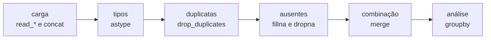

## **Etapa 2:** Avanços em Manipulação de Dados

---
layout: section
---

## Seleção e **filtros**
**loc, iloc, condições booleanas e query()**

---
layout: two-cols-header
layoutClass: gap-8
sourceLabel: Indexação e seleção
source: https://pandas.pydata.org/docs/user_guide/indexing.html
---

# Seleção com loc e iloc

#### **loc seleciona por rótulo; iloc seleciona por posição**

::left::

```python [etapa2.ipynb] {1-2|4-5|7-8}{at:+1}
# loc: rótulos das linhas e nomes das colunas
viagens.loc[0:4, ["viagem_id", "duracao_min"]]

# iloc: posições das linhas e das colunas
viagens.iloc[0:4, [0, 6]]

# todas as linhas, algumas colunas
viagens.loc[:, ["viagem_id", "tipo_usuario"]]
```

::right::

<div class="text-left w-full [&_li]:mb-4">

- **`loc[linhas, colunas]`** — usa os rótulos: o índice e os nomes das colunas.
- **`iloc[linhas, colunas]`** — usa as posições, como numa lista do Python.
- **`:`** — seleciona tudo naquele eixo.

</div>

> [!CAUTION]
> No `loc` a fatia **inclui** o fim; no `iloc`, **exclui**: `loc[0:4]` traz 5 linhas, e `iloc[0:4]`, 4.

<!--
- confira com len(viagens.loc[0:4]) e len(viagens.iloc[0:4]).
- com o índice padrão (0, 1, 2...), rótulo e posição coincidem: é por isso que a confusão passa despercebida.
-->

---
layout: two-cols-header
layoutClass: gap-8
sourceLabel: Indexação e seleção
source: https://pandas.pydata.org/docs/user_guide/indexing.html
---

# Índice com rótulos

#### **Quando o índice tem significado, o loc fica natural**

::left::

```python [etapa2.ipynb]
por_id = viagens.set_index("viagem_id")

por_id.loc["V00010":"V00012",
           ["tipo_usuario", "duracao_min"]]
```

```text
          tipo_usuario  duracao_min
viagem_id
V00010       assinante         10.3
V00011       assinante         11.4
V00012       assinante          4.1
```

::right::

<div class="text-left w-full [&_li]:mb-4">

- **`set_index`** — transforma uma coluna no índice das linhas.
- **`loc`** — passa a aceitar o próprio identificador: `por_id.loc["V00010"]`.
- **`reset_index`** — devolve o índice para uma coluna comum.

</div>

<!--
- com o índice por viagem_id, a diferença entre rótulo (loc) e posição (iloc) fica evidente.
- set_index devolve um DataFrame novo: viagens continua com o índice 0, 1, 2...
-->

---
layout: two-cols-header
layoutClass: gap-8
sourceLabel: Indexação e seleção
source: https://pandas.pydata.org/docs/user_guide/indexing.html
---

# Demo: loc x iloc

#### **Com um índice de rótulos, a diferença entre os dois aparece na hora**

::left::

```python {monaco-run} {autorun: false, height: 'auto'}
import pandas as pd

viagens = pd.DataFrame(
    {"duracao_min": [11.6, 16.1, 1.0, 4.7, 1.9]},
    index=["V01", "V02", "V03", "V04", "V05"],
)
print(viagens.loc["V02":"V04"], "\n")
print(viagens.iloc[1:3])
```

::right::

<div class="text-left w-full [&_li]:mb-4">

- **`loc["V02":"V04"]`** — rótulos: traz V02, V03 e V04, porque **inclui** o fim.
- **`iloc[1:3]`** — posições: traz V02 e V03, porque **exclui** o fim, como no Python.
- **Antes de executar** — quantas linhas cada um devolve?

</div>

<!--
- peça para a turma prever a saída antes de executar.
- um bloco executável por slide: o addon de Python joga a saída de dois blocos no mesmo painel.
-->

---
layout: two-cols-header
layoutClass: gap-8
sourceLabel: Indexação booleana
source: https://pandas.pydata.org/docs/user_guide/indexing.html#boolean-indexing
---

# Filtros com condições booleanas

#### **Uma condição gera uma Series de True e False que escolhe as linhas**

::left::

```python [etapa2.ipynb] {1-2|4|6-8}{at:+1}
assinante = viagens["tipo_usuario"] == "assinante"
longa = viagens["duracao_min"] > 30

viagens[assinante & longa]   # 88 viagens

centro_ou_lapa = (viagens["estacao_origem"]
                  .isin(["E01", "E02"]))
viagens[centro_ou_lapa | longa]
```

::right::

<div class="text-left w-full [&_li]:mb-4">

- **`&`** (e), **`|`** (ou) e **`~`** (não) combinam condições.
- **`isin`** — testa se o valor está numa lista.
- **Máscara** — dar nome à condição deixa o filtro legível.

</div>

> [!CAUTION]
> Sem variáveis, cada condição vai entre parênteses: `viagens[(cond1) & (cond2)]`. As palavras `and` e `or` não funcionam com Series.

<!--
- erro clássico: viagens[viagens["a"] > 1 & viagens["b"] < 2] -> o & tem precedência maior que o > e o filtro quebra.
- and/or numa Series -> ValueError: The truth value of a Series is ambiguous.
- ~ inverte a máscara: viagens[~assinante] são as viagens avulsas.
-->

---
layout: two-cols-header
layoutClass: gap-8
sourceLabel: query
source: https://pandas.pydata.org/docs/reference/api/pandas.DataFrame.query.html
---

# Filtros com query()

#### **O mesmo filtro, escrito como uma frase**

::left::

```python [etapa2.ipynb]
viagens.query(
    'tipo_usuario == "assinante" and duracao_min > 30'
)                                    # 88 viagens

limite = 30
viagens.query("duracao_min > @limite")

viagens.query('estacao_origem in ["E01", "E02"]')
```

::right::

<div class="text-left w-full [&_li]:mb-4">

- **Legibilidade** — `and`, `or` e `not` funcionam dentro da consulta.
- **`@variavel`** — usa uma variável do Python na consulta.
- **Mesmo resultado** — `query()` e a máscara booleana devolvem as mesmas linhas.

</div>

<!--
- máscara com & -> 88 linhas; query -> 88 linhas, na base do live coding.
- query recebe uma string: um erro de digitação no nome da coluna só aparece na execução.
- coluna com espaço no nome vai entre crases dentro da consulta: df.query("`tempo total` > 30").
-->

---
layout: section
---

## Limpeza: **duplicatas** e **ausentes**
**duplicated, drop_duplicates, isna, fillna e dropna**

---
layout: two-cols-header
layoutClass: gap-8
sourceLabel: Duplicatas
source: https://pandas.pydata.org/docs/user_guide/duplicates.html
---

# Duplicatas: duplicated e drop_duplicates

#### **Registros repetidos inflam contagens e médias**

::left::

```python [etapa2.ipynb] {1-2|3|5-6}{at:+1}
# mesma viagem_id
viagens.duplicated(subset="viagem_id").sum()  # 82
viagens.duplicated().sum()  # 82: idênticas em tudo

viagens = viagens.drop_duplicates(subset="viagem_id",
                                  keep="first")
```

::right::

<div class="text-left w-full [&_li]:mb-4">

- **`duplicated`** — marca com `True` cada repetição de uma linha já vista.
- **`subset`** — define as colunas que identificam o registro.
- **`keep="first"`** — mantém a primeira ocorrência.

</div>

> [!TIP]
> Remova as duplicatas **antes** de preencher ausentes: na mediana, um registro repetido conta duas vezes.

<!--
- comparar duplicated(subset=...) com duplicated() confirma que são reenvios idênticos, e não viagens diferentes com o mesmo id.
- as 82 duplicatas são as linhas reenviadas pelo app e as viagens de 31/03 repetidas no export de abril.
-->

---
layout: two-cols-header
layoutClass: gap-8
sourceLabel: Dados ausentes
source: https://pandas.pydata.org/docs/user_guide/missing_data.html
---

# Valores ausentes: onde estão?

#### **Antes de tratar, meça: quantos ausentes e em quais colunas**

::left::

```python [etapa2.ipynb]
viagens.isna().sum()
```

```text
viagem_id         0
...
distancia_km      0
duracao_min     149
avaliacao       482
```

```python
viagens["avaliacao"].isna().mean()   # 0.155
```

::right::

<div class="text-left w-full [&_li]:mb-4">

- **`isna()`** — `True` onde falta valor; `sum()` conta os `True` de cada coluna.
- **`isna().mean()`** — a proporção de ausentes: 15,5% das viagens não foram avaliadas.
- **`NaN` nos cálculos** — `mean()` e `count()` ignoram os ausentes.

</div>

> [!NOTE]
> Pergunte **por que** o valor falta: falha técnica (duração não registrada) é diferente de dado que não existe (cliente que não avaliou).

<!--
- números da base do live coding, já sem duplicatas: duracao_min 149 ausentes (4,8%), avaliacao 482 (15,5%).
- isnull() é sinônimo de isna().
-->

---
layout: two-cols-header
layoutClass: gap-8
sourceLabel: Dados ausentes
source: https://pandas.pydata.org/docs/user_guide/missing_data.html
---

# Preencher ou remover: fillna e dropna

#### **A decisão depende do significado do valor ausente**

::left::

```python [etapa2.ipynb] {1-4|6-7}{at:+1}
# falha técnica: preencher com a mediana
mediana = viagens["duracao_min"].median()
viagens["duracao_min"] = (viagens["duracao_min"]
                          .fillna(mediana))

# opinião não dada: não inventar; separar
avaliadas = viagens.dropna(subset=["avaliacao"])
```

::right::

| estratégia | média da duração |
| --- | --- |
| ignorar os ausentes | 12,23 min |
| `fillna(mediana)` | 12,12 min |
| `fillna(0)` | **11,65 min** |

<div class="h-4" />

> [!CAUTION]
> `fillna(0)` inventa viagens de zero minuto e puxa a média para baixo. E `dropna()` sem `subset` remove a linha por qualquer coluna vazia.

<!--
- a mediana (9,95 min) resiste às viagens muito longas; a média é puxada por elas.
- avaliadas: 2637 de 3119 viagens. O DataFrame principal continua com todas as viagens.
-->

---
layout: section
---

## Combinação de **fontes**
**pd.concat e pd.merge**

---
layout: two-cols-header
layoutClass: gap-8
sourceLabel: concat
source: https://pandas.pydata.org/docs/reference/api/pandas.concat.html
---

# Empilhar com concat

#### **concat empilha tabelas com as mesmas colunas, como exports de meses diferentes**

::left::

```python [etapa2.ipynb]
jan_mar = pd.read_csv("viagens.csv")
abril = pd.read_csv("viagens_abril.csv")

viagens = pd.concat([jan_mar, abril],
                    ignore_index=True)

len(jan_mar), len(abril), len(viagens)
# (2396, 805, 3201)
```

::right::

<div class="text-sm leading-tight [&_td]:py-2 [&_th]:py-1">

| | `concat` | `merge` |
| --- | --- | --- |
| junta | linhas | colunas |
| exige | mesmas colunas | uma chave |
| exemplo | jan–mar + abril | viagens + estações |

</div>

<div class="h-4" />

> [!TIP]
> Depois de empilhar exports, procure duplicatas: períodos sobrepostos repetem registros.

<!--
- ignore_index=True renumera o índice de 0 até o fim; sem ele, os índices dos dois arquivos se repetem.
- o export de abril repete as viagens de 31/03: elas viram duplicatas depois do concat.
- concat com colunas diferentes não dá erro: preenche com NaN o que faltar. Confira as colunas antes.
-->

---
layout: two-cols-header
layoutClass: gap-8
sourceLabel: Merge, join e concat
source: https://pandas.pydata.org/docs/user_guide/merging.html
---

# Combinar por chave com merge

#### **merge junta as colunas de duas tabelas a partir de uma chave em comum**

::left::

```python [etapa2.ipynb] {1-3|4-5|7}{at:+1}
base = (viagens
        .merge(estacoes, left_on="estacao_origem",
               right_on="estacao_id", how="left")
        .merge(clima, left_on="data_inicio",
               right_on="data", how="left"))

base.shape   # (3119, 15): as mesmas linhas de viagens
```

::right::

<div class="text-left w-full [&_li]:mb-3">

- **`on`** — a chave com o mesmo nome nos dois lados.
- **`left_on` / `right_on`** — a chave com nomes diferentes.
- **`how`** — quais linhas sobrevivem (próximo slide).

</div>

> [!CAUTION]
> Chaves de tipos diferentes (`datetime64` × texto) dão `ValueError`: converta antes com `astype`.

<!--
- confira o número de linhas antes e depois: com how="left" e chave única na tabela da direita, o merge não cria linhas.
- se as linhas aumentarem, a chave da direita tem repetições (junção muitos-para-muitos).
-->

---
layout: two-cols-header
layoutClass: gap-8
sourceLabel: merge
source: https://pandas.pydata.org/docs/reference/api/pandas.DataFrame.merge.html
---

# Demo: tipos de junção (how)

#### **inner fica com o que existe nos dois lados; left preserva a tabela da esquerda**

::left::

```python {monaco-run} {autorun: false, height: 'auto'}
import pandas as pd

viagens = pd.DataFrame({"estacao": ["E01", "E02", "E09"],
                        "viagens": [12, 7, 3]})
estacoes = pd.DataFrame({"estacao": ["E01", "E02", "E03"],
                         "bairro": ["Centro", "Lapa", "Glória"]})

for how in ["inner", "left", "right", "outer"]:
    print(how, len(viagens.merge(estacoes, on="estacao", how=how)))
```

::right::

| `how` | mantém | linhas |
| --- | --- | --- |
| `inner` | chaves presentes nos dois lados | 2 |
| `left` | todas as linhas da esquerda | 3 |
| `right` | todas as linhas da direita | 3 |
| `outer` | todas, dos dois lados | 4 |

<!--
- E09 não tem estação cadastrada; E03 não teve viagens.
- no left, a E09 fica com bairro NaN: é assim que se descobre uma chave sem correspondência.
-->

---
layout: default
---

# A ordem do pipeline importa

#### **Cada passo prepara o seguinte: trocar a ordem distorce o resultado**

<div class="h-4" />



<div class="h-4" />

- **Tipos antes de tudo** — sem `float` não há mediana; sem `datetime64` não há merge por data.
- **Duplicatas antes dos ausentes** — a mediana do preenchimento não pode contar registros repetidos.
- **Combinação depois da limpeza** — chaves limpas evitam linhas perdidas ou multiplicadas no `merge`.

<!--
- é a mesma sequência do TP1: tipos (Ex. 3), duplicatas (Ex. 6), ausentes (Ex. 7), combinação (Ex. 8) e agregação (Ex. 9).
- seleção e filtros (loc, iloc, query) não são um passo do pipeline: são ferramentas usadas em todos eles.
-->

---
layout: section
---

## Live Coding

🚲 &nbsp;**Dataset:** a mesma base de viagens, agora com o export de abril (`viagens_abril.csv`)

🌧️ &nbsp;**Análise:** e quando chove? Volume, duração e avaliação das viagens com e sem chuva

<!--
Continua a base da etapa 1 (mesmo gerar_dados.py, seed 42).

=================================================================
ARQUIVO 1 — acrescentar ao final do gerar_dados.py (e rodar de novo)

```python
# viagens_abril.csv: o export de abril começa repetindo as viagens de 31/03
abril = gerar_viagens("2026-04-01", "2026-04-30", len(viagens) + 1)
repetidas = viagens[viagens["data_inicio"] == "2026-03-31"]
reenviadas = abril.sample(frac=0.02, random_state=7)
pd.concat([repetidas, abril, reenviadas], ignore_index=True).to_csv("viagens_abril.csv", index=False)
```

>>> Os três arquivos da etapa 1 saem idênticos: o sorteio de abril acontece depois.

=================================================================
ARQUIVO 2 — etapa2.ipynb (uma célula de markdown antes de cada célula de código)

```python
# 1. Carga e concat
import pandas as pd

jan_mar = pd.read_csv("viagens.csv")
abril = pd.read_csv("viagens_abril.csv")
viagens = pd.concat([jan_mar, abril], ignore_index=True)
estacoes = pd.read_excel("estacoes.xlsx")
clima = pd.read_json("clima.json")

# 2. Tipos (os mesmos da etapa 1, mais a data do clima)
viagens["duracao_min"] = viagens["duracao_min"].str.replace(",", ".").astype(float)
viagens["data_inicio"] = viagens["data_inicio"].astype("datetime64[ns]")
viagens["tipo_usuario"] = viagens["tipo_usuario"].astype("category")
clima["data"] = clima["data"].astype("datetime64[ns]")

# 3. Seleção
viagens.loc[0:4, ["viagem_id", "tipo_usuario", "duracao_min"]]
viagens.iloc[0:4, [0, 4, 6]]

# 4. Filtros
longas = viagens[(viagens["tipo_usuario"] == "assinante") & (viagens["duracao_min"] > 30)]
longas_q = viagens.query('tipo_usuario == "assinante" and duracao_min > 30')
len(longas), len(longas_q)

# 5. Duplicatas
viagens.duplicated(subset="viagem_id").sum(), viagens.duplicated().sum()
viagens = viagens.drop_duplicates(subset="viagem_id", keep="first")

# 6. Ausentes
viagens.isna().sum()
viagens["duracao_min"] = viagens["duracao_min"].fillna(viagens["duracao_min"].median())
avaliadas = viagens.dropna(subset=["avaliacao"])

# 7. Merge
base = (viagens
        .merge(estacoes, left_on="estacao_origem", right_on="estacao_id", how="left")
        .merge(clima, left_on="data_inicio", right_on="data", how="left"))
base.shape

# 8. Chuva x viagens
base["choveu"] = base["chuva_mm"] > 5
resumo = base.groupby("choveu").agg(total_viagens=("viagem_id", "count"),
                                    duracao_media=("duracao_min", "mean"),
                                    avaliacao_media=("avaliacao", "mean"))
resumo["viagens_por_dia"] = resumo["total_viagens"] / base.groupby("choveu")["data_inicio"].nunique()
resumo.round(2)
```

>>> Resultados esperados: concat 2396 + 805 = 3201; filtros 88 = 88; 82 duplicatas (idênticas);
>>> ausentes 149 (duracao_min) e 482 (avaliacao); base (3119, 15).
>>> Sem chuva: 29.6 viagens/dia, 11.8 min, nota 4.68. Com chuva: 16.9 viagens/dia, 13.4 min, nota 4.32.
>>> Tente o merge com o clima SEM converter clima["data"]: ValueError de tipos diferentes na chave.
-->

---
layout: default
layoutClass: gap-8
---

# Live coding: codificação assistida por IA

#### **Prompt para limpar, combinar e analisar a base de viagens**

<div class="h-7" />

<WindowMockup color="dark" padding="0.5rem 0.5rem 0.5rem 0.5rem" title="prompt.md" codeblock>

```md {*}{maxHeight:'290px'}
# Papel
Você é um analista de dados especialista em Python e pandas.

# Tarefa
Complete a base de viagens com o export de abril e, num notebook,
selecione, filtre, limpe e combine as fontes para comparar as viagens
em dias com e sem chuva.

# Contexto
1. Acrescente ao @gerar_dados.py a geração de "viagens_abril.csv", com
   as mesmas colunas e imperfeições de "viagens.csv"; o arquivo deve
   começar repetindo as viagens de 31/03 (export sobreposto).
2. Em "etapa2.ipynb", empilhe "viagens.csv" e "viagens_abril.csv" com
   pd.concat e corrija os tipos como no @etapa1.ipynb, incluindo a
   coluna data do clima.
3. Mostre seleções com loc e iloc (compare loc[0:4] e iloc[0:4]) e
   filtre os assinantes com viagens acima de 30 minutos, com máscara
   booleana e com query(), conferindo que o resultado é o mesmo.
4. Remova as duplicatas por viagem_id, conferindo se as linhas
   repetidas são idênticas em todas as colunas.
5. Preencha duracao_min ausente com a mediana; não preencha avaliacao:
   crie com dropna um DataFrame só com as viagens avaliadas.
6. Com merge (how="left"), junte as estações (estacao_origem =
   estacao_id) e o clima (data_inicio = data), confirmando que o número
   de linhas não muda.
7. Compare, com groupby, os dias com chuva (chuva_mm > 5) e sem chuva:
   total de viagens, viagens por dia, duração média e avaliação média.
8. Antes de cada passo, crie uma célula de markdown explicando o passo.

# Saída e Verificação
- Atualize gerar_dados.py e gere etapa2.ipynb.
- Execute os dois do início ao fim, sem erros.
```
</WindowMockup>

<!--
# 1 - o @ dá ao agente o contexto do que já existe: o gerador e o notebook da etapa 1.

# 2 - human-in-the-loop: confira o número de linhas depois do concat, do drop_duplicates e de cada merge.

# 3 - se o agente preencher avaliacao com a média ou com zero, é a deixa para discutir o slide "Preencher ou remover".
-->

---
layout: default
---

# Hands-on

<br/>

🛠️ &nbsp;**Exercício \#1:** No Gapminder, selecione com `loc` e `iloc`, e use `set_index("country")`.

🛠️ &nbsp;**Exercício \#2:** Filtre as Américas de 2007 com expectativa de vida > 75, com `&` e `query()`.

🛠️ &nbsp;**Exercício \#3:** Na sua base do hands-on da etapa 1, remova as duplicatas e trate os ausentes.

🛠️ &nbsp;**Exercício \#4:** Combine sua base com outra fonte (`merge`) e com outro export (`concat`).

- [ ] selecionar com `loc` (rótulo) e `iloc` (posição)
- [ ] filtrar com `&`, `|`, `~`, `isin` e `query()`
- [ ] contar duplicatas com `duplicated` e removê-las com `drop_duplicates`
- [ ] medir ausentes com `isna().sum()` e tratá-los com `fillna` ou `dropna`
- [ ] combinar com `concat` e `merge`, conferindo o número de linhas

<br/>

<!--
# Exercício #1 — Seleção no Gapminder
df.loc[:, ["country", "year", "lifeExp"]] e df.iloc[:10, :3].
Com por_pais = df.set_index("country"), por_pais.loc["Brazil", ["year", "lifeExp"]] devolve as 12 medições do Brasil.

# Exercício #2 — Filtros no Gapminder
df[(df["continent"] == "Americas") & (df["year"] == 2007) & (df["lifeExp"] > 75)]
df.query('continent == "Americas" and year == 2007 and lifeExp > 75')
As duas formas devolvem os mesmos 10 países (Argentina, Canadá, Chile, Costa Rica, Cuba, México, Panamá, Porto Rico, EUA e Uruguai).

# Exercício #3 — Limpeza da base própria
Remover as duplicatas antes de preencher os ausentes; escrever, em markdown, por que preencheu
(falha técnica) ou não preencheu (dado que não existe) cada coluna.

# Exercício #4 — Combinação
Peça ao agente uma segunda fonte com chave em comum (ex.: cadastro de clientes) e um segundo
export com as mesmas colunas (ex.: o mês seguinte). Conferir as linhas antes e depois de cada operação.

## os exercícios preparam o TP1 (Exercícios 4 a 8)
-->
