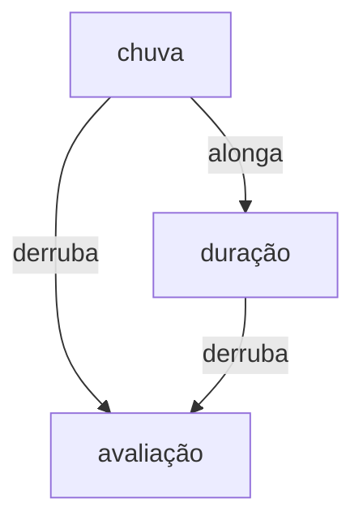

## **Etapa 4:** Análise de Relações Numéricas

---
layout: section
---

## Relações entre **variáveis**
**Scatter plots, covariância, correlação e heatmaps**

---
layout: two-cols-header
layoutClass: gap-8
sourceLabel: scatterplot
source: https://seaborn.pydata.org/generated/seaborn.scatterplot.html
---

# Scatter plot: uma variável contra a outra

#### **Cada ponto é uma viagem: a nuvem mostra a direção e a força da relação**

::left::

```python [etapa4.ipynb]
sns.scatterplot(data=base, x="distancia_km",
                y="duracao_min", hue="tipo_usuario",
                alpha=0.4)
```

<div class="text-left w-full [&_li]:mb-2">

- **Direção** — mais distância, mais duração: relação positiva.
- **`hue`** — a cor traz uma terceira variável: os avulsos ficam acima, porque pedalam mais devagar.
- **`alpha`** — a transparência mostra onde os pontos se acumulam.

</div>

::right::

<AssetImg src="eda-scatter-distancia-duracao.png" class="rounded-lg w-full" />

<!--
- base: a mesma base da etapa 3, carregada por carregar_base() do preparar_base.py.
- velocidade mediana: assinantes 13,6 km/h e avulsos 11,7 km/h (o live coding calcula).
-->

---
layout: default
---

# Padrões em scatter plots

#### **Olhe o gráfico antes de calcular: a correlação de Pearson só enxerga retas**

<div class="h-4" />

<AssetImg src="eda-padroes-scatter.png" class="rounded-lg w-full" />

<div class="h-4" />

- **Não linear** — a relação é forte, mas r ≈ 0: Pearson mede só a parte linear da relação.
- **Sem relação** — a nuvem não tem direção, e r também fica perto de zero.

<!--
- dados sintéticos, só para ilustrar os quatro padrões.
- o mesmo r ≈ 0 aparece em "não linear" e "sem relação": só o gráfico separa os dois casos.
-->

---
layout: two-cols-header
layoutClass: gap-8
sourceLabel: cov
source: https://pandas.pydata.org/docs/reference/api/pandas.DataFrame.cov.html
---

# Covariância

#### **O sinal mostra a direção; o valor depende das unidades**

::left::

$$
\operatorname{cov}(X, Y) = \frac{\sum (x_i - \bar{x})(y_i - \bar{y})}{n - 1}
$$

```python [etapa4.ipynb]
km = base["distancia_km"]
metros = km * 1000

km.cov(base["duracao_min"])       # 16.17
metros.cov(base["duracao_min"])   # 16173.2
```

::right::

<div class="text-left w-full [&_li]:mb-4">

- **Positiva** — as duas crescem juntas; **negativa** — uma cresce quando a outra cai.
- **Unidade** — km × min: trocar km por metros multiplica a covariância por 1.000.
- **Por isso** — o valor sozinho não diz se a relação é forte ou fraca.

</div>

<!--
- a relação é a mesma nos dois casos; só a unidade mudou.
- df.cov() devolve a matriz de covariância de todas as colunas numéricas escolhidas.
-->

---
layout: two-cols-header
layoutClass: gap-8
sourceLabel: corr
source: https://pandas.pydata.org/docs/reference/api/pandas.DataFrame.corr.html
---

# Correlação de Pearson

#### **A covariância padronizada: sem unidade e sempre entre −1 e 1**

::left::

$$
r = \frac{\operatorname{cov}(X, Y)}{s_X \, s_Y}
$$

```python [etapa4.ipynb]
km.corr(base["duracao_min"])       # 0.947
metros.corr(base["duracao_min"])   # 0.947
```

::right::

<div class="text-sm leading-tight [&_td]:py-2 [&_th]:py-1">

| r (em módulo) | leitura usual |
| --- | --- |
| abaixo de 0,3 | fraca |
| de 0,3 a 0,7 | moderada |
| acima de 0,7 | forte |

</div>

<div class="h-4" />

> [!NOTE]
> É uma régua de bolso, não uma lei: o que conta como forte depende do contexto.

<!--
- dividir pelos desvios padrão tira a unidade: por isso o r é o mesmo em km e em metros.
- o sinal de r é o mesmo da covariância.
-->

---
layout: two-cols-header
layoutClass: gap-8
sourceLabel: numpy.corrcoef
source: https://numpy.org/doc/stable/reference/generated/numpy.corrcoef.html
---

# Demo: a correlação só enxerga retas

#### **Uma relação perfeita pode ter correlação zero**

::left::

```python {monaco-run} {autorun: false, height: 'auto'}
import numpy as np

x = np.linspace(-3, 3, 201)
y = x ** 2              # y depende totalmente de x

r = np.corrcoef(x, y)[0, 1]
print("r =", round(r, 3) + 0.0)
```

::right::

<div class="text-left w-full [&_li]:mb-4">

- **`y = x²`** — conhecendo x, sabemos y exatamente.
- **E mesmo assim r ≈ 0** — a parábola não tem tendência linear.
- **Lição** — calcule a correlação e olhe o scatter plot.

</div>

<!--
- o "+ 0.0" só evita imprimir "-0.0" por causa de arredondamento.
- peça para a turma prever o valor de r antes de executar.
-->

---
layout: two-cols-header
layoutClass: gap-8
sourceLabel: heatmap
source: https://seaborn.pydata.org/generated/seaborn.heatmap.html
---

# Heatmap de correlação com seaborn

#### **Todos os pares numéricos de uma vez: a cor mostra a direção e a força**

::left::

```python [etapa4.ipynb]
cols = ["distancia_km", "duracao_min", "avaliacao",
        "chuva_mm", "temp_max", "capacidade"]
corr = base[cols].corr()

sns.heatmap(corr, annot=True, fmt=".2f",
            vmin=-1, vmax=1, cmap="coolwarm")
```

> [!CAUTION]
> `base.corr()` sem escolher as colunas dá `ValueError`: as colunas de texto não viram número.

::right::

<AssetImg src="eda-heatmap-correlacao.png" class="rounded-lg w-full" />

<!--
- vmin=-1 e vmax=1 fixam a escala: sem isso, a cor mais forte vira o maior valor da tabela.
- o par mais forte é distância × duração (0,95); avaliação se relaciona negativamente com duração (−0,29) e chuva (−0,18).
- o heatmap do slide esconde a diagonal (sempre 1) e a metade de cima, que repete a de baixo.
-->

---
layout: two-cols-header
layoutClass: gap-8
---

# Correlação não é causalidade

#### **Antes de concluir, procure uma terceira variável que explique as duas**

::left::



::right::

<div class="text-left w-full [&_li]:mb-4">

- **Duração × avaliação** — r = −0,29: viagens longas recebem notas menores.
- **Causa comum** — a chuva alonga a viagem e também derruba a nota (r = −0,18 com a avaliação).
- **Por subgrupo** — nos dias com e sem chuva, a correlação continua (−0,27 e −0,28): a duração também pesa sozinha.

</div>

<!--
- a pergunta certa: a relação continua quando a terceira variável fica fixa? Aqui, sim.
- correlação mostra associação; causa exige desenho de estudo ou conhecimento do mecanismo.
-->

---
layout: two-cols-header
layoutClass: gap-8
sourceLabel: Group by
source: https://pandas.pydata.org/docs/user_guide/groupby.html
---

# Correlação por subgrupo

#### **A correlação da base inteira pode esconder diferenças entre grupos**

::left::

```python [etapa4.ipynb]
base["distancia_km"].corr(base["duracao_min"])
# 0.947

for tipo, g in base.groupby("tipo_usuario"):
    print(tipo, g["distancia_km"].corr(g["duracao_min"]))
# assinante 0.956
# avulso    0.950
```

::right::

<div class="text-left w-full [&_li]:mb-4">

- **Aqui ela se mantém** — forte nos dois grupos e na base inteira.
- **Pode mudar** — dentro de cada grupo, a correlação pode ficar mais forte, mais fraca ou até trocar de sinal.
- **Paradoxo de Simpson** — o caso extremo, em que o sinal se inverte (próxima demo).

</div>

<!--
- o groupby da etapa 1 volta aqui: cada grupo vira um DataFrame g, e o corr roda dentro dele.
- grupos pequenos dão correlações instáveis: confira o tamanho de cada grupo.
-->

---
layout: two-cols-header
layoutClass: gap-8
---

# Demo: paradoxo de Simpson

#### **Positiva em cada grupo, negativa na base inteira**

::left::

```python {monaco-run} {autorun: false, height: 'auto'}
import numpy as np

rng = np.random.default_rng(1)
x1 = rng.uniform(0, 4, 100)
y1 = x1 + 6 + rng.normal(0, 0.5, 100)
x2 = rng.uniform(6, 10, 100)
y2 = x2 - 6 + rng.normal(0, 0.5, 100)

x, y = np.concatenate([x1, x2]), np.concatenate([y1, y2])
for nome, a, b in [("grupo 1", x1, y1), ("grupo 2", x2, y2),
                   ("juntos ", x, y)]:
    print(nome, round(np.corrcoef(a, b)[0, 1], 2))
```

::right::

<div class="text-left w-full [&_li]:mb-4">

- **Em cada grupo** — y cresce com x: correlação positiva.
- **Juntos** — o grupo de x maior tem y menor, e o sinal se inverte.
- **Lição** — confira a correlação dentro dos grupos antes de recomendar algo para a base inteira.

</div>

<!--
- dados sintéticos: dois grupos com a mesma inclinação positiva, em faixas opostas de x e y.
- peça para a turma prever o sinal de "juntos" antes de executar.
-->

---
layout: section
---

## Live Coding

🚲 &nbsp;**Dataset:** a base de viagens, carregada pelo `preparar_base.py` da etapa 3

🏁 &nbsp;**Análise:** o que explica a duração de uma viagem? Distância, tipo de usuário e chuva

<!--
=================================================================
ARQUIVO — etapa4.ipynb (uma célula de markdown antes de cada célula de código)

```python
# 1. Carga e velocidade média de cada viagem
import matplotlib.pyplot as plt
import seaborn as sns
from preparar_base import carregar_base

base = carregar_base()
base["velocidade_kmh"] = base["distancia_km"] / (base["duracao_min"] / 60)

# 2. Scatter plots
sns.scatterplot(data=base, x="distancia_km", y="duracao_min", hue="tipo_usuario", alpha=0.4)
plt.show()
sns.scatterplot(data=base, x="chuva_mm", y="velocidade_kmh", alpha=0.4)
plt.show()

# 3. Heatmap de correlação (só colunas numéricas)
cols = ["distancia_km", "duracao_min", "velocidade_kmh", "avaliacao", "chuva_mm", "temp_max"]
corr = base[cols].corr()
sns.heatmap(corr, annot=True, fmt=".2f", vmin=-1, vmax=1, cmap="coolwarm")

# 4. Covariância depende da unidade; correlação não
km, metros = base["distancia_km"], base["distancia_km"] * 1000
km.cov(base["duracao_min"]), metros.cov(base["duracao_min"])
km.corr(base["duracao_min"]), metros.corr(base["duracao_min"])

# 5. Correlação por subgrupo
{t: g["distancia_km"].corr(g["duracao_min"]) for t, g in base.groupby("tipo_usuario")}
{c: g["duracao_min"].corr(g["avaliacao"]) for c, g in base.groupby("choveu")}

# 6. O que explica a duração?
base.groupby("tipo_usuario")["velocidade_kmh"].median()
base.groupby("choveu")["velocidade_kmh"].median()
```

>>> Resultados esperados: corr distância × duração 0,95 (0,956 assinante, 0,950 avulso);
>>> cov 16,17 em km e 16.173,2 em metros, corr 0,947 nos dois;
>>> velocidade × duração −0,26 e velocidade × chuva −0,10;
>>> duração × avaliação −0,29 (−0,28 sem chuva, −0,27 com chuva);
>>> velocidade mediana: assinante 13,6 e avulso 11,7 km/h; sem chuva 13,3 e com chuva 12,2 km/h.
>>> Conclusão: a distância explica quase tudo; o tipo de usuário e a chuva mudam a velocidade.
-->

---
layout: default
layoutClass: gap-8
---

# Live coding: codificação assistida por IA

#### **Prompt para investigar o que explica a duração das viagens**

<div class="h-7" />

<WindowMockup color="dark" padding="0.5rem 0.5rem 0.5rem 0.5rem" title="prompt.md" codeblock>

```md {*}{maxHeight:'290px'}
# Papel
Você é um analista de dados especialista em Python, pandas e estatística.

# Tarefa
Investigue, num notebook, o que explica a duração de uma viagem:
distância, tipo de usuário e chuva.

# Contexto
1. Em "etapa4.ipynb", carregue a base com carregar_base() do
   @preparar_base.py e crie a coluna velocidade_kmh (distancia_km
   dividida pela duração em horas).
2. Faça um scatter plot de distancia_km × duracao_min colorido por
   tipo_usuario e outro de chuva_mm × velocidade_kmh.
3. Construa um heatmap de correlação com seaborn para distancia_km,
   duracao_min, velocidade_kmh, avaliacao, chuva_mm e temp_max.
4. Calcule a covariância e a correlação entre distância e duração,
   com a distância em km e em metros, e explique a diferença.
5. Calcule a correlação entre distância e duração em cada tipo de
   usuário, e entre duração e avaliação nos dias com e sem chuva.
6. Compare a velocidade mediana por tipo de usuário e com e sem chuva.
7. Antes de cada passo, crie uma célula de markdown explicando o passo.

# Saída e Verificação
- Gere etapa4.ipynb.
- Execute o notebook do início ao fim, sem erros.
```
</WindowMockup>

<!--
# 1 - o @preparar_base.py reaproveita a base da etapa 3: o notebook novo começa direto na análise.

# 2 - human-in-the-loop: confira se o agente escolheu só colunas numéricas antes do corr() e se fixou a escala do heatmap.

# 3 - se o agente afirmar que a chuva "causa" notas baixas, é a deixa para o slide de correlação e causalidade.
-->

---
layout: default
---

# Hands-on

<br/>

🛠️ &nbsp;**Exercício \#1:** No Gapminder de 2007, faça o scatter de gdpPercap × lifeExp e repita com o PIB em log.

🛠️ &nbsp;**Exercício \#2:** Construa o heatmap de correlação das colunas numéricas do Gapminder.

🛠️ &nbsp;**Exercício \#3:** Calcule a correlação entre o log do PIB e lifeExp em cada continente.

🛠️ &nbsp;**Exercício \#4:** Na sua base, ache o par mais correlacionado e procure uma causa comum.

- [ ] construir scatter plots, usando `hue` para uma terceira variável
- [ ] selecionar só as colunas numéricas antes do `corr()`
- [ ] construir o heatmap com `annot` e escala de −1 a 1
- [ ] comparar covariância e correlação
- [ ] calcular a correlação por subgrupo com `groupby`

<br/>

<!--
# Exercício #1 — Relação não linear
g7 = df[df["year"] == 2007]: corr(gdpPercap, lifeExp) = 0,68; com np.log10(gdpPercap), 0,81.
O log transforma a curva em algo próximo de uma reta: o Pearson "enxerga" melhor.

# Exercício #2 — Heatmap
Colunas year, lifeExp, pop e gdpPercap (base toda): lifeExp × gdpPercap 0,58; year × lifeExp 0,44; pop quase sem correlação.

# Exercício #3 — Por subgrupo
log do PIB × lifeExp em 2007: África 0,45, Américas 0,78, Ásia 0,80, Europa 0,84 e Oceania 1,00.
A Oceania tem só 2 países: com n = 2, a correlação é sempre ±1. Ótimo para discutir tamanho do grupo.

# Exercício #4 — Base própria
Reaproveite a base das etapas anteriores: ache o par mais forte no heatmap e discuta se há uma terceira variável por trás.

## os exercícios preparam o TP2 (Exercícios 5 a 8, 11 e 12)
-->
