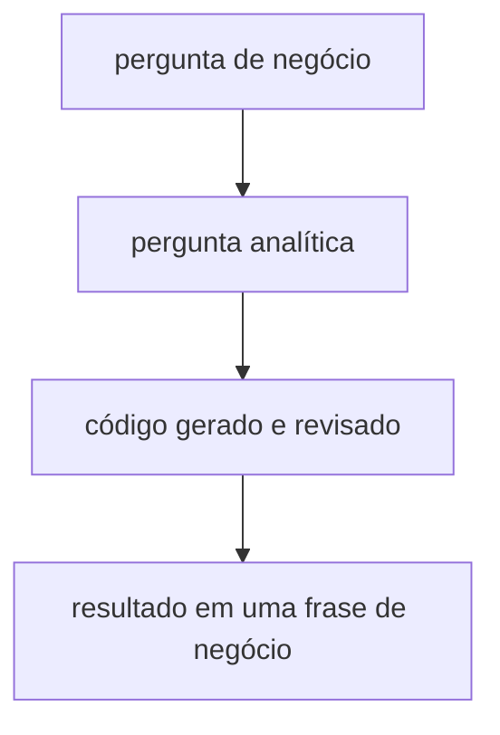

## **Etapa 5:** Análise e Limpeza com IA

---
layout: section
---

## Limpeza de dados com **IA**
**Prompts que geram código de limpeza em pandas**

---
layout: two-cols-header
layoutClass: gap-8
sourceLabel: Starting Data Analytics with Generative AI, cap. 2
source: https://www.manning.com/books/starting-data-analytics-with-generative-ai-and-python
---

# Da limpeza manual à limpeza com IA

#### **A ferramenta mudou; o padrão de exigência, não**

::left::

<div class="text-left w-full [&_li]:mb-4">

**Etapa 2: limpeza manual**

- Você escreveu cada passo: `concat`, `astype`, `drop_duplicates`, `fillna` e `merge`.
- Cada decisão de limpeza foi sua.
- O resultado virou a referência: 3.119 viagens e 149 durações preenchidas pela mediana.

</div>

::right::

<div class="text-left w-full [&_li]:mb-4">

**Etapa 5: limpeza com IA**

- O LLM escreve o código a partir do seu prompt.
- Você define as regras, revisa o código e confere o resultado.
- A referência da etapa 2 mostra se o código gerado está certo.

</div>

> [!IMPORTANT]
> O LLM é um copiloto: acelera a escrita, mas a decisão e a conferência continuam com você.

<!--
- abra a aula com a comparação: "Na etapa 2 fizemos a limpeza manualmente. Agora faremos com IA."
- o capítulo 2 do livro trata a IA generativa como copiloto: cada sugestão de limpeza é validada contra os dados reais, nunca aceita por confiança na resposta.
-->

---
layout: two-cols-header
layoutClass: gap-8
sourceLabel: to_numeric
source: https://pandas.pydata.org/docs/reference/api/pandas.to_numeric.html
---

# O que um prompt vago produz

#### **Sem o schema e as regras do negócio, o LLM escreve uma limpeza genérica**

::left::

<WindowMockup color="dark" padding="0.5rem 0.5rem 0.5rem 0.5rem" title="prompt" codeblock>

```md
Limpe os dados de viagens.csv e viagens_abril.csv.
```
</WindowMockup>

```python [código gerado]
viagens = pd.concat([pd.read_csv("viagens.csv"),
                     pd.read_csv("viagens_abril.csv")])
viagens = viagens.drop_duplicates()
viagens = viagens.dropna()
viagens["duracao_min"] = pd.to_numeric(
    viagens["duracao_min"], errors="coerce")
```

::right::

<div class="text-left w-full [&_li]:mb-4">

- **Roda sem erro** — e devolve 2.514 viagens, todas com a duração vazia.
- **`dropna()`** — apaga 605 viagens (19%) porque falta a avaliação ou a duração.
- **`errors="coerce"`** — para o `to_numeric`, "11,6" não é número: toda duração vira `NaN`.

</div>

> [!CAUTION]
> Rodar sem erro não quer dizer estar certo: confira o resultado.

<!--
- é um código típico de prompt vago: as funções existem e estão bem escritas, mas ignoram o formato dos dados e as regras do negócio.
- o drop_duplicates() sem subset funciona aqui só porque as linhas repetidas são idênticas em todas as colunas.
- no live coding, rode este prompt primeiro, para a turma ver o resultado: 2.514 linhas e duracao_min.isna().sum() = 2.514.
-->

---
layout: default
sourceLabel: Starting Data Analytics with Generative AI, cap. 2
source: https://www.manning.com/books/starting-data-analytics-with-generative-ai-and-python
---

# O que um prompt de limpeza precisa ter

#### **Quanto mais o LLM sabe sobre os dados e as regras, menos ele adivinha**

<div class="h-2" />

<div class="text-sm leading-tight [&_td]:py-2 [&_th]:py-1">

| no prompt | exemplo na base de viagens |
| --- | --- |
| **schema** | as colunas e os tipos: `viagem_id` (a chave), `duracao_min` (texto), `avaliacao` (nota de 1 a 5) |
| **formato real** | `duracao_min` chega como "11,6", com vírgula, e vazia quando a duração não foi registrada |
| **regras do negócio** | remover as repetidas por `viagem_id` antes da mediana; não preencher `avaliacao` |
| **ambiente** | pandas 3: atribuir o resultado, sem `inplace=True` |
| **verificação** | no fim, 3.119 viagens e nenhuma duração ausente |

</div>

> [!TIP]
> Peça uma função, como `limpar(viagens)`: fica fácil testá-la num caso pequeno e compará-la com a referência.

<!--
- é a estrutura Papel, Tarefa, Contexto e Saída e Verificação dos prompts de live coding, com o contexto detalhado.
- informar a versão importa: os LLMs aprenderam com muito código de pandas 1 e 2.
-->

---
layout: two-cols-header
layoutClass: gap-8
sourceLabel: Starting Data Analytics with Generative AI, cap. 8
source: https://www.manning.com/books/starting-data-analytics-with-generative-ai-and-python
---

# Contexto sem expor os dados

#### **O schema e algumas linhas bastam para o LLM entender a base**

::left::

```python [etapa5.ipynb]
bruto = pd.concat([pd.read_csv("viagens.csv"),
                   pd.read_csv("viagens_abril.csv")],
                  ignore_index=True)

bruto.dtypes         # nomes e tipos das colunas
bruto.head(3)        # o formato real dos valores
bruto.isna().sum()   # onde faltam valores
```

> [!CAUTION]
> Tudo o que entra no prompt, inclusive um arquivo citado com `@`, vai para o provedor do modelo.

::right::

<div class="text-left w-full [&_li]:mb-4">

- **No chat** — cole no prompt a saída dessas três linhas, e não a base inteira.
- **No agente do editor** — o `@viagens.csv` entrega o arquivo como contexto.
- **Dados sensíveis** — troque nomes, documentos e contatos por valores fictícios antes de enviar.

</div>

<!--
- a base de viagens é fictícia, mas a regra vale para dados reais: LGPD e a política de uso de IA da empresa.
- o capítulo 8 do livro trata dos riscos de privacidade: identificar dados sensíveis, anonimizar e pseudonimizar.
-->

---
layout: section
---

## Revisão crítica do **código gerado**
**Rodar sem erro não quer dizer estar certo**

---
layout: default
sourceLabel: Copy-on-Write
source: https://pandas.pydata.org/docs/user_guide/copy_on_write.html
---

# Erros silenciosos no código gerado

#### **Cada linha abaixo roda sem erro na base de viagens e muda o resultado**

<div class="h-2" />

<div class="text-sm leading-tight [&_td]:py-2 [&_th]:py-1">

| código gerado | o que acontece na base de viagens |
| --- | --- |
| `pd.to_numeric(df["duracao_min"], errors="coerce")` | as 3.201 durações viram `NaN`: "11,6" não é número |
| `df["duracao_min"].fillna(m, inplace=True)` | no pandas 3, nada muda: as 149 durações continuam ausentes |
| `df.dropna()` | somem 605 viagens (19%), sem avaliação ou sem duração |
| `drop_duplicates()` em cada arquivo, antes do `concat` | sobram 20 viagens repetidas: o 31/03 está nos dois exports |
| mediana calculada antes de remover as repetidas | a duração ausente vira 10,0, e não 9,95 |

</div>

> [!NOTE]
> No pandas 3, `df["coluna"]` se comporta como uma cópia: o `inplace=True` altera essa cópia, e o DataFrame fica igual.

<!--
- o fillna com inplace só emite um aviso (ChainedAssignmentError) e segue; o to_numeric com coerce nem avisa.
- a forma certa: df["duracao_min"] = df["duracao_min"].fillna(m).
- as repetidas de 31/03 só aparecem depois do concat: remover duplicatas em cada arquivo não as encontra.
-->

---
layout: two-cols-header
layoutClass: gap-8
sourceLabel: Copy-on-Write
source: https://pandas.pydata.org/docs/user_guide/copy_on_write.html
---

# Demo: o código roda e não faz nada

#### **Dois erros silenciosos num DataFrame de três linhas**

::left::

```python {monaco-run} {autorun: false, height: 'auto'}
import warnings
import pandas as pd
pd.options.mode.copy_on_write = True  # pandas 3

df = pd.DataFrame({"dur": ["10,0", "20,0", None]})
x = pd.to_numeric(df["dur"], errors="coerce")
print(x.tolist())

df["dur"] = df["dur"].str.replace(",", ".")
df["dur"] = df["dur"].astype(float)
m = df["dur"].median()
with warnings.catch_warnings(record=True) as w:
    warnings.simplefilter("always")
    df["dur"].fillna(m, inplace=True)
print(df["dur"].tolist(), w[0].category.__name__)
```

::right::

<div class="text-left w-full [&_li]:mb-4">

- **`to_numeric` com `coerce`** — troca por `NaN` tudo o que não entende, sem avisar.
- **`fillna(..., inplace=True)`** — preenche uma cópia da coluna e só emite um aviso; o DataFrame continua com o ausente.
- **Correção** — atribua o resultado: `df["dur"] = df["dur"].fillna(m)`.

</div>

<!--
- o navegador roda o pandas 2 (Pyodide); a terceira linha liga o copy-on-write, que é o padrão do pandas 3.
- peça para a turma prever as duas saídas antes de executar: [nan, nan, nan] e [10.0, 20.0, nan].
- o catch_warnings só encurta o aviso para caber no slide; no notebook, o ChainedAssignmentError aparece inteiro, e é o único sinal do erro.
-->

---
layout: two-cols-header
layoutClass: gap-8
sourceLabel: Starting Data Analytics with Generative AI, cap. 2
source: https://www.manning.com/books/starting-data-analytics-with-generative-ai-and-python
---

# Teste com um caso pequeno e conhecido

#### **Monte à mão um DataFrame com cada defeito: você sabe a resposta antes de rodar**

::left::

```python [etapa5.ipynb]
mini = pd.DataFrame({
    "viagem_id":    ["V1", "V1", "V2", "V3"],
    "data_inicio":  ["2026-01-05"] * 4,
    "tipo_usuario": ["avulso", "avulso", "assinante", "avulso"],
    "duracao_min":  ["10,0", "10,0", "20,0", None],
    "avaliacao":    [5.0, 5.0, None, 4.0],
})
limpa = limpar(mini)

assert len(limpa) == 3                   # a repetição de V1 sai
assert limpa["duracao_min"].tolist() == [10.0, 20.0, 15.0]
assert limpa["avaliacao"].isna().sum() == 1    # nota não inventada
```

::right::

<div class="text-left w-full [&_li]:mb-4">

- **Mediana certa** — sem a repetição de V1, a mediana de 10 e 20 é 15, e não 10.
- **`assert`** — fica calado quando passa; quando falha, aponta a regra quebrada.
- **Erros comuns** — `coerce`, `inplace`, `dropna()` e mediana antes das repetidas derrubam algum `assert`.

</div>

<!--
- quem gera o código não deve gerar a prova: escreva o caso pequeno e os assert você mesmo.
- o caso pequeno não pega a repetição entre arquivos (o 31/03): essa só aparece na conferência com a base inteira.
-->

---
layout: two-cols-header
layoutClass: gap-8
sourceLabel: Series.equals
source: https://pandas.pydata.org/docs/reference/api/pandas.Series.equals.html
---

# Confira com a referência da etapa 2

#### **As mesmas viagens e os mesmos valores preenchidos da limpeza manual**

::left::

```python [etapa5.ipynb]
ref = limpeza_manual()    # o pipeline da etapa 2
ia = limpar(bruto)        # a função gerada pelo LLM

a = ia.set_index("viagem_id").sort_index()
b = ref.set_index("viagem_id").sort_index()

len(a), len(b)                              # (3119, 3119)
a.index.equals(b.index)                     # True
a["duracao_min"].equals(b["duracao_min"])   # True
```

::right::

<div class="text-left w-full [&_li]:mb-4">

- **Pela chave** — comparar por `viagem_id` não depende da ordem das linhas.
- **`equals`** — compara valor a valor e trata dois `NaN` como iguais.
- **Nem toda diferença é erro** — `to_datetime` cria `datetime64[us]`, e o `astype` da etapa 2, `[ns]`: as datas são as mesmas.

</div>

<!--
- limpeza_manual() é o código da etapa 2 (concat, tipos, duplicatas e fillna da duração) dentro de uma função.
- pd.testing.assert_frame_equal(a, b, check_like=True) acusa só o tipo da data: é útil, mas obriga a decidir o que precisa ser igual.
-->

---
layout: two-cols-header
layoutClass: gap-8
---

# Registre o prompt, o código gerado e a correção

#### **No notebook, fica claro o que veio do LLM e o que você corrigiu**

::left::

<WindowMockup color="dark" padding="0.5rem 0.5rem 0.5rem 0.5rem" title="etapa5.ipynb" codeblock>

```md
[markdown]  Prompt enviado ao LLM
[código]    Código gerado pelo LLM, sem alterações
[código]    Teste com o caso pequeno e conferência
[código]    Versão corrigida, se precisou
[markdown]  O que mudou e por quê
```
</WindowMockup>

::right::

<div class="text-left w-full [&_li]:mb-4">

- **Prompt antes do código** — quem lê sabe o que foi pedido e o que veio em resposta.
- **Gerado e corrigido separados** — a correção não apaga o código original.
- **O porquê em markdown** — por exemplo: "o `inplace` não alterava o DataFrame no pandas 3".

</div>

<!--
- os TPs pedem esse registro: o prompt logo antes do código ou da interpretação que ele gerou.
- com o agente do editor, o prompt fica no painel do agente: copie-o para uma célula de markdown.
-->

---
layout: section
---

## Perguntas e análise descritiva com **IA**
**Primeiro a pergunta, depois o código**

---
layout: two-cols-header
layoutClass: gap-8
sourceLabel: Starting Data Analytics with Generative AI, cap. 3
source: https://www.manning.com/books/starting-data-analytics-with-generative-ai-and-python
---

# Primeiro a pergunta, depois o código

#### **A pergunta define a métrica, os grupos e o que conferir no resultado**

::left::



::right::

<div class="text-left w-full [&_li]:mb-4">

- **De negócio** — "Os clientes gostam do serviço?" é vaga demais para virar código.
- **Analítica** — "A nota média muda com a chuva e com a duração da viagem?" diz a métrica, os grupos e as colunas.
- **Só então o código** — gerado pelo LLM, revisado e executado por você.

</div>

<!--
- é a ordem do capítulo 3 do livro: pergunta de pesquisa, desenho da análise, análise descritiva e, só depois, interpretação.
- uma pergunta analítica boa já diz qual tabela ou gráfico vai respondê-la.
-->

---
layout: default
sourceLabel: Starting Data Analytics with Generative AI, cap. 3
source: https://www.manning.com/books/starting-data-analytics-with-generative-ai-and-python
---

# Perguntas sugeridas pelo LLM

#### **O LLM sugere; quem decide quais perguntas os dados respondem é você**

<div class="h-2" />

<div class="text-sm leading-tight [&_td]:py-2 [&_th]:py-1">

| pergunta sugerida | os dados respondem? |
| --- | --- |
| A nota média é menor nos dias de chuva? | ✅ sim: `avaliacao` e `chuva_mm` |
| Viagens mais longas recebem notas menores? | ✅ sim: `duracao_min` e `avaliacao` |
| Avulsos avaliam pior que assinantes? | ✅ sim: `tipo_usuario` e `avaliacao` |
| A idade do ciclista influencia a nota? | ❌ não: a base não tem a idade |
| O preço da viagem afeta a satisfação? | ❌ não: a base não tem o preço |
| Por que as viagens caíram em abril? | ⚠️ não caíram: abril teve 25,7 viagens por dia, contra 22,7 em março |

</div>

> [!TIP]
> No prompt, liste as colunas disponíveis e peça que o LLM marque as perguntas que exigem dados que a base não tem.

<!--
- a pergunta de abril pressupõe um fato: confira o fato antes de buscar a causa.
- viagens por dia: janeiro 26,6, fevereiro 29,3, março 22,7 e abril 25,7. Março tem mais dias de chuva (39%).
-->

---
layout: two-cols-header
layoutClass: gap-8
sourceLabel: cut
source: https://pandas.pydata.org/docs/reference/api/pandas.cut.html
---

# Do código gerado à frase de negócio

#### **Execute, confira e só então traduza o número para quem decide**

::left::

```python [etapa5.ipynb]
base = carregar_base()
faixa = pd.cut(base["duracao_min"], [0, 10, 20, 30, 80])

(base.groupby(faixa)["avaliacao"]
     .agg(["mean", "count"]).round(2))
#              mean  count
# (0, 10]      4.68   1275
# (10, 20]     4.70    831
# (20, 30]     4.39    277
# (30, 80]     3.88    131
```

::right::

<div class="text-left w-full [&_li]:mb-4">

- **Revise** — `pd.cut` fecha as faixas à direita, e `count` conta só as viagens avaliadas.
- **Confira** — a maior viagem tem 75,8 min: a última faixa cobre todas.
- **Traduza** — "Viagens de mais de 30 minutos recebem nota média 3,88, contra 4,68 nas de até 10 minutos."

</div>

<!--
- carregar_base() vem do preparar_base.py da etapa 3: a base limpa, sem preencher a duração.
- a frase descreve uma associação; ela não diz que a duração causa a nota (etapa 4).
-->

---
layout: two-cols-header
layoutClass: gap-8
sourceLabel: Group by
source: https://pandas.pydata.org/docs/user_guide/groupby.html
---

# O que se associa à avaliação?

#### **Chuva e duração se destacam; o resto quase não muda a nota média**

::left::

<div class="text-sm leading-tight [&_td]:py-2 [&_th]:py-1">

| fator | grupos | nota média |
| --- | --- | --- |
| chuva | sem / com | 4,68 / 4,32 |
| duração | até 10 / acima de 30 min | 4,68 / 3,88 |
| tipo de usuário | assinante / avulso | 4,63 / 4,57 |
| fim de semana | não / sim | 4,61 / 4,61 |
| bairro de origem | 12 bairros | de 4,56 a 4,66 |

</div>

::right::

<div class="text-left w-full [&_li]:mb-4">

- **Chuva e duração** — as duas diferenças que se destacam.
- **Tipo de usuário** — 0,05 ponto: uma diferença real ou ruído da amostra?
- **Próxima etapa** — testes de hipótese e intervalos de confiança respondem a essa pergunta.

</div>

<!--
- 2.637 viagens avaliadas (nota média 4,61); nenhuma recebeu nota 1.
- cada linha é um groupby da base de viagens: o live coding gera o código com o LLM.
-->

---
layout: section
---

## Live Coding

🚲 &nbsp;**Dataset:** os arquivos brutos de viagens da etapa 2, limpos agora com código gerado por IA

⭐ &nbsp;**Análise:** o que se associa à avaliação das viagens? Perguntas e análise descritiva com IA

<!--
Os arquivos de dados são os da etapa 2 (gerar_dados.py, seed 42) e o preparar_base.py da etapa 3.

=================================================================
ARQUIVO — etapa5.ipynb (uma célula de markdown antes de cada célula de código)

```python
# 1. Os exports brutos e o contexto para o prompt
import pandas as pd
from preparar_base import carregar_base

bruto = pd.concat([pd.read_csv("viagens.csv"), pd.read_csv("viagens_abril.csv")],
                  ignore_index=True)
bruto.dtypes
bruto.head(3)
bruto.isna().sum()

# 2. Código do prompt vago (rode para a turma ver o resultado)
vago = pd.concat([pd.read_csv("viagens.csv"), pd.read_csv("viagens_abril.csv")])
vago = vago.drop_duplicates()
vago = vago.dropna()
vago["duracao_min"] = pd.to_numeric(vago["duracao_min"], errors="coerce")
len(vago), vago["duracao_min"].isna().sum()

# 3. Função gerada pelo prompt específico (parte 1); um exemplo correto
def limpar(viagens: pd.DataFrame) -> pd.DataFrame:
    df = viagens.copy()
    df = df.drop_duplicates(subset="viagem_id", keep="first")
    df["duracao_min"] = df["duracao_min"].str.replace(",", ".").astype(float)
    df["duracao_min"] = df["duracao_min"].fillna(df["duracao_min"].median())
    df["data_inicio"] = pd.to_datetime(df["data_inicio"])
    df["tipo_usuario"] = df["tipo_usuario"].astype("category")
    return df

# 4. Caso pequeno (escrito por você, não pelo agente)
mini = pd.DataFrame({
    "viagem_id": ["V1", "V1", "V2", "V3"],
    "data_inicio": ["2026-01-05"] * 4,
    "tipo_usuario": ["avulso", "avulso", "assinante", "avulso"],
    "duracao_min": ["10,0", "10,0", "20,0", None],
    "avaliacao": [5.0, 5.0, None, 4.0],
})
limpa = limpar(mini)
assert len(limpa) == 3
assert limpa["duracao_min"].tolist() == [10.0, 20.0, 15.0]
assert limpa["avaliacao"].isna().sum() == 1

# 5. Conferência com a limpeza manual da etapa 2
def limpeza_manual():
    viagens = pd.concat([pd.read_csv("viagens.csv"), pd.read_csv("viagens_abril.csv")],
                        ignore_index=True)
    viagens["duracao_min"] = viagens["duracao_min"].str.replace(",", ".").astype(float)
    viagens["data_inicio"] = viagens["data_inicio"].astype("datetime64[ns]")
    viagens["tipo_usuario"] = viagens["tipo_usuario"].astype("category")
    viagens = viagens.drop_duplicates(subset="viagem_id", keep="first")
    viagens["duracao_min"] = viagens["duracao_min"].fillna(viagens["duracao_min"].median())
    return viagens

ia, ref = limpar(bruto), limpeza_manual()
a, b = ia.set_index("viagem_id").sort_index(), ref.set_index("viagem_id").sort_index()
len(a), len(b), a.index.equals(b.index), a["duracao_min"].equals(b["duracao_min"])

# 6. Análise descritiva (parte 2): a base limpa da etapa 3, sem preencher a duração
base = carregar_base()
faixa = pd.cut(base["duracao_min"], [0, 10, 20, 30, 80])
base.groupby(faixa)["avaliacao"].agg(["mean", "count"]).round(2)
base.groupby("choveu")["avaliacao"].agg(["mean", "count"]).round(2)
base.groupby("tipo_usuario")["avaliacao"].agg(["mean", "count"]).round(2)
base.groupby(base["data_inicio"].dt.day_of_week >= 5)["avaliacao"].agg(["mean", "count"]).round(2)
base.groupby("bairro")["avaliacao"].mean().sort_values().round(2)
base.groupby(base["data_inicio"].dt.month)["viagem_id"].count() / base.groupby(base["data_inicio"].dt.month)["data_inicio"].nunique()
```

>>> Resultados esperados: bruto (3201, 8), 151 durações e 500 avaliações ausentes.
>>> Prompt vago: 2514 linhas, todas com duracao_min NaN.
>>> limpar(bruto): 3119 linhas, nenhuma duração ausente; índice e duracao_min iguais aos da etapa 2 (mediana 9,95).
>>> Nota média: faixas 4,68 / 4,70 / 4,39 / 3,88; sem chuva 4,68 (2150) e com chuva 4,32 (487);
>>> assinante 4,63 (1867) e avulso 4,57 (770); fim de semana 4,61 e 4,61; bairros de 4,56 a 4,66.
>>> Viagens por dia: jan 26,6, fev 29,3, mar 22,7 e abr 25,7.
-->

---
layout: default
layoutClass: gap-8
---

# Live coding: codificação assistida por IA - parte 1

#### **Prompt para gerar a função de limpeza dos exports de viagens**

<div class="h-7" />

<WindowMockup color="dark" padding="0.5rem 0.5rem 0.5rem 0.5rem" title="prompt.md" codeblock>

```md {*}{maxHeight:'290px'}
# Papel
Você é um engenheiro de dados especialista em Python e pandas 3.

# Tarefa
Escreva, no notebook "etapa5.ipynb", uma função limpar(viagens) que
limpe os exports brutos de viagens de bicicleta.

# Contexto
1. viagens é o pd.concat (ignore_index=True) de "viagens.csv" e
   "viagens_abril.csv"; veja as colunas e os defeitos em @viagens.csv.
2. viagem_id identifica a viagem, e os dois arquivos se sobrepõem no
   dia 31/03: remova as repetidas por viagem_id, mantendo a primeira.
3. duracao_min chega como texto com vírgula decimal ("11,6") e vazia
   quando não foi registrada: converta para float e preencha as
   ausentes com a mediana, calculada depois de remover as repetidas.
4. avaliacao vazia é cliente que não avaliou: não preencha.
5. Converta data_inicio para data e tipo_usuario para category.
6. Não use inplace=True nem atribuição encadeada.

# Saída e Verificação
- Gere a função e uma célula que a aplique ao concat dos dois arquivos.
- Mostre o número de linhas e os ausentes por coluna antes e depois.
- Execute o notebook do início ao fim, sem erros.
```
</WindowMockup>

<!--
# 1 - comece pelo prompt vago do slide "O que um prompt vago produz": a turma vê o código genérico rodar sem erro e devolver a duração vazia.

# 2 - human-in-the-loop: o caso pequeno e a conferência com a etapa 2 são escritos por você, e não pelo agente.

# 3 - registre no notebook o prompt e o código gerado, sem alterações, antes de qualquer correção.
-->

---
layout: default
layoutClass: gap-8
---

# Live coding: codificação assistida por IA - parte 2

#### **Prompt para formular perguntas e gerar a análise descritiva da avaliação**

<div class="h-7" />

<WindowMockup color="dark" padding="0.5rem 0.5rem 0.5rem 0.5rem" title="prompt.md" codeblock>

```md {*}{maxHeight:'290px'}
# Papel
Você é um analista de dados especialista em Python, pandas e estatística.

# Tarefa
Proponha perguntas sobre o que se associa à avaliação das viagens e
responda, com análise descritiva, as que eu escolher.

# Contexto
1. No "etapa5.ipynb", carregue a base com carregar_base() do
   @preparar_base.py e liste as colunas disponíveis.
2. Liste 8 perguntas analíticas sobre os fatores associados à
   avaliação e marque as que exigem dados que a base não tem,
   explicando por quê.
3. Para as perguntas sobre chuva, duração (faixas de 0 a 10, 10 a 20,
   20 a 30 e acima de 30 min) e tipo de usuário, gere o código pandas
   com a nota média e o número de viagens avaliadas em cada grupo.
4. Depois de cada resultado, escreva em markdown uma frase de
   interpretação para o negócio, sem afirmar causa.

# Saída e Verificação
- Acrescente as células ao etapa5.ipynb.
- Execute o notebook do início ao fim, sem erros.
```
</WindowMockup>

<!--
# 1 - a escolha das perguntas é sua: o prompt já diz quais das 8 sugestões serão respondidas.

# 2 - human-in-the-loop: confira se o código usou só as viagens avaliadas e se as faixas cobrem todas as durações.

# 3 - se a frase do agente disser que a chuva "causa" notas baixas, é a deixa para o slide de correlação e causalidade da etapa 4.
-->

---
layout: default
---

# Hands-on

<br/>

🛠️ &nbsp;**Exercício \#1:** Peça ao LLM a limpeza da sua base com um prompt vago e com um específico.

🛠️ &nbsp;**Exercício \#2:** Teste o código gerado num caso pequeno e compare-o com a sua limpeza da etapa 2.

🛠️ &nbsp;**Exercício \#3:** Peça ao LLM perguntas sobre o Gapminder e descarte as que os dados não respondem.

🛠️ &nbsp;**Exercício \#4:** Responda a uma pergunta com código gerado pelo LLM e interprete o resultado.

- [ ] incluir no prompt o schema, o formato dos dados e as regras do negócio
- [ ] registrar o prompt e o código gerado, sem alterações
- [ ] testar o código num caso pequeno e conferir com a limpeza manual
- [ ] separar as perguntas respondíveis das que exigem dados que não existem
- [ ] traduzir cada resultado numa frase de negócio

<br/>

<!--
# Exercício #1 — Prompt vago x específico
Reaproveite a base de outro domínio criada no hands-on das etapas 1 e 2, com os defeitos de export.
O prompt vago costuma gerar dropna() e to_numeric com coerce; o específico traz as colunas, o formato, as regras e a versão do pandas.

# Exercício #2 — Revisão do código
Um DataFrame de 3 ou 4 linhas com uma repetição, um número com vírgula e um ausente, e um assert por regra.
Depois, compare com a limpeza manual da etapa 2: o mesmo número de linhas e os mesmos valores preenchidos.

# Exercício #3 — Perguntas sobre o Gapminder
Respondível: "a expectativa de vida cresceu mais na Ásia ou na África entre 1952 e 2007?" (Ásia +24,4 anos; África +15,7).
Sem dados: "o gasto com saúde explica a expectativa de vida?" (a base não tem gasto com saúde).
Os dados mostram, mas não explicam: a expectativa de vida de Ruanda cai para 23,6 anos em 1992; a causa está fora da base.

# Exercício #4 — Análise descritiva com o LLM
Ex.: expectativa de vida média por continente em 2007 (Oceania 80,7, Europa 77,6, Américas 73,6, Ásia 70,7, África 54,8).
A frase de negócio cita o número e o grupo, sem afirmar causa.

## os exercícios preparam o TP3 (Exercícios 1 a 4)
-->
