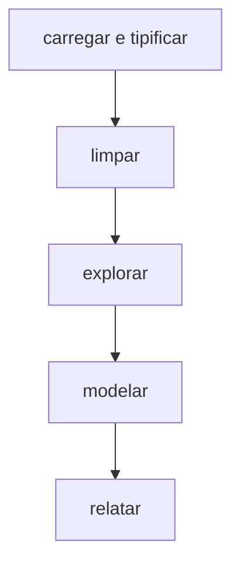

## **Etapa 9:** Pipeline de EDA com Python

---
layout: section
---

## Um pipeline de **ponta a ponta**
**Do dado bruto ao relatório**

---
layout: two-cols-header
layoutClass: gap-8
---

# As etapas de um pipeline de EDA

#### **O caminho que a disciplina percorreu, agora num fluxo só**

::left::



::right::

<div class="text-left w-full [&_li]:mb-3">

- **Carregar e tipificar** — `read_*`, `dtypes` e `astype` (etapa 1).
- **Limpar** — duplicatas, ausentes e combinações (etapas 2 e 5).
- **Explorar** — distribuições, probabilidades e correlações (etapas 3, 4 e 6).
- **Modelar** — regressão avaliada no teste (etapas 7 e 8).
- **Relatar** — frases de negócio, com números e limitações.

</div>

<!--
- cada passo recebe um DataFrame e devolve outro: é isso que permite encadear e testar.
- a IA pode acelerar qualquer passo, sempre com revisão (etapas 5 e 6).
-->

---
layout: two-cols-header
layoutClass: gap-8
sourceLabel: DataFrame.assign
source: https://pandas.pydata.org/docs/reference/api/pandas.DataFrame.assign.html
---

# Funções em vez de células repetidas

#### **Cada passo do pipeline vira uma função que recebe e devolve um DataFrame**

::left::

```python [pipeline_taxis.py]
URL = ("https://raw.githubusercontent.com/"
       "mwaskom/seaborn-data/master/taxis.csv")


def carregar(caminho=URL):
    df = pd.read_csv(caminho)
    df["pickup"] = pd.to_datetime(df["pickup"])
    df["dropoff"] = pd.to_datetime(df["dropoff"])
    return df


def adicionar_duracao(df):
    seg = (df["dropoff"] - df["pickup"]).dt.total_seconds()
    return df.assign(duracao_min=seg / 60)
```

::right::

<div class="text-left w-full [&_li]:mb-4">

- **Uma função por passo** — carregar, limpar, enriquecer e modelar.
- **Reaproveitar** — o mesmo `limpar()` serve para outro mês ou outro recorte, sem copiar células.
- **Testar** — cada função cabe num caso pequeno, como na etapa 5.

</div>

<!--
- é o padrão do carregar_base() das etapas 3 a 8, agora com todos os passos.
- assign devolve um DataFrame novo, sem alterar o original: combina com o copy-on-write do pandas 3.
-->

---
layout: two-cols-header
layoutClass: gap-8
sourceLabel: DataFrame.pipe
source: https://pandas.pydata.org/docs/reference/api/pandas.DataFrame.pipe.html
---

# Encadeando os passos com pipe

#### **O pipeline se lê de cima para baixo, na ordem em que os passos acontecem**

::left::

```python [etapa9.ipynb]
from pipeline_taxis import (adicionar_duracao,
                            carregar, limpar)

corridas = (carregar()
            .pipe(adicionar_duracao)
            .pipe(limpar))
corridas.shape        # (6343, 15)
```

::right::

<div class="text-left w-full [&_li]:mb-4">

- **`pipe`** — passa o DataFrame para a função e devolve o resultado.
- **Sem variáveis intermediárias** — nada de `df2`, `df_limpo` e `df_final` espalhados pelo notebook.
- **Confira cada passo** — o número de linhas antes e depois de cada função.

</div>

<!--
- df.pipe(f) é o mesmo que f(df); a vantagem é a leitura em sequência.
- funções que recebem parâmetros também entram: df.pipe(filtrar, coluna="fare").
-->

---
layout: two-cols-header
layoutClass: gap-8
sourceLabel: DataFrame.pipe
source: https://pandas.pydata.org/docs/reference/api/pandas.DataFrame.pipe.html
---

# Demo: um pipeline que se explica

#### **Cada função registra quantas linhas entrou e quantas saiu**

::left::

```python {monaco-run} {autorun: false, height: 'auto'}
import pandas as pd

def sem_ausentes(df):
    out = df.dropna()
    print("ausentes: ", len(df), "->", len(out))
    return out

def com_distancia(df):
    out = df[df["km"] > 0]
    print("distância:", len(df), "->", len(out))
    return out

dados = {"km": [1.2, 0, 3.5, None, 2.1],
         "tarifa": [7.5, 3, 14, 9, None]}
limpo = (pd.DataFrame(dados)
           .pipe(sem_ausentes)
           .pipe(com_distancia))
```

::right::

<div class="text-left w-full [&_li]:mb-4">

- **Cada passo informa o que fez** — a contagem vira a documentação da limpeza.
- **A ordem importa** — trocar os dois passos muda as contagens intermediárias?
- **Antes de executar** — quantas corridas sobram no fim?

</div>

<!--
- saída esperada: ausentes 5 -> 3 e distância 3 -> 2; sobram as corridas de 1,2 km e 3,5 km (limpo no fim).
- trocando a ordem: distância 5 -> 3 (o None não passa no filtro > 0) e ausentes 3 -> 2. O resultado final é o mesmo; as contagens, não.
-->

---
layout: section
---

## Um pipeline sobre **dados reais**
**Corridas de táxi em Nova York**

---
layout: two-cols-header
layoutClass: gap-8
sourceLabel: seaborn-data
source: https://github.com/mwaskom/seaborn-data
---

# Um dataset real: corridas de táxi

#### **Uma amostra das corridas de março de 2019 em Nova York, com defeitos de verdade**

::left::

```python [etapa9.ipynb]
bruto = carregar().pipe(adicionar_duracao)
bruto.shape                      # (6433, 15)
bruto["payment"].isna().sum()    # 44
(bruto["distance"] == 0).sum()   # 51
(bruto["duracao_min"] <= 0).sum()    # 6
```

::right::

<div class="text-left w-full [&_li]:mb-4">

- **Colunas** — horários de embarque e desembarque, distância (milhas), tarifa, gorjeta, pedágio, total, pagamento e bairros.
- **Defeitos reais** — datas como texto, pagamento ausente, distância zero e duração zero ou negativa.
- **Pergunta** — o que explica o valor da corrida (`fare`)?

</div>

<!--
- os dados vêm dos registros públicos de corridas da comissão de táxis de Nova York (TLC), na amostra que acompanha o seaborn.
- os valores estão em dólares e as distâncias em milhas: 6.433 corridas de táxis amarelos e verdes.
-->

---
layout: two-cols-header
layoutClass: gap-8
sourceLabel: Boolean indexing
source: https://pandas.pydata.org/docs/user_guide/indexing.html#boolean-indexing
---

# Limpeza com critério registrado

#### **Cada regra de limpeza tem um motivo e uma contagem**

::left::

```python [pipeline_taxis.py]
def limpar(df):
    """Remove corridas sem distância, com duração
    zero ou negativa e sem forma de pagamento."""
    validas = ((df["distance"] > 0)
               & (df["duracao_min"] > 0)
               & df["payment"].notna())
    return df[validas]
```

::right::

<div class="text-sm leading-tight [&_td]:py-2 [&_th]:py-1">

| problema | corridas | decisão |
| --- | --- | --- |
| distância zero | 51 | remover |
| duração zero ou negativa | 6 | remover |
| pagamento ausente | 44 | remover |
| pagas em dinheiro | 1.812 | gorjeta sempre zero: analisar a gorjeta só no cartão |

</div>

<div class="text-left w-full mt-4 [&_li]:mb-2">

- **Resultado** — ficam 6.343 das 6.433 corridas; as regras se sobrepõem em algumas.

</div>

<!--
- a gorjeta em dinheiro não é registrada: todas as 1.812 corridas pagas assim têm tip = 0. Não é um ausente, é um limite do dado.
- o motivo de cada regra vai para uma célula de markdown e para o relatório.
-->

---
layout: two-cols-header
layoutClass: gap-8
sourceLabel: corr
source: https://pandas.pydata.org/docs/reference/api/pandas.DataFrame.corr.html
---

# Explorar: probabilidades e correlações

#### **A exploração escolhe as preditoras e aponta os riscos do modelo**

::left::

```python [etapa9.ipynb]
cartao = corridas[corridas["payment"] == "credit card"]
(cartao["tip"] / cartao["fare"] >= 0.2).mean()   # 0.729
(corridas["duracao_min"] > 30).mean()            # 0.090

cols = ["fare", "distance", "duracao_min",
        "tolls", "tip", "total"]
corridas[cols].corr()["fare"]
```

::right::

<div class="text-left w-full [&_li]:mb-4">

- **Probabilidades** — 72,9% das corridas no cartão dão gorjeta de 20% ou mais; 9% passam de 30 min.
- **Correlação com a tarifa** — distância 0,95, duração 0,88 e pedágio 0,61.
- **Alertas** — distância × duração, 0,82 (multicolinearidade); `total`, 0,97 (vazamento).

</div>

<!--
- a gorjeta é condicional ao pagamento no cartão: é a probabilidade condicional da etapa 3.
- antes do modelo, faça também o histograma da tarifa (assimétrica, mediana de US$ 9,50) e o boxplot por bairro.
-->

---
layout: two-cols-header
layoutClass: gap-8
sourceLabel: get_dummies
source: https://pandas.pydata.org/docs/reference/api/pandas.get_dummies.html
---

# Modelo: o que entra e o que fica de fora

#### **Cada preditora nova precisa melhorar o teste e fazer sentido para o negócio**

::left::

<div class="text-sm leading-tight [&_td]:py-2 [&_th]:py-1">

| preditoras | R² no teste | RMSE no teste |
| --- | --- | --- |
| distância | 0,916 | US$ 3,41 |
| + duração | 0,939 | US$ 2,90 |
| + pedágio e bairro de origem | 0,961 | US$ 2,08 |
| `total` (vazamento) | 0,950 | não entra |

</div>

::right::

<div class="text-left w-full [&_li]:mb-4">

- **Leitura** — no modelo final, US$ 1,99 por milha e US$ 0,30 por minuto: o taxímetro cobra distância e tempo.
- **Multicolinearidade moderada** — distância e duração (0,82) ficam: os dois coeficientes são estáveis e fazem sentido.
- **Vazamento** — o `total` contém a própria tarifa: R² alto e nenhuma previsão.

</div>

<!--
- bairro de origem com pd.get_dummies(drop_first=True); 14 corridas sem bairro saem do modelo.
- multicolinearidade não obriga a tirar a variável: decida pela estabilidade dos coeficientes e pelo sentido de negócio.
-->

---
layout: two-cols-header
layoutClass: gap-8
---

# O relatório de uma página

#### **Para quem decide: a pergunta, a resposta e o quanto confiar nela**

::left::

<WindowMockup color="dark" padding="0.5rem 0.5rem 0.5rem 0.5rem" title="relatorio.md" codeblock>

```md {*}{maxHeight:'370px'}
# O que explica o valor da corrida?

## Dados
6.343 corridas de março de 2019, depois de remover
90 (distância zero, duração inválida e sem pagamento).

## Achados
- A tarifa sobe US$ 1,99 por milha e US$ 0,30 por min.
- 72,9% das corridas no cartão têm gorjeta ≥ 20%.

## Modelo
Distância, duração, pedágio e bairro de origem:
R² 0,961 e RMSE de US$ 2,08 no teste.

## Limitações
Um mês de dados; gorjeta em dinheiro não registrada.
```
</WindowMockup>

::right::

<div class="text-left w-full [&_li]:mb-4">

- **Números com unidade** — US$, minutos e %: nada de "o modelo é bom".
- **Decisões de limpeza** — o que saiu e por quê, com as contagens.
- **Limitações explícitas** — o que os dados não cobrem e onde o modelo erra.

</div>

<!--
- o relatório não repete o notebook: resume as decisões e os números que sustentam a resposta.
- vale o mesmo cuidado da etapa 6: diga o tamanho do efeito e a incerteza, e não só que "é significativo".
-->

---
layout: default
---

# IA ao longo do pipeline

#### **A IA acelera cada passo; a conferência continua com você**

<div class="h-2" />

<div class="text-sm leading-tight [&_td]:py-2 [&_th]:py-1">

| passo | a IA ajuda a | você confere |
| --- | --- | --- |
| carregar e tipificar | gerar a leitura e as conversões | `dtypes` e número de linhas |
| limpar | propor as regras de limpeza | cada remoção, com a contagem |
| explorar | sugerir perguntas e gráficos | se os dados respondem e se o gráfico distorce |
| modelar | estruturar o modelo e as métricas | vazamento, multicolinearidade e métricas no teste |
| relatar | redigir o texto | cada número contra o notebook |

</div>

<!--
- é o resumo das etapas 5 e 6 aplicado ao pipeline inteiro.
- registre os prompts no notebook, antes do código ou do texto que eles geraram.
-->

---
layout: two-cols-header
layoutClass: gap-8
sourceLabel: uv
source: https://docs.astral.sh/uv/
---

# Reprodutível do início ao fim

#### **Outra pessoa precisa conseguir rodar e chegar aos mesmos números**

::left::

<WindowMockup color="dark" padding="0.5rem 0.5rem 0.5rem 0.5rem" title="projeto" codeblock>

```md
projeto/
├── pipeline_taxis.py   # funções de cada passo
├── etapa9.ipynb        # a análise, em ordem
├── relatorio.md        # uma página
├── pyproject.toml      # dependências
└── uv.lock             # versões exatas
```
</WindowMockup>

::right::

<div class="text-left w-full [&_li]:mb-4">

- **Reiniciar e executar tudo** — antes de entregar, o notebook roda do zero, sem erros.
- **Sementes fixas** — `random_state` em toda divisão e reamostragem.
- **Fonte dos dados** — de onde vieram e como baixar de novo.

</div>

<!--
- o uv.lock trava as versões: o mesmo pandas, scikit-learn e scipy em qualquer máquina.
- os dados públicos não precisam ir na entrega; o endereço de download, sim.
-->

---
layout: section
---

## Live Coding

🚕 &nbsp;**Dataset:** corridas de táxi de Nova York (março de 2019), na amostra pública do seaborn

🧭 &nbsp;**Análise:** o que explica o valor da corrida? Um pipeline em funções, do CSV ao relatório de uma página

<!--
Projeto: as dependências das etapas anteriores (pandas, matplotlib, seaborn, scipy e scikit-learn).

=================================================================
ARQUIVO 1 — pipeline_taxis.py

```python
"""Pipeline de EDA das corridas de táxi de Nova York (março de 2019)."""
import pandas as pd
from sklearn.linear_model import LinearRegression
from sklearn.metrics import r2_score, root_mean_squared_error
from sklearn.model_selection import train_test_split

URL = "https://raw.githubusercontent.com/mwaskom/seaborn-data/master/taxis.csv"


def carregar(caminho=URL):
    df = pd.read_csv(caminho)
    df["pickup"] = pd.to_datetime(df["pickup"])
    df["dropoff"] = pd.to_datetime(df["dropoff"])
    return df


def adicionar_duracao(df):
    seg = (df["dropoff"] - df["pickup"]).dt.total_seconds()
    return df.assign(duracao_min=seg / 60)


def limpar(df):
    """Remove corridas sem distância, com duração zero ou negativa e sem forma de pagamento."""
    validas = (df["distance"] > 0) & (df["duracao_min"] > 0) & df["payment"].notna()
    return df[validas]


def modelar(df, preditoras, alvo="fare"):
    """Regressão linear avaliada no teste (80% treino, 20% teste, random_state=42)."""
    X_tr, X_te, y_tr, y_te = train_test_split(df[preditoras], df[alvo], test_size=0.2, random_state=42)
    modelo = LinearRegression().fit(X_tr, y_tr)
    prev = modelo.predict(X_te)
    return modelo, r2_score(y_te, prev), root_mean_squared_error(y_te, prev)
```

=================================================================
ARQUIVO 2 — etapa9.ipynb (uma célula de markdown antes de cada célula de código)

```python
# 1. Carga e diagnóstico
import pandas as pd
from pipeline_taxis import adicionar_duracao, carregar, limpar, modelar

bruto = carregar().pipe(adicionar_duracao)
bruto.shape, bruto.isna().sum()
(bruto["distance"] == 0).sum(), (bruto["duracao_min"] <= 0).sum()

# 2. Limpeza
corridas = bruto.pipe(limpar)
corridas.shape
corridas.loc[corridas["payment"] == "cash", "tip"].max()

# 3. Exploração
cartao = corridas[corridas["payment"] == "credit card"]
(cartao["tip"] / cartao["fare"] >= 0.2).mean()
(corridas["duracao_min"] > 30).mean()
corridas[["fare", "distance", "duracao_min", "tolls", "tip", "total"]].corr().round(2)

# 4. Modelos
for preditoras in [["distance"], ["distance", "duracao_min"], ["total"]]:
    print(preditoras, modelar(corridas, preditoras)[1:])
com_bairro = corridas.dropna(subset=["pickup_borough"])
bairros = pd.get_dummies(com_bairro["pickup_borough"], prefix="origem", drop_first=True, dtype=int)
com_bairro = pd.concat([com_bairro, bairros], axis=1)
final, r2, rmse = modelar(com_bairro, ["distance", "duracao_min", "tolls"] + list(bairros.columns))
final.coef_, r2, rmse
```

>>> Resultados esperados: bruto (6433, 15); 44 sem pagamento, 51 com distância zero e 6 com duração zero ou negativa;
>>> limpo (6343, 15); gorjeta em dinheiro sempre 0;
>>> P(gorjeta ≥ 20% | cartão) 0,729 (4.554 corridas no cartão); P(duração > 30 min) 0,090;
>>> correlação com fare: distance 0,95, duracao_min 0,88, tolls 0,61, tip 0,47, total 0,97; distance × duracao_min 0,82;
>>> distância: R² 0,916, RMSE 3,41; + duração: 0,939 e 2,90; total: 0,950 (vazamento);
>>> final (distância, duração, pedágio e 3 bairros, 6.329 corridas): R² 0,961, RMSE 2,08; US$ 1,99 por milha e US$ 0,30 por minuto.
-->

---
layout: default
layoutClass: gap-8
---

# Live coding: codificação assistida por IA

#### **Prompt para montar o pipeline completo das corridas de táxi**

<div class="h-7" />

<WindowMockup color="dark" padding="0.5rem 0.5rem 0.5rem 0.5rem" title="prompt.md" codeblock>

```md {*}{maxHeight:'290px'}
# Papel
Você é um analista de dados especialista em Python, pandas e scikit-learn.

# Tarefa
Monte um pipeline de EDA, do CSV ao relatório, para responder: o que
explica o valor das corridas de táxi de Nova York?

# Contexto
1. Em "pipeline_taxis.py", escreva as funções carregar (lê o taxis.csv
   do repositório público mwaskom/seaborn-data e converte pickup e
   dropoff para data), adicionar_duracao, limpar e modelar
   (LinearRegression, test_size=0.2 e random_state=42).
2. limpar remove as corridas com distância zero, duração zero ou
   negativa e sem forma de pagamento; mostre quantas cada regra remove.
3. Em "etapa9.ipynb", encadeie as funções com pipe e explore:
   P(gorjeta ≥ 20% da tarifa) nas corridas pagas no cartão,
   P(duração > 30 min) e a correlação entre fare, distance,
   duracao_min, tolls, tip e total.
4. Compare modelos para fare: só a distância; com a duração; com
   tolls e pickup_borough (get_dummies, drop_first=True).
5. Escreva "relatorio.md", de uma página: dados e limpeza, achados,
   modelo e limitações.

# Saída e Verificação
- Gere pipeline_taxis.py, etapa9.ipynb e relatorio.md.
- Execute o notebook do início ao fim, sem erros.
```
</WindowMockup>

<!--
# 1 - human-in-the-loop: confira as contagens de cada regra de limpeza e se as datas viraram datetime.

# 2 - se o agente usar total ou tip como preditora, é a deixa para discutir vazamento; se analisar a gorjeta com as corridas em dinheiro, para discutir o limite do dado.

# 3 - confira cada número do relatorio.md contra o notebook.
-->

---
layout: default
---

# Hands-on

<br/>

🛠️ &nbsp;**Exercício \#1:** Escolha um dataset real do seaborn (penguins, diamonds ou tips) e escreva a pergunta.

🛠️ &nbsp;**Exercício \#2:** Monte o pipeline em funções com `pipe` e registre cada decisão de limpeza.

🛠️ &nbsp;**Exercício \#3:** Ajuste um modelo múltiplo, cheque multicolinearidade e vazamento e avalie no teste.

🛠️ &nbsp;**Exercício \#4:** Escreva o relatório de uma página e explique as decisões num vídeo de até 5 min.

- [ ] uma função por passo, num módulo `.py`
- [ ] contagem de linhas antes e depois de cada regra de limpeza
- [ ] uma probabilidade, uma visualização e a matriz de correlação
- [ ] modelo avaliado no teste, sem variáveis que vêm do alvo
- [ ] relatório com números, unidades e limitações

<br/>

<!--
# Exercício #1 — Dataset e pergunta
penguins: 344 pinguins; body_mass_g pelo flipper_length_mm (r = 0,87), bill_length_mm e species; 2 linhas sem medidas e 11 sem sexo.
diamonds: 53.940 diamantes; price por carat, cut, color e clarity; o preço é muito assimétrico (teste o log).
tips: 244 contas; tip por total_bill e size; a gorjeta tende a acompanhar a conta.

# Exercício #2 — Pipeline em funções
carregar, limpar, explorar e modelar num .py; o notebook só chama as funções e comenta os resultados.

# Exercício #3 — Modelo
A matriz de correlação antes; nada que venha do alvo (no tips, a gorjeta não pode explicar a conta).

# Exercício #4 — Relatório e vídeo
Uma página com números e limitações; vídeo de até 5 min explicando as escolhas, como pede o AT.

## os exercícios preparam o AT (Exercício 14, o capstone, e o vídeo)
-->
